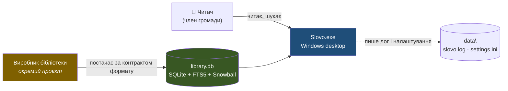
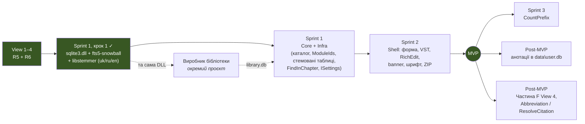

# Slovo — README: карта документів

**Стан:** View 1–4 написані; аудит R3 закрито 2026-09-13; **аудит R4 закрито ревізією R6 2026-10-30** — архітектурних питань перед Sprint 1 не лишилось. R5 (2026-09-20) спростила архітектуру для MVP: синхронний пошук, двофазний старт, каталог у пам'яті, глава одним RTF. R6 обрала найпростіші варіанти для решти деталей UI і **справжні форми слова через Snowball усередині SQLite** (B-31). **Sprint 1, крок 1 виконано 2026-11-04** — власна `sqlite3.dll` зі Snowball зібрана й перевірена з Delphi (`tools\sqlite\`).
**Оновлено:** 2026-11-04.

> **Джерело істини — ця папка `architecture\` у репозиторії** (рішення Vitalii, 2026-11-04). Правки вносяться сюди й комітяться; копії в проєкті claude.ai — лише для читання й можуть відставати.
>
> Цей файл — **карта, а не копія**. Кожне рішення живе рівно в одному документі; реєстр усіх рішень з ідентифікаторами (`A-xx`…`E-xx`) — у `Slovo_01`. Тут лише те, що змінюється раз на ревізію: що будуємо, де що шукати, скоуп MVP, відкриті питання, порядок дій.

---

## Що будуємо

| | |
|---|---|
| **Що** | Наступник «Исследуя Слово 4.0» — портативна Windows-читалка Духа пророцтва та релігійної бібліотеки з миттєвим UI і швидким повнотекстовим пошуком по всій бібліотеці |
| **Стек** | Delphi 13, VCL, x64, Windows 10+; SQLite + FTS5 + Snowball через **власну `sqlite3.dll`** поруч з EXE (прямий C API, без FireDAC); UI — `TRichEdit` + VirtualTreeView за макетом Claude Design |
| **Архітектура** | Гексагональна (Ports & Adapters): Core / Infrastructure / Shell + MVVM-light |
| **Дані** | Одна read-only база `library.db` — усі книги й переклади Біблії, контент + точні й стемовані FTS5-індекси. Виробляється окремим проєктом |
| **Поставка** | ZIP без інсталятора; нічого поза папкою програми; `data\` поруч з EXE — єдине writable-місце (лог, `settings.ini`) |
| **Модуль** | Книга або переклад Біблії як запис у таблиці `Modules`; ідентифікується `ModuleId`. Архітектурною одиницею **не є** (B-29) |
| **Свідомо поза MVP** | Анотації користувача, `CountPrefix` разом із фоновим потоком пошуку й скасуванням, онлайн-оновлення бібліотеки, окремо поставлені модулі, «Утренние чтения», «перейти за посиланням» і абревіатури книг, бюджети продуктивності, макетні дрібниці зі списку `Slovo_04` Частина F |

## Карта документів

| Файл | Що всередині | Коли відкривати |
|---|---|---|
| `Slovo_01_Domain_and_Contracts.md` | Діаграми шарів і двох моделей; **реєстр рішень (ADR), групи A–E**; доменна модель (`TModule`, Book/Bible, `TLibraryCatalog`, `TReadingPosition`, `TResult`, пошук і `TParagraphHit`); порти `ILibrary`/`ISearchIndex`/`ILogger`/`ISettings` | Будь-який тип або інтерфейс; «чому так вирішили» |
| `Slovo_02_Storage_SQLite_FTS5.md` | Схема `library.db` + ER (точні й стемовані таблиці на мову); **збірка власної `sqlite3.dll` зі Snowball**; одиниця офсетів; вимоги до файлу бази й параметри конекції; запити каталогу; пошук (вибір таблиць, `IN` за `ModuleIds`), `FindInChapter`; санітизація `MATCH`; межі токенізації | Усе про SQLite, FTS5, формат бази |
| `Slovo_03_Runtime_Threading_Deployment.md` | Композиційний корінь і **двофазний старт** (C-22); життєвий цикл; **один UI-потік** (C-21); сценарії читання/пошуку; error banner; логування; структура на диску й поставка; **Частина C — стратегія тестування MVP** | Старт і вихід, потоки, помилки, що лежить поруч з EXE, що і як тестуємо |
| `Slovo_04_Presentation_UI.md` | **View 4.** Що фіксує макет (компонування, стани колонки, дерево, пошук, «Тиша», клавіатура); рішення E-01…E-17, B-27, B-28; контракти `TMainViewModel`/`IMainView`, `ISettings` + `settings.ini`, локалізація й ключі `lang\`, `TChapterRtfBuilder`, VST; структура Shell; **Частина F — що з макета відкладено** | Усе про вигляд і поведінку UI |
| `Slovo_Audit_R3_2026-09-13.md` | Робочий аудит R3, усі пункти внесено | Чому саме так вирішили в R3 |
| `Slovo_Audit_R4_2026-09-14.md` | Робочий аудит R4: 92 пункти і 20 ідей спрощення; статуси R5 і R6 — усі 🔴/🟡 закрито | Чому так вирішили в R5/R6; рецепти відкладених покращень |
| `Slovo_Import_Deferred.md` | Парковка проєкту-виробника `library.db`: CHM, правила розбору, обов'язки (зокрема стемовані таблиці й та сама DLL), інваріанти, IMP-1…IMP-6 | Коли почнеться робота над імпортом |

**Макет UI** — Claude Design, файл «Slovo — Читання v2 (збережена точка)»; standalone-копія з вбудованими шрифтами додана до проєкту. `Slovo_04` посилається на нього як на джерело істини для вигляду.

---

## Контекст і рушійні сили

**Що успадковуємо від 4.0:** zero-latency UI, елегантний пошук з лічильником входжень.
**Що виправляємо:** (а) додати книгу має бути тривіально — *(перевипуск `library.db` виробником)*; (б) метадані користувача не мають зникати з видаленням програми — *(програма портативна, усі дані користувача в `data\` поруч з EXE)*.

> ⚠️ **Пункт (б) — заявлений головний біль проєкту — MVP не вирішує.** Анотації винесені за скоуп цілком. Рішення, яке рятує фічу наперед, ухвалено: зовнішній якір абзацу — `(ModuleId, ChapterOrder, LogicalIndex)` + хеш тексту (B-21).

**Атрибути якості за пріоритетом:**

| # | Атрибут | Як досягається | Чим міряємо |
|---|---|---|---|
| 1 | Миттєвий відгук читання | Синхронне читання глави зі спільної конекції; дерево й навігація — з каталогу в пам'яті (B-29); RTF у `TRichEdit`, зум через `EM_SETZOOM` | У MVP не міряємо (E-17); неповний рендер глави — у лог |
| 2 | Швидкий і розумний пошук | FTS5, `bm25`, snippet на льоту, `LIMIT 200`, `IN` по відмічених книгах; **форми слова — Snowball у SQLite** (B-31) | У MVP не міряємо (E-17); пошук синхронний, «Шукаю…» (C-21) |
| 3 | Простота розповсюдження | Портативний ZIP: EXE + `sqlite3.dll` + `library.db` + `lang\` + `fonts\` | Інсталятора немає; шрифт приватний |
| 4 | Тестованість Core | Гексагональна межа; `TMainViewModel` без `Vcl.*`, порти з GUID | `Slovo_03`, Частина C |
| 5 | Розширюваність бібліотеки | Одна `library.db` зі `SchemaVersion`; оновлення = заміна файлу | Версіонування є |

---

## Скоуп MVP

### Входить

| Область | Обсяг |
|---|---|
| Контент | Одна `library.db`: 39 книг EGW + модулі history/spiritual/prophecy + 3 переклади Біблії (≈42 книги + 3 переклади ≈ 45 модулів, оцінка IMP-3) |
| Старт | Дві фази (C-22): передумови (`data\`, `sqlite3.dll` зі Snowball, `library.db`, `SchemaVersion`, каталог) → `MessageBox` мовою користувача і вихід; потім наповнення |
| Читання | Дерево з каталогу (B-29); полиця й зміст — списки, читання — глава одним RTF; маркер сторінки на початку абзацу; зум; «Тиша»; позиція на кожну книгу |
| Пошук | `SearchBook` + `SearchBible` у відмічених книгах або по всій бібліотеці (B-27), по Enter, синхронно (C-21); «точна фраза» і **«форми слова» (Snowball, стемовані таблиці на мову, B-28/B-31)** — незалежні; видача двома секціями, Біблія групами перекладів; збіги в главі з того самого індексу (E-08) |
| Цитати | «Копіювати з посиланням» з повною назвою книги (E-13) |
| Помилки | Під час роботи — `TErrorBannerFrame`; порожній запит — рядок стану; на старті — `MessageBox` і вихід |
| Налаштування | `data\settings.ini`: мова, крок масштабу, панелі, вікно, позиції, скоуп пошуку (E-06); запис при виході й зміні глави |
| Локалізація | `lang\uk|ru|en.lang`, ключі-шаблони, нуль літералів у `.dfm` (E-05) |
| Діагностика | `data\slovo.log` — лише помилки |
| Поставка | Портативний ZIP: EXE + власна `sqlite3.dll` + `library.db` + `lang\` + `fonts\` (EB Garamond × 3) + `LICENSES\` |

### Свідомо не входить

| Що | Причина | Коли |
|---|---|---|
| Анотації (нотатки, хайлайти), `IAnnotationStore` | Потребує writable-сховища і стабільних якорів | Post-MVP. ⚠ якір уже зафіксовано (B-21) |
| `CountPrefix`, фоновий пошук і скасування | Механізм не вирішено; YAGNI | Sprint 3 |
| «Перейти за посиланням», абревіатури книг | Зміна формату й парсер посилань | Post-MVP разом |
| Онлайн-оновлення бібліотеки, окремо поставлені модулі | Не спроєктовано; умова вже тримається — `ModuleId` глобально унікальний (B-30) | Post-MVP |
| Бюджети продуктивності й заміри | Не перевірити до реальної `library.db` (E-17) | Окремим рішенням |
| «Утренние чтения» | Інша структура | Не досліджено |
| Макетні деталі: маркер у полі й посеред абзацу, міжряддя 1.72, IBM Plex, картки полиці, хедер «Тиші» поверх тексту, `InlineSpans`, паперова текстура | Рішення R6 «спершу найпростіше» | `Slovo_04`, Частина F — з рецептами |
| Словник форм (чергування «друг/друзі») | Стемер достатній для MVP | Post-MVP |

### Визнані компроміси

| Компроміс | Що обрано | Ціна |
|---|---|---|
| Пошук синхронний в UI-потоці (C-21) | Нуль потокової механіки | Під час пошуку вікно не реагує — «Шукаю…» і пісочний годинник |
| Кілька екземплярів (C-23) | Нуль коду | `settings.ini` — виграє останній збережений |
| Підсвітка запікається в RTF (E-01) | Немає окремого проходу форматування | Перехід між збігами перегенеровує главу |
| Snowball у власній `sqlite3.dll` (B-31) | Справжні форми слова без мовного коду в Delphi; підсвітка з того самого індексу | Власна збірка DLL (одна для застосунку й виробника); база ~вдвічі більша; стемер не знає чергувань; ранги між мовами непорівнювані — видача групами |
| `unicode61`, `remove_diacritics 0` | Для кирилиці єдино правильне | Апостроф/дефіс розбивають слово; «все» не знайде «всё». Шлях — власний токенізатор, лише `rebuild` |
| `TRichEdit` замість painter'а чи WebView2 | Виділення, копіювання, скрол, клавіатура, DPI — з коробки | Без hover, тіні, градієнта, текстури |
| VirtualTreeView | Дерево, списки й видача без ручного custom-draw усього рядка | Залежність лише в Shell (E-02) |
| Статичний VCL runtime, `sqlite3.dll` поруч | Без BPL; SQLite оновлюється заміною DLL | EXE ~10–15 МБ; «один файл» не буквальний |

---

## Відкриті питання

Архітектурних — немає.

Закрито 2026-09-13: E-09, E-10, стратегія тестування.
Закрито 2026-09-20 (R5): C-21, C-22, C-23, B-29, B-30, E-01, E-17.
Закрито 2026-10-30 (R6): усі 🔴/🟡 аудиту R4 — RTF, шрифти, форми слова (B-31), VST, клавіатура, налаштування, копіювання. Закрито 2026-11-01: залишки 🟢 аудиту R4; усі питання виробника IMP-1…IMP-6 (`Slovo_Import_Deferred.md`, §5); перевірку Snowball на Linux — працює, промахи стемера прийнято як є (`Slovo_02`). Закрито 2026-11-04: Windows-збірка `sqlite3.dll` і перевірка з Delphi (`Slovo_02`).

---

## Рекомендований порядок дій

**Наступні кроки, конкретно:**

1. ~~**Зібрати власну `sqlite3.dll` під Win64**~~ — **виконано 2026-11-04.** SQLite 3.54.1 + `fts5-snowball` + Snowball 3.2.0, `tools\sqlite\` у репозиторії (скрипт, вихідні коди, готова DLL, Delphi-тест `ALL PASS`); подробиці — `Slovo_02`. Від цієї DLL залежать і застосунок, і виробник бази.
2. **Запустити проєкт-виробник `library.db`** (`Slovo_Import_Deferred.md`) — усі його питання вирішено: почати з `books.csv` (метадані книг) і набору критичних HTML-фрагментів для тестів.
3. **Sprint 1** — Core + Infrastructure за View 1–3: `TLibraryCatalog`, `ILibrary`, `Fts5SearchIndex` з вибором таблиць і `FindInChapter`, `ISettings`; тестова база тією самою DLL.
