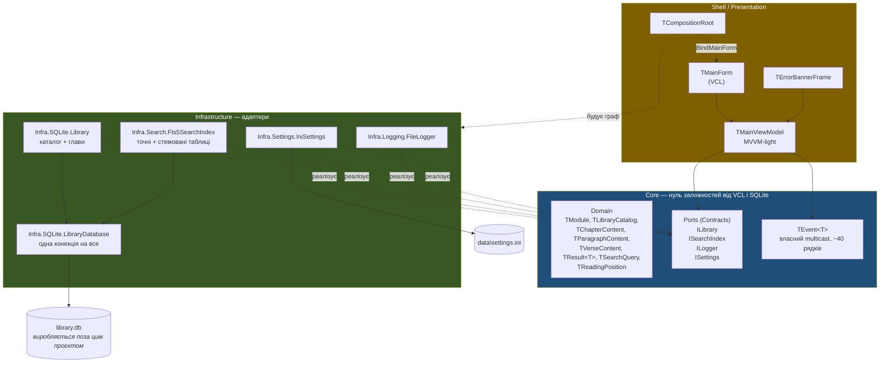
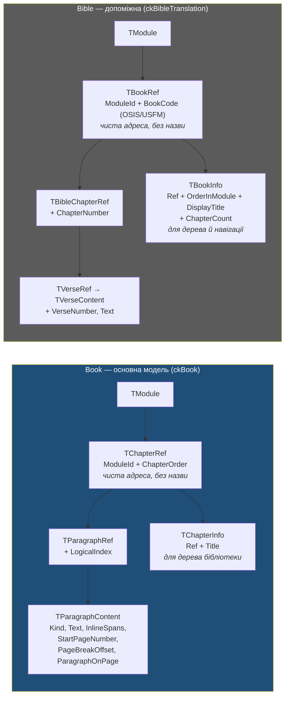

# Slovo — Архітектурний Огляд

> **Ревізія R2 — 2026-09-11.** `TChapterRef` розділено на адресу й опис; `TParagraphContent` отримав позицію маркера сторінки та номер абзацу на сторінці; інлайнові діапазони; `TResultError` розширено; `TSearchQuery.MaxResults`; GUID усім інтерфейсам; правило стабільного якоря абзацу та версія формату; `HybridIndex` → `Fts5SearchIndex`.
>
> **Ревізія R3 — 2026-09-13** (за `Slovo_Audit_R3_2026-09-13.md`, усі пункти внесено 2026-09-13). R3-02: `TBookRef`/`TBookInfo`, `TBookInfo.ChapterCount`. R3-03: `TBookSearchResult.PageNumber`/`ParagraphOnPage`. R3-07: офсети — UTF-16 code units. R3-08: серії в `TModule`. R3-24: рантайм-`sqlite3.dll`. Скасування пошуку прибрано. **R3-06: уся бібліотека — одна база `library.db`**; глобальний пошук — у MVP; портативна поставка.
>
> **Ревізія R4 — 2026-09-13 (View 4).** B-27: `TSearchQuery.ModuleIds`; видача — дві секції. B-28: `WordForms`. E-06: порт `ISettings`. E-09: лічильник у дереві — обчислюване поле.
>
> **Ревізія R5 — 2026-09-20 (спрощення архітектури для MVP).** B-29: порт `ILibrary` + каталог у пам'яті замість реєстру й репозиторіїв. B-30: `ModuleId` глобально унікальний і незмінний. C-21: пошук синхронний. C-22: старт у дві фази. C-23: кілька екземплярів. E-01 переглянуто, E-17: бюджети прибрано. `TResultError` отримав `reUnexpected`.
>
> **Ревізія R6 — 2026-10-30 (закриття аудиту R4, рішення Vitalii «спершу найпростіше»).** **B-31 (нове): форми слова — Snowball у власній `sqlite3.dll`, точні й стемовані FTS-таблиці на мову**; **B-28 переглянуто:** `WordForms` вибирає індекс, а не префікс. **E-08 переглянуто:** збіги в главі дає FTS — `ISearchIndex.FindInChapter`/`FindInBibleChapter`, нові типи `TParagraphHit`/`TVerseHit`. `TModule.ChapterCount` → **`ChildCount`** (R4-46). `TReadingPosition` перенесено сюди, у Domain, без дубльованого `ModuleId` (R4-28). E-01, E-04, E-07, E-11, E-13, C-01, D-08, D-09 уточнено. Таблицю «Обґрунтування» очищено від рядків, джерело яких — інші View (R4-54); B-16/B-25 без застарілого `ModuleInfo` (R4-55).

## Про проєкт

**Slovo** — легкий, надшвидкий Windows-додаток для дослідження **Духа пророцтва** (книг Еллен Уайт) та інших релігійних книг бібліотеки "Исследуя Слово" (історичні, духовна література, дослідження пророцтв) — основний фокус застосунку. Усі вони — єдина сутність **Книга** (`ckBook`): структурно однакові (глава → абзац, з опційною сторінковою прив'язкою до оригіналу), різняться лише метаданими (автор, категорія). **Біблія** (три переклади: Огієнка UA, Синодальний RU, King James EN) — допоміжний контент, не головна мета. Наступник класичного "Исследуя Слово 4.0": успадковує миттєвий відгук (zero-latency UI) та елегантний пошук.

**Стек:** Delphi 13, SQLite (FTS5 — вбудований повнотекстовий рушій; з R6 — з токенізатором Snowball для форм слова), прямий import C API з власної `sqlite3.dll`, що вантажиться в рантаймі за повним шляхом поруч з EXE (без FireDAC — C-01)
**Архітектура:** Гексагональна (Ports & Adapters) — Core / Infrastructure / Shell
**UI-патерн:** MVVM-light

---

## Структура

### Шари й напрямок залежностей



Стрілки залежностей ідуть **тільки всередину**, до Core: Core можна зібрати й протестувати без жодного `Vcl.*` чи `sqlite3` у `uses`.

### Дві доменні моделі, свідомо не злиті



Адресація принципово різна (глава+сторінка оригіналу+абзац vs книга+глава+вірш), тому спільної абстракції немає — ні в методах доступу до контенту (`GetChapterContent` / `GetBibleChapter`), ні в пошуку (`SearchBook` / `SearchBible`, `FindInChapter` / `FindInBibleChapter`). Це наскрізний принцип: **не форсувати спільну абстракцію заради симетрії** (B-01). Пара «адреса / опис» однакова в обох моделях: `TChapterRef`/`TChapterInfo` і `TBookRef`/`TBookInfo`.

Категорія книги (`bcSpiritOfProphecy` / `bcHistory` / `bcSpiritualLife` / `bcProphecyStudy`) — **лише метадані для групування дерева в UI**, на структуру не впливає. У не-EGW категоріях маркерів сторінки немає (поля лишаються з дефолтами `0 / −1 / 0`).

---

## Реєстр архітектурних рішень (ADR)

**Єдиний реєстр** (R3-12). Кожне рішення має один ID; посилання з усіх документів (`C-01`, `D-03`, `E-01`…) ведуть сюди. «Джерело» — де рішення ухвалено й де його розгорнуте обґрунтування: `V1` — таблиця «Обґрунтування рішень (детально)» нижче в цьому документі, `V2` — `Slovo_02`, `V3` — `Slovo_03` (A.1 для C-xx і D-08, B.2 для решти D-xx), `V4` — `Slovo_04` (Частина B). **Правило:** нове рішення = новий рядок тут з наступним номером у своїй групі; рядки не перенумеровуються, скасовані позначаються ~~закресленням~~; обґрунтування — лише в документі-джерелі, решта посилається на ID (R4-54).

### A — Фундамент

| # | Рішення | Ключове обґрунтування | Джерело |
|---|---|---|---|
| A-01 | Гексагональна межа Core ↔ світ | Core unit-testable, ізольований від VCL і SQLite | V1 |
| A-02 | MVVM-light, не MVC/MVI | MVC у VCL змішує View+Controller; MVI надлишковий для читалки | V1 |
| A-03 | Власний `TEvent<T>` (~40 рядків) замість Spring.Events | Нуль зовнішніх залежностей у Core | V1 |
| A-04 | `Fire()` з фонового потоку маршалиться через `TThread.Queue` у ViewModel; **у MVP фону немає** — події фаяться напряму (C-21) | View ніколи не думає про потоки. Правило повертається разом із фоновим пошуком | V1 · R5 |
| A-05 | Без Application/Use-Case шару в MVP | ViewModel оркеструє 1–2 порти. YAGNI | V1 |
| A-06 | `TResult<T>` замість exceptions — вибірково | Лише одиничні методи + `Search*`/`Find*`. Для `TArray<T>` порожній масив і так означає «нічого». Помилка — enum-код, не текст | V1 |
| A-07 | Exceptions лишаються для апаратних/файлових збоїв | Пошкоджений SQLite, недоступний диск — не бізнес-стан | V1 |
| A-08 | Усі інтерфейси Core мають GUID | Без GUID не працюють `Supports()`/`as` — блокує моки, декоратори, проксі | V1 · R2 |

### B — Дані та пошук

| # | Рішення | Ключове обґрунтування | Джерело |
|---|---|---|---|
| B-01 | Дві окремі доменні моделі — Book і Bible | Структурно несумісна адресація. Підтверджено повторно в R3-02 | V1 · R3 |
| B-02 | Логічний абзац ≠ HTML-абзац | Маркер сторінки рве текст посеред речення; імпортер зливає фрагменти | V1 |
| B-03 | `class="glink"` відкидається повністю | Внутрішня навігація файлу, дублікат дерева глав, не контент | V1 |
| B-04 | 7 типів `TParagraphKind`, без inline-розмітки | Стиль рендерить Presentation за `Kind` | V1 |
| B-05 | `glava` і `glava2` обидва починають нову главу — на етапі імпорту | `pkSubChapterTitle` існує лише для стилізації | V1 |
| B-06 | **SQLite FTS5 замість власного індексу** | FTS5 дає зворотний індекс, `snippet()` і `highlight()` з коробки | **V2 (перегляд V1)** |
| B-07 | `snippet()` генерується на льоту, не зберігається | Нуль дублювання тексту на диску | V2 |
| B-08 | Build-time наповнення FTS5 — `rebuild` + `optimize` наприкінці збірки бази (тригери скасовано) | Контент read-only; у готовому файлі немає активної логіки; зміна токенізатора потребує лише `rebuild` | V2 · R2 |
| B-09 | ~~Один модуль = один файл~~ → **Уся бібліотека — одна база `library.db`** | Старт — одне відкриття; глобальний пошук — одна FTS-таблиця; інваріанти — один запит. Ціна: нова книга = перевипуск бази; пошкоджена база = уся бібліотека недоступна | V1+V2 · **переглянуто R3** |
| B-10 | Два методи `SearchBook`/`SearchBible` замість union-типу | Той самий принцип, що й у доступі до контенту | V1 |
| B-11 | `StrictWordOrder` прибрано з MVP | FTS5 `NEAR()` не гарантує порядку | V2 |
| B-12 | Обов'язкова санітизація `MATCH` (`TryBuildMatchQuery`) | Інакше `(`, `"`, `*`, `:` від користувача ламають запит | V2 |
| B-13 | Ніяких додаткових `CREATE INDEX` понад PK/UNIQUE | `Chapters`/`Books` читаються повністю | V2 |
| B-14 | `BookCode` за OSIS/USFM | Стабільне міжмодульне мапування | V1 |
| B-15 | Точні таблиці (`ParagraphsFTS`, `VersesFTS`) — `tokenize='unicode61 remove_diacritics 0'` | Lowercase + пунктуація з коробки, без стемінгу; `й` не згортається. **R6:** форми слова — окремі стемовані таблиці (B-31) | V2 · R6 |
| B-16 | `Meta.SchemaVersion` у базі + правило «нові значення enum — тільки в кінець» | Формат бази — публічний контракт; без версії старий EXE скаже «файл пошкоджено» про цілком справну новішу базу | V1 · R2 |
| B-17 | `PageBreakOffset` + `ParagraphOnPage` замість `SpansToNextOriginalPage` | Позиція маркера сторінки й номер абзацу на сторінці — для показу як у 4.0 і посилання `GC 595.2`. **R6:** `PageBreakOffset` у MVP не рендериться, але зберігається | V1 · R2 · R6 |
| B-18 | Таблиця `Spans` — інлайнові діапазони пишуться при імпорті, у MVP не рендеряться | Курсив біблійних цитат — семантика; не зберегти зараз = переімпорт потім | V1 · R2 |
| B-19 | `TSearchQuery.MaxResults` доходить до `LIMIT`; `≤ 0` = 200; `LIMIT N+1` → `Truncated`; масив у порядку bm25 | Інакше поширене слово рахує `snippet()` для десятків тисяч рядків | V1 · R2 · R3 |
| B-20 | `Ref` — це адреса і лише адреса (`TChapterRef`/`TBookRef` без назв; описи — `TChapterInfo`/`TBookInfo`) | Назва дублювалася б у кожному з тисяч результатів, рівність адрес залежала б від текстового поля | V1 · R2 · R3-02 |
| B-21 | Стабільний зовнішній якір абзацу = `(ModuleId, ChapterOrder, LogicalIndex)` + хеш тексту; `Paragraphs.Id` назовні не виходить | `Id` змінюється при кожному перевипуску бази | V1 · R2 |
| B-22 | `Books.ChapterCount` + `TBookInfo.ChapterCount` — Біблія знає свої глави | Список глав, «наступна глава» через межу книги, перевірка посилання — у пам'яті | V1 · R3-02 |
| B-23 | `TBookSearchResult.PageNumber` + `ParagraphOnPage` | Посилання `GC 595.2` у кожному рядку видачі без довантаження глави | V1 · R3-03 |
| B-24 | Усі текстові офсети — UTF-16 code units, від нуля | «У символах» — не одиниця; UTF-16 — нуль перетворень у Delphi | V1 · R3-07 |
| B-25 | Дерево бібліотеки: серії з канонічним порядком (`Series`, `SeriesTitle`, `SeriesOrder`, `SortOrder` у `Modules`), решта книг за алфавітом | Читач шукає книгу за звичним місцем; порядок — властивість контенту й їде в базі, а не в окремому маніфесті | V1 · R3-08 |
| B-26 | Пошкоджена, несумісна чи відсутня `library.db` → **`MessageBox` у фазі 0 старту і вихід** | Без бібліотеки програмі нема що показати | V1 · R3 · **переглянуто R5** |
| B-27 | **`TSearchQuery.ModuleIds: TArray<TModuleId>`**; порожній = уся бібліотека; `SearchBook` і `SearchBible` послідовно; видача — **дві секції** | Чекбокси «шукати в цій книзі» дають довільну множину модулів обох видів; ранги різних FTS-таблиць непорівнювані | **V4** |
| B-28 | **`TSearchQuery.WordForms` вибирає індекс:** `False` — точні таблиці, `True` — стемовані (B-31); з `ExactPhrase` незалежний (**переглянуто R6**; R4–R5 — префікс `"жертв"*`) | Макет: «Враховувати форми слова». Справжні форми одразу в MVP за рішенням Vitalii | **V4 · R6** |
| B-29 | **Каталог бібліотеки в пам'яті; порт `ILibrary` замість реєстру модулів і репозиторіїв.** Модуль — запис у таблиці `Modules`, не архітектурна одиниця | Реєстр і репозиторій на модуль — рудимент схеми «модуль = файл». Каталог — кілька сотень КБ, читається трьома запитами у фазі 0 | V1 · R5 |
| B-30 | **`ModuleId` глобально унікальний і незмінний** — правило для виробника бази | Посилаються позиції читання й майбутні якорі анотацій | V2 · R5 |
| B-31 | **Форми слова — Snowball усередині SQLite** (R6, рішення Vitalii): власна `sqlite3.dll` з `fts5-snowball`; поруч із точними — стемовані FTS-таблиці **на кожну мову** (`ParagraphsStem_<lang>`, `VersesStem_<lang>`, мова — `Modules.Language`, uk/ru/en); пошук із галочкою — по запиту на мову, результати групами | SQLite сам зводить форми і в індексі, і в запиті — у Delphi жодного мовного коду; підсвітка в главі з того самого індексу (E-08). Два індекси — щоб пошук без галочки знаходив саме введену форму. Таблиця на мову — бо стемер у таблиці один, а змішаний кириличний корпус uk/ru іншим стемером ріжеться неправильно. Ціна: власна збірка DLL (одна для застосунку й виробника), база приблизно вдвічі більша, ранги між мовами непорівнювані. Відхилено: префікс (не форми), тріграм (підрядок, не форми, і шум), словник форм (точніше, але найбільше роботи в імпорті — post-MVP) | **V2 · R6** |

### C — Процеси й потоки

| # | Рішення | Ключове обґрунтування | Джерело |
|---|---|---|---|
| C-01 | **Прямий import C API SQLite з власної `sqlite3.dll`, завантаженої в рантаймі за повним шляхом поруч з EXE**, без FireDAC; **R6:** DLL зібрана з `fts5-snowball` (B-31, D-08) | Біндинг уже написаний; сирий хендл знадобиться для `sqlite3_interrupt` із `CountPrefix`; повний шлях закриває hijacking; системна `winsqlite3.dll` не підходить | V1 · R2 · R3-24 · R5 · R6 |
| C-02 | **Одна конекція на сеанс для всього** (`LibraryDatabase`): каталог, глави й пошук | Файл один (B-09), потік один (C-21) | V1 · R3 · R5 |
| C-03 | ~~Пошук — окрема конекція, нова на кожен виклик~~ — **знято R5** | Повернеться разом із фоном | V3 · знято R5 |
| C-04 | ~~Модель «одного активного слота»~~ → **пошук по кнопці/Enter, без скасування** (R3) | Скасування без споживача; повернеться з `CountPrefix` | V3 · R3 |
| C-05 | ~~Скасування через `sqlite3_interrupt`~~ — **прибрано в R3** | Повернеться з `CountPrefix` | V3 · знято R3 |
| C-05a | ~~`FQueryId`~~ — **прибрано в R3** | Другого пошуку під час першого не буває | R2 · знято R3 |
| C-05b | ~~Лічильник задач «у польоті»~~ — **знято R5** | Задач немає (C-21) | R2 · знято R5 |
| C-06 | ~~Лок на `RawHandle`~~ — **прибрано в R3** | `Fts5SearchIndex` без стану між викликами | V3 · знято R3 |
| C-07 | ~~Bounded wait при закритті~~ — **знято R5** | Чекати нічого (C-21) | V3 · знято R5 |
| C-08 | `ISearchIndex` синхронний у Core; асинхронність, коли повернеться, — у ViewModel | Саме синхронний контракт робить повернення фону локальною зміною | V1 · R5 |
| C-09 | Помилки пошуку — не exception, а `roError` у `TResult`; `TResultOutcome = (roError, roSuccess)` — помилка першою (R4-82) | Один шлях до банера для читання й пошуку | V3 · R3 · R5 |
| C-10 | Один `TErrorBannerFrame` і одна подія `FOnErrorOccurred` на весь ViewModel | Банер знає лише код `TResultError` | V3 |
| C-11 | `ILogger` — мінімальний, без рівнів і ротації; ~~лок~~ (знято R5) | Логер викликається лише з UI-потоку; між екземплярами — «відкрити-дописати-закрити» | V3 · R5 |
| C-12 | ~~`LibraryRegistry` пробрасує `ILogger` у кожен репозиторій~~ — **знято R5** | Репозиторіїв немає (B-29) | V3 · знято R5 |
| C-13 | `TCompositionRoot` — ручний constructor injection; **дві фази** (C-22) | Порядок залежностей читається зверху вниз | V3 · R5 |
| C-14 | `Application.CreateForm` лишається стандартним; `BindMainForm` — окремий крок через `IMainView` | Інакше ламається семантика `Application.MainForm` | V3 |
| C-15 | `ISearchIndex` — singleton, не per-module; **R6:** отримує каталог (мови модулів) | `TSearchQuery.ModuleIds` несе адреси модулів | V3 · R4 · R6 |
| C-16 | ~~Стан реєстру між потоками~~ — **знято R3** | — | R2 · знято R3 |
| C-17 | ~~Порт `IModuleLocator`~~ — **видалено R3** | Шлях до бази один | R2 · знято R3 |
| C-18 | `ILogger.LogError` не має права кинути виняток | Виняток із логера підмінив би оригінальну помилку | V3 · R2 |
| C-19 | ~~Токен життя `FAlive`~~ — **знято R5** | Замикань із фонового потоку немає | R3-11 · знято R5 |
| C-20 | ~~ViewModel звертається до `IModuleRegistry` для навігації~~ — **знято R5** | Навігація — каталог у пам'яті (B-29) | V3 · знято R5 |
| C-21 | **Пошук синхронний, в UI-потоці** (MVP) | Без фону зникає вся потокова механіка; UX — «Шукаю…» + `crHourGlass` | V3 · R5 |
| C-22 | **Старт у дві фази**: передумови до форми (`data\`, `sqlite3.dll`, `library.db`, `SchemaVersion`, **токенізатор snowball** — R6, каталог) → `MessageBox` мовою користувача і вихід; далі наповнення | Прибирає банер для стартових помилок; ловить запуск прямо з ZIP і чужу DLL | V3 · R5 · R6 |
| C-23 | **Кілька екземплярів програми дозволено** | `settings.ini` — виграє останній збережений | V3 · R5 |

### D — Розгортання

| # | Рішення | Джерело |
|---|---|---|
| D-01 | Статичне лінкування VCL runtime, без BPL | V3 |
| D-02 | ~~Inno Setup~~ → **Портативний ZIP, без інсталятора** — нічого поза директорією програми | V3 · **переглянуто R3** |
| D-03 | ~~`%ProgramFiles%` + `%LOCALAPPDATA%`~~ → усе поруч з EXE: `library.db` (read-only), `data\` (єдине writable-місце) | V3 · **переглянуто R3** |
| D-04 | Лог — `data\slovo.log`; read-only папка — не помилка, одне попередження у фазі 0 | V3 · R3 · R5 |
| D-05 | Windows 10+, x64, без x86-збірки | V3 |
| D-06 | Без auto-update у MVP; оновлення — новий ZIP поверх, `data\` не чіпається | V3 · R3 |
| D-07 | База відкривається `SQLITE_OPEN_READONLY`; постачається в `journal_mode = DELETE` після `VACUUM` | V2 · R2 |
| D-08 | **Власна `sqlite3.dll`** (SQLite + FTS5 + `fts5-snowball` + `libstemmer_c` з `ukrainian`) поруч з EXE, завантаження за повним шляхом — явний крок фази 0; та сама DLL у виробника бази (R6) | V3 · R3-24 · R5 · R6 |
| D-09 | `fonts\` — **EB Garamond, 3 файли** (Regular/Italic/Bold, SIL OFL), `AddFontResourceEx(FR_PRIVATE)`, без `RemoveFontResourceEx`; UI — Segoe UI; `data\settings.ini` — налаштування (R6) | V4 · R6 |

### E — Presentation / UI (View 4)

Обґрунтування кожного рядка — `Slovo_04`, Частина B.

| # | Рішення | Джерело |
|---|---|---|
| E-01 | **Рендер глави — `TRichEdit` (RichEdit 4.1) з RTF від `TChapterRtfBuilder`; уся глава — один документ з заголовком**; підсвітка запікається; неповний рендер → лог. **R6:** маркер сторінки на початку рядка, маркера посеред абзацу немає, штатний інтервал | V4 · R5 · R6 |
| E-02 | **VirtualTreeView** для дерева, полиці/змісту й видачі — єдина стороння залежність, лише в Shell | V4 |
| E-03 | Три панелі в одному вікні; «Тиша» і видимість панелей — стан форми, не ViewModel | V4 |
| E-04 | Шрифт тексту EB Garamond у поставці (3 файли, `FR_PRIVATE`), fallback Georgia; UI — Segoe UI (R6) | V4 · R6 |
| E-05 | Локалізація форми в коді (`ApplyLocalization`), у `.dfm` — жодного літерала; рядки з даними — ключі-шаблони `L(key, [args])` (R6) | V4 · R6 |
| E-06 | Порт `ISettings`; `Infra.Settings.IniSettings` над `data\settings.ini`; `Save` — при виході й при зміні глави (R6) | V4 · R6 |
| E-07 | Позиція читання — на кожну книгу (`[Positions]`, двокрапка = Біблія), плюс `[Reading] Last` | V4 · R6 |
| E-08 | **Збіги в главі дає той самий FTS-індекс** — `ISearchIndex.FindInChapter`/`FindInBibleChapter` з `highlight()`; одиниця навігації — абзац (**переглянуто R6**; до R6 — пошук термінів у Delphi) | V4 · R6 |
| E-09 | Лічильник у дереві — `TModule.ChildCount` (R6: перейменовано з `ChapterCount`), обчислюється каталогом, у базі колонки немає | V4 · R5 · R6 |
| E-10 | Епіграф — одним блоком; окреме посилання — IMP-6 виробника | V4 |
| E-11 | Масштаб — `EM_SETZOOM` над одним RTF; зберігається індекс кроку −4…+6 (R6) | V4 · R6 |
| E-12 | Кількість результатів: точна або «Показано перші 200»; без `COUNT(*)` | V4 |
| E-13 | «Копіювати з посиланням» — у MVP, посилання першого абзацу виділення (R6); колонки `Modules.Abbreviation`/`Books.Abbreviation` **у форматі вже є** (IMP-5, R6), застосунок їх у MVP не читає; абревіатури в цитатах і `ResolveCitation` — post-MVP | V4 · R6 |
| E-14 | DPI `PerMonitorV2`; розміри — 96-DPI пікселі через `ScaleValue` | V4 |
| E-15 | `TErrorBannerFrame` — лише для помилок під час роботи; помилки старту — `MessageBox`; порожній запит — рядок стану | V4 · R5 · R6 |
| E-16 | Старт, фаза 1: дерево з каталогу → позиція; вікно з'являється наповненим; невалідна позиція → Shelf мовчки | V4 · R5 |
| E-17 | **Бюджети продуктивності в MVP не ведуться** | V4 · R5 |

---

## Обґрунтування рішень (детально)

Перший стовпчик — ID з реєстру вище. Тут — лише рішення, джерело яких `V1`; решта обґрунтовані у своїх View (R4-54).

| # | Рішення | Обґрунтування |
|---|---|---|
| A-01 | Гексагональна межа Core ↔ світ | Core повністю unit-testable, ізольований від VCL/FMX і SQLite |
| A-02 | MVVM-light, не MVC/MVI | MVC у VCL типово змішує View+Controller; MVI надлишковий для desktop-читалки без reactive-потреб |
| A-03 | Власний `TEvent<T>` (~40 рядків, multicast) — **КЛАС, не record** | Нуль зовнішніх залежностей — свідомо відхилено Spring.Events, щоб Core лишався автономним. *Клас, бо ViewModel віддає подію через `property OnErrorOccurred: TEvent<TResultError> read FOnErrorOccurred`; якби `TEvent<T>` був record'ом, властивість повертала б КОПІЮ, і `Add()` на ній тихо зник би. Власник екземплярів — ViewModel* |
| A-04 | ViewModel маршалить `Fire()` з фонового потоку через `TThread.Queue` | View ніколи не думає про потоки. *R5: у MVP фону немає (C-21), події фаяться напряму; правило повертається з `CountPrefix` (Sprint 3)* |
| A-05 | Без окремого Application/Use-Case шару в MVP | ViewModel сам оркеструє виклики 1–2 портів. Якщо комбіновані виклики почнуть дублюватись між кількома ViewModel — тонкий `TChapterUseCase`. YAGNI |
| A-06 | `TResult<T>` замість exceptions — лише для одиничних методів + `Search*`/`Find*` | Для масивів каталогу (`TLibraryCatalog.Chapters`, `.Books`) порожній масив — ідіоматичне «нічого». `SearchBook`/`SearchBible`/`FindInChapter` загорнуті в `TResult`: апаратна помилка приходить як `roError` тим самим шляхом, що й помилка читання глави. Помилка — enum-код (`TResultError`): Core не диктує UI-формулювання/locale. Exceptions лишаються для апаратних збоїв — зокрема `ILibrary.LoadCatalog` у фазі 0, де виняток означає `MessageBox` і вихід (C-22) |
| A-07 | Exceptions для апаратних/файлових збоїв | Пошкоджений файл, недоступний диск — не бізнес-стан, а аварія |
| A-08 | Усі інтерфейси Core мають GUID | Без GUID інтерфейс не працює з `Supports()` і не приводиться через `as` — блокує моки, декоратори, проксі. Додати зараз коштує нуль |
| B-01 | **Дві окремі доменні моделі контенту** — Book і Bible | Book адресується главою+сторінкою оригіналу+абзацом, Біблія — книгою+главою+віршем. Категорійної різниці на рівні СТРУКТУРИ між книгами немає — усі `ckBook`. *R3-02: альтернатива «Біблія = група звичайних книг» відхилена — половина полів `TParagraphContent` була б незначущою для віршів, а міжперекладний якір `BookCode` втратив би місце в моделі* |
| B-02 | Book: логічний абзац ≠ HTML-абзац | Маркер сторінки оригіналу завжди ізольований у власному `<p>`, але текстовий абзац може розриватись ним посередині речення; імпортер зливає фрагменти. `history`/`spiritual`/`prophecy` маркерів не мають — поля сторінок там дефолтні (0 / −1 / 0) |
| B-03 | Book: `class="glink"` відкидається повністю при імпорті | Внутрішня навігація файлу (дублікат дерева глав), не контент |
| B-04 | Book: `TParagraphKind` — 7 типів, без inline-розмітки | Стиль рендериться Presentation-шаром за `Kind`; оригінальні `<b>`/`<i>`/`align` не зберігаються (інлайнові діапазони — окремо, B-18) |
| B-05 | Book: `glava`/`glava2` визначають межі глав ще на етапі імпорту | Розбиття HTML-файлу на `TChapterContent` — ДО побудови параграфів; `pkSubChapterTitle` лише для стилістичного розрізнення |
| B-09 | **Уся бібліотека — одна база `library.db`** (R3-06, рішення Vitalii) | R2 тримав файл на модуль і заради цього вводив `IModuleLocator`. З однією базою шлях один — порт видалено. Виграш: старт — один `sqlite3_open` замість ~42; глобальний пошук безкоштовний (ранги `bm25` порівнювані в одному корпусі); інваріанти перевіряються одним запитом. Ціна: «додати книгу = покласти файл» більше не діє; пошкоджена база = уся бібліотека недоступна. Деталі схеми — View 2 |
| B-10 | Пошук: два методи `SearchBook`/`SearchBible` замість union-типу | Той самий принцип, що й для доступу до контенту. `TBookSearchResult.Ref: TParagraphRef`, `TBibleSearchResult.Ref: TVerseRef`; так само `FindInChapter`/`FindInBibleChapter` (R6) |
| B-14 | Ідентифікація книги Біблії — `BookCode` за OSIS/USFM | Стабільне міжмодульне мапування |
| B-16 | `Meta.SchemaVersion` + правило «нові значення enum — тільки в кінець» | Формат бази — публічний контракт між застосунком і виробником; без версії старий EXE, зустрівши новішу базу, впаде на відсутній колонці й скаже «файл пошкоджено». `Kind`/`Category`/`TParagraphKind` зберігаються порядковими номерами, тому вставка значення в середину enum'а тихо зсуває сенс усіх випущених баз |
| B-17 | Маркер сторінки зберігає **позицію** (`PageBreakOffset`) і номер абзацу на сторінці (`ParagraphOnPage`) | Булевий прапорець дозволяв знати «абзац перетнув межу», але не намалювати маркер там, де він стояв (як у «Исследуя Слово»). `ParagraphOnPage` — друга половина канонічного посилання `GC 595.2`; лічильник скидається на кожному `pkPageMarker`. *R6: маркер посеред абзацу в MVP не малюється (View 4, Частина F), поле лишається — інакше повернути його можна лише переімпортом* |
| B-18 | Інлайнові діапазони (`TInlineSpan`) пишуться при імпорті, але **не рендеряться в MVP** | Курсивом набрані біблійні цитати всередині авторського тексту — це семантика; втратити її означає переімпорт усього корпусу |
| B-19 | `TSearchQuery.MaxResults` — обов'язкове обмеження; `≤ 0` = 200; `Truncated`; порядок масиву = релевантність | Без нього пошук поширеного слова повертає десятки тисяч рядків, і для кожного SQLite рахує `snippet()`. Релевантність визначає **склад** видачі: з `LIMIT` сортування за адресою обрізало б кінець бібліотеки |
| B-20 | **Ref — це адреса і лише адреса** | `TParagraphRef` вкладає `TChapterRef`, а кожен результат пошуку несе `TParagraphRef` — назва глави дублювалася б у тисячах результатів, а рівність адрес залежала б від текстового поля. Назви — з каталогу в пам'яті (B-29). R3-02: правило доведено до Біблії (`TBookRef` = `ModuleId` + `BookCode`) |
| B-21 | **Стабільний зовнішній якір абзацу** = `(ModuleId, ChapterOrder, LogicalIndex)` + хеш нормалізованого тексту | `Paragraphs.Id` — сурогатний rowid для FTS5, який **змінюється при кожному перевипуску бази**. Якщо майбутні анотації заякоряться на нього, вони злетять при першому оновленні книги — рівно той біль, заради усунення якого затіяно проєкт. `Id` ніколи не виходить за межі Infrastructure |
| B-22 | **Біблія знає свої глави: `TBookInfo.ChapterCount`** | Без цього UI не побудує список глав, не намалює «наступна глава» (після `GEN 50` — `EXO 1`) і не перевірить посилання. Глави Біблії — `1..N` без пропусків, тож досить числа. Це властивість **модуля**, не канону (Псалми в LXX-базованих — 151, модуль може бути частковим), тому колонка `Books.ChapterCount`, а не константа |
| B-23 | `TBookSearchResult.PageNumber` + `ParagraphOnPage` | Видача — єдиний екран, де посилання потрібне масово; довантажувати главу на кожен результат — N викликів на видачу. Цитується сторінка, де абзац починається; `0` = сторінкової системи немає |
| B-24 | **Одиниця текстових офсетів — UTF-16 code unit, від нуля** | Delphi-рядок рахує UTF-16, SQLite `length()` — кодові точки, байтові функції — байти UTF-8; для кирилиці збігаються, розбіжність проявилась би через роки на символі поза BMP. UTF-16 — нуль перетворень у Delphi (`Copy(Text, StartOffset + 1, Length)`). Офсети обчислюються **після** нормалізації тексту виробником |
| B-25 | **Дерево бібліотеки: серії з канонічним порядком, решта — за алфавітом** | Читач шукає книгу за звичним місцем: «Конфлікт віків» `PP → PK → DA → AA → GC`, «Свідоцтва» `T1…T9`. Не один глобальний `SortOrder`, а серія: `Series` (код), `SeriesTitle` (мовою книги, не ключ локалізації — серія властивість контенту), `SeriesOrder`, `SortOrder`. Порядок — властивість контенту й живе в таблиці `Modules` разом із ним. Явний `SeriesOrder` — щоб порядок не залежав від мови. Ціна: назва серії повторюється в кожному модулі серії, збіг перевіряє виробник |
| B-26 | Пошкоджена, несумісна чи відсутня база — `MessageBox` у фазі 0 і вихід | Порожнє вікно з банером, що не ховається, вимагало другого шляху до банера й типу винятку, якого Core не мав (R4-13, R4-25). Фаза 0 (C-22) відкриває базу, перевіряє `SchemaVersion` і читає каталог до створення форми; повідомлення — мовою користувача. Відсутня база найчастіше означає запуск прямо з ZIP — текст про це й каже |
| B-29 | **Каталог бібліотеки в пам'яті; `ILibrary` замість реєстру модулів і репозиторіїв** (R5, рішення Vitalii) | Після R3-06 контракт лишився від схеми «модуль = файл»: `IModuleRegistry` + `IBookRepository` + `IBibleContentRepository`, прокидання логера в кожен репозиторій, лінива побудова дерева й назви у видачі лише для «відкритого» модуля. Каталог — модулі, усі глави книг і всі книги перекладів — кілька тисяч коротких записів, читається трьома запитами у фазі 0 і до виходу не змінюється. Дерево будується одразу, лічильники E-09 рахуються з масивів, навігація, крихти, перевірка позиції й назви у видачі — у пам'яті. **Модуль лишається поняттям предметної області** — запис у `Modules` з ключем `ModuleId`. Майбутні окремо поставлені модулі — `ATTACH DATABASE` і `LoadCatalog` з кількох баз, без змін у ViewModel |
| C-01 | Прямий import SQLite3 C API з **власної `sqlite3.dll`**, завантаженої в рантаймі за повним шляхом поруч з EXE, без FireDAC | Історично — `sqlite3_interrupt()` на сирому хендлі, якого FireDAC не віддає; скасування прибрано в R3, але повернеться з `CountPrefix`. Біндинг `Infrastructure.SQLite3.Api` (`LoadLibraryEx` + `GetProcAddress`) уже написаний і працює; R3-24 переглянув статичну лінковку R2 на користь DLL. Аргументи проти DLL закриті: «один EXE» не був буквальним; системна `winsqlite3.dll` не використовується; hijacking закритий повним шляхом. **R6:** DLL — власна збірка з `fts5-snowball` (B-31), тож системна чи «будь-яка» DLL тим паче не підходить; фаза 0 перевіряє FTS5 і токенізатор. Стосується всіх класів `Infra.SQLite.*` |
| C-02 | Одна конекція на весь сеанс — для каталогу, глав і пошуку | R3: «lazy-кешування конекції на модуль» скасовано разом із файлами модулів. R5: репозиторіїв немає (B-29), фону немає (C-21) — і друга конекція для пошуку нічого не дає. Відкривається у фазі 0 (C-22) |
| C-08 | `ISearchIndex` лишається синхронним у контракті | Core не знає про потоки. Коли фон повернеться, асинхронність буде відповідальністю ViewModel (`TTask.Run` + `TThread.Queue`), і саме синхронний контракт робить цю зміну локальною |
| — | Анотації користувача (нотатки/хайлайти) | **Відкладено поза MVP.** `IAnnotationStore`/`TAnnotation` — не частина поточної моделі; якір — B-21 |

---

## Domain-моделі (Core/Domain)

### Спільне

```pascal
// МОДУЛЬ (B-29) — книга або переклад Біблії як запис у таблиці Modules бази
// library.db. Архітектурною одиницею (файл, реєстр, репозиторій) не є.
// ModuleId глобально унікальний і незмінний (B-30). Формат: без '=', ',', ':';
// не починається з ';' чи '[' — він ключ у settings.ini (View 4, C.2).
TModuleId = type string;              // 'MB', 'GC', 'DA', 'synodal-ru', 'ohienko-uk'...

TContentKind = (
  ckBook,                              // будь-яка книга: СОП, історична, духовна, дослідження пророцтв
  ckBibleTranslation                   // переклад Біблії
);

// Категорія книги — лише для групування дерева бібліотеки в UI.
// bcDailyReadings — ПОЗА MVP: "Утренние чтения" мають іншу структуру (365 записів,
// b_glava/glink3), ймовірно потребують адресації за датою. Заготовка без наповнення.
TBookCategory = (
  bcSpiritOfProphecy,    // Еллен Уайт — основний фокус застосунку
  bcHistory,              // історичні релігійні книги
  bcSpiritualLife,        // духовна література інших авторів
  bcProphecyStudy,        // тлумачення пророцтв (Даниїл тощо)
  bcDailyReadings          // "Утренние чтения" — ПОЗА MVP
);

TModule = record
  Id: TModuleId;
  Kind: TContentKind;
  Category: TBookCategory;            // значущий лише для ckBook
  Language: string;                   // ISO 639-1; R6 (B-31): вибирає стемовану таблицю пошуку
  Title: string;
  Author: string;                     // '' для перекладів Біблії

  // Серії (B-25). Дерево в межах категорії: вузли серій за SeriesOrder, у кожному —
  // модулі за SortOrder; потім модулі поза серією за Title. Правило сортування — у ViewModel.
  Series: string;                     // код серії ('conflict-of-ages', 'testimonies'); '' = поза серією
  SeriesTitle: string;                // назва вузла серії МОВОЮ КНИГИ, не ключ локалізації
  SeriesOrder: Integer;               // порядок серій між собою; 0 поза серією
  SortOrder: Integer;                 // позиція в межах серії; 0 поза серією

  // E-09. Лічильник у дереві й на полиці: ckBook → кількість глав («73 розд.»),
  // ckBibleTranslation → кількість книг («66 кн.»). У БАЗІ КОЛОНКИ НЕМАЄ — поле
  // заповнює TLibraryCatalog з уже прочитаних Chapters/Books. R6 (R4-46): назва
  // ChildCount («скільки дітей у дереві») чесна для обох видів; справжня кількість
  // глав книги Біблії — TBookInfo.ChapterCount.
  ChildCount: Integer;
end;

// Позиція читання (E-07). R6 (R4-28): оголошено тут, у Domain — на неї посилається
// порт ISettings, а Core на Presentation не залежить. ModuleId — у Chapter або
// BibleChapter.Book залежно від Kind; верхнього дубля немає.
TReadingPosition = record
  Kind: TContentKind;
  Chapter: TChapterRef;               // ckBook
  BibleChapter: TBibleChapterRef;     // ckBibleTranslation
  function ModuleId: TModuleId;       // Chapter.ModuleId або BibleChapter.Book.ModuleId за Kind
end;

// Result-тип — лише для одиничних методів і пошуку (A-06).
TResultError = (
  reNone,
  reNotFound,           // глава/модуль не знайдено — очікуваний стан
  reModuleCorrupted,    // SQLite-файл пошкоджено
  reIOFailure,          // диск/файл недоступний

  // Додано ревізією R2. Без них кожна з ситуацій нижче мапилась на reModuleCorrupted.
  reInvalidQuery,       // R6: лише синтаксис FTS5, що прорвався крізь санітизацію; порожній
                        // запит і порожній скоуп — не помилки, а рядок стану форми (View 4, A.4)
  reUnsupportedModule,  // вид модуля не відповідає операції; SQL його не перевіряє (R4-23) —
                        // лишається для захисних перевірок у Core/ViewModel
  reUnsupportedSchema,  // SchemaVersion бази новіша за відому застосунку; лише у фазі 0 (C-22)

  // Додано ревізією R5 (у кінець — append-only).
  reUnexpected          // Application.OnException → лог + банер (View 3, A.6)
);

// R2 мав третій стан roCancelled; скасування прибрано в R3. Коли повернеться
// CountPrefix (Sprint 3) — roCancelled додається В КІНЕЦЬ.
// R6 (R4-82): roError ПЕРШИМ — нульова ініціалізація record'а (Default(TResult<T>),
// забутий Outcome) читається як помилка, а не як тихий успіх. Enum не зберігається
// у форматі бази, тож порядок можна міняти вільно.
TResultOutcome = (roError, roSuccess);

TResult<T> = record
  Outcome: TResultOutcome;
  Value: T;              // валідне лише при roSuccess
  Error: TResultError;   // валідне лише при roError
end;
```

### Книга (Book) — основна модель, MVP-пріоритет

Охоплює книги Духа пророцтва (Еллен Уайт) та інші категорії з бібліотеки «Исследуя Слово» (`history`, `spiritual`, `prophecy`) — структурно ідентичні на рівні глава/абзац (підтверджено аналізом CHM-корпусу: 962 файли, 39 книг EGW). Новий парсер лише наповнює той самий `TChapterContent`/`TParagraphContent`.

```pascal
// АДРЕСА глави — і тільки адреса (B-20).
TChapterRef = record
  ModuleId: TModuleId;
  ChapterOrder: Integer;              // порядок глави в книзі (для навігації)
end;

// Те, що потрібно ДЕРЕВУ БІБЛІОТЕКИ: адреса + назва. Саме це тримає TLibraryCatalog.Chapters.
TChapterInfo = record
  Ref: TChapterRef;
  Title: string;                      // 'Блаженства', 'На склоне горы'...
end;

TParagraphKind = (
  pkChapterTitle,      // Назва ГЛАВИ. Джерело: <p class="glava">. Перший параграф глави.
  pkSubChapterTitle,    // Назва ПІДГЛАВИ у файлах-компіляціях (T1-T9, SM1-SM3). Джерело: <p class="glava2">.
                        // Теж перший параграф щойно розпочатої глави; різниця з pkChapterTitle —
                        // лише для стилізації в UI.
  pkEpigraph,           // Курсивна цитата одразу під заголовком глави. Джерело: <p><i>...</i></p>.
                        // E-10: посилання на вірш лишається всередині Text (IMP-6 виробника).
  pkSectionHeading,     // Жирний ПІДЗАГОЛОВОК ПОСЕРЕД глави (не нова глава!). Джерело: <p><b>…</b></p>.
  pkSourceCitation,     // Джерело фрагмента тексту (видання + дата), курсивом.
  pkPageMarker,         // ТЕХНІЧНИЙ. Маркер сторінки оригіналу <p><b><A NAME=PAGEn>[n]</A></b></p>.
                        // НЕ потрапляє у TChapterContent.Paragraphs — «витрачається» при парсингу,
                        // лишаючи StartPageNumber/PageBreakOffset і скидаючи ParagraphOnPage.
  pkText                // Звичайний абзац тексту.
);

// class="glink" (внутрішня навігація файлу) відкидається при імпорті (B-03).

TParagraphRef = record
  Chapter: TChapterRef;
  LogicalIndex: Integer;              // послідовний номер ЛОГІЧНОГО (не HTML) абзацу в главі
end;

// Інлайновий діапазон форматування (B-18). Пишеться імпортером, у MVP НЕ рендериться.
TInlineSpanKind = (iskBold, iskItalic);

TInlineSpan = record
  StartOffset: Integer;               // від початку Text; UTF-16 code units, від нуля (B-24)
  Len: Integer;                       // R6 (R4-81): не Length — не затіняє інтринсик; колонка в базі — Spans.Length
  Kind: TInlineSpanKind;
end;

TParagraphContent = record
  Ref: TParagraphRef;
  Kind: TParagraphKind;
  Text: string;                       // чистий текст, БЕЗ inline-розмітки
  StartPageNumber: Integer;           // сторінка оригіналу, де абзац ПОЧИНАЄТЬСЯ
  PageBreakOffset: Integer;           // B-17: де стояв маркер наступної сторінки; −1 — не перетинає.
                                       // UTF-16 code units, від нуля. R6: у MVP не рендериться
  ParagraphOnPage: Integer;           // B-17: друга половина посилання GC 595.2
  InlineSpans: TArray<TInlineSpan>;   // порожній масив — звичайна ситуація
end;

TChapterContent = record
  Ref: TChapterRef;
  Title: string;                           // назва глави тут доречна: це вже КОНТЕНТ, а не адреса
  Paragraphs: TArray<TParagraphContent>;   // pkPageMarker сюди НЕ потрапляє; впорядковано за
                                            // LogicalIndex — реалізація ILibrary пише ORDER BY явно
end;
```

**Звідки беруться ці абзаци.** Правила розбору вихідного HTML — відповідальність виробника бази (`Slovo_Import_Deferred.md`). Домен фіксує лише результат: які `Kind` існують і що вони означають.

### Біблія — допоміжна модель

```pascal
TBookCode = type string;              // OSIS/USFM: 'GEN', 'MAT'...

// АДРЕСА книги Біблії — і тільки адреса (B-20, R3-02).
TBookRef = record
  ModuleId: TModuleId;
  BookCode: TBookCode;
end;

// Те, що потрібно ДЕРЕВУ й НАВІГАЦІЇ. Саме це тримає TLibraryCatalog.Books.
TBookInfo = record
  Ref: TBookRef;
  OrderInModule: Integer;             // порядок книги в цьому перекладі
  DisplayTitle: string;               // 'Буття', 'Бытие', 'Genesis'
  // B-22: скільки глав у книзі В ЦЬОМУ МОДУЛІ. Глави — 1..ChapterCount без пропусків.
  // Навігація «наступна глава»: ChapterNumber < ChapterCount → та сама книга, +1;
  // інакше → перша глава книги з наступним OrderInModule.
  ChapterCount: Integer;
end;

TBibleChapterRef = record
  Book: TBookRef;
  ChapterNumber: Integer;             // 1..TBookInfo.ChapterCount
end;

TVerseRef = record
  Chapter: TBibleChapterRef;
  VerseNumber: Integer;
end;

TVerseContent = record
  Ref: TVerseRef;
  Text: string;
end;

TBibleChapterContent = record
  Ref: TBibleChapterRef;
  Verses: TArray<TVerseContent>;      // впорядковано за VerseNumber — ORDER BY явно
end;
```

Назву книги для результатів пошуку ViewModel бере з каталогу (`TLibraryCatalog.BookTitle`) — для будь-якого перекладу; `JOIN Books` у пошуковому запиті не потрібен.

### Каталог бібліотеки (B-29)

Усе, що потрібно дереву, полиці, змісту, крихтам, навігації ‹ › і підписам у видачі, — в одному незмінному об'єкті. Його створює `ILibrary.LoadCatalog` у фазі 0 старту (C-22), ним володіє композиційний корінь; ViewModel і `Fts5SearchIndex` лише читають. Вміст глав у каталог не входить.

```pascal
// Core. Чисті дані + пошук у пам'яті; незмінний після конструктора.
TLibraryCatalog = class
private
  FModules: TArray<TModule>;
  FChapters: TDictionary<TModuleId, TArray<TChapterInfo>>;
  FBooks: TDictionary<TModuleId, TArray<TBookInfo>>;
public
  // Групує масиви за ModuleId і рахує TModule.ChildCount (E-09):
  // ckBook — кількість глав, ckBibleTranslation — кількість книг.
  constructor Create(const AModules: TArray<TModule>; const AChapters: TArray<TChapterInfo>;
    const ABooks: TArray<TBookInfo>);
  destructor Destroy; override;

  property Modules: TArray<TModule> read FModules;               // порядок дерева — ViewModel (B-25)
  function FindModule(const Id: TModuleId; out Module: TModule): Boolean;
  function Chapters(const Id: TModuleId): TArray<TChapterInfo>;  // ckBook, за ChapterOrder
  function Books(const Id: TModuleId): TArray<TBookInfo>;        // ckBibleTranslation, за OrderInModule

  function ChapterTitle(const Ref: TChapterRef): string;         // B-20: видача, крихти
  function BookTitle(const Ref: TBookRef): string;

  function IsValid(const Ref: TChapterRef): Boolean; overload;
  function IsValid(const Ref: TBibleChapterRef): Boolean; overload;   // 1..TBookInfo.ChapterCount

  // Сусідня глава: Delta = +1 / −1. Для Біблії — через межу книги (B-22).
  // False — за межею модуля: межу модуля навігація не перетинає, ‹ › неактивні.
  function Neighbour(const Ref: TChapterRef; Delta: Integer; out Target: TChapterRef): Boolean; overload;
  function Neighbour(const Ref: TBibleChapterRef; Delta: Integer; out Target: TBibleChapterRef): Boolean; overload;
end;
```

### Пошук

```pascal
TSearchQuery = record
  // B-27: множина модулів. Порожній масив = ВСЯ БІБЛІОТЕКА; непорожній — лише ці модулі.
  // ViewModel перед SearchBook лишає тут лише ckBook-модулі, перед SearchBible — лише
  // переклади; якщо після фільтрації порожньо — виклику немає (R4-01).
  ModuleIds: TArray<TModuleId>;
  Text: string;                       // сирий текст користувача; санітизація — справа Infrastructure
  ExactPhrase: Boolean;               // фраза в точному порядку слів

  // B-28 (переглянуто R6): «Враховувати форми слова» вибирає ІНДЕКС — стемовані
  // таблиці Snowball замість точних (B-31). З ExactPhrase незалежний: обидва разом —
  // фраза з основ слів.
  WordForms: Boolean;

  // B-19. Усе <= 0 (у т.ч. дефолт record'а 0) = DefaultMaxResults (200) — нормалізує
  // Fts5SearchIndex ДО прив'язки, бо в SQLite LIMIT 0 = нуль рядків. З WordForms і
  // кількома мовами ліміт діє на кожну мовну групу окремо.
  MaxResults: Integer;
end;

// Snippet НЕ містить HTML (R2): FTS5 обгортає збіг службовими маркерами (View 2),
// Presentation отримує готові межі підсвітки.
TSearchHighlight = record
  StartOffset: Integer;                     // у Snippet або Text; UTF-16 code units, від нуля (B-24)
  Len: Integer;                             // R6 (R4-81)
end;

TBookSearchResult = record
  Ref: TParagraphRef;
  PageNumber: Integer;                      // B-23: = StartPageNumber абзацу; 0 — без сторінкової системи
  ParagraphOnPage: Integer;
  Snippet: string;                          // чистий текст фрагмента, без розмітки
  Highlights: TArray<TSearchHighlight>;
end;

TBibleSearchResult = record
  Ref: TVerseRef;
  Snippet: string;
  Highlights: TArray<TSearchHighlight>;
end;

// Сторінка видачі. Items — у порядку релевантності (bm25) В МЕЖАХ мовної групи;
// з WordForms групи йдуть одна за одною (B-31), ранги між ними не порівнюються —
// View 4 показує групи окремо. Truncated: обрізано хоч одну групу (LIMIT MaxResults + 1).
TSearchPage<T> = record
  Items: TArray<T>;
  Truncated: Boolean;
end;

// Збіги в одній главі (E-08, R6): абзац + межі збігів у його Text. Порядок — як у главі.
TParagraphHit = record
  LogicalIndex: Integer;
  Highlights: TArray<TSearchHighlight>;     // офсети в TParagraphContent.Text
end;

TVerseHit = record
  VerseNumber: Integer;
  Highlights: TArray<TSearchHighlight>;     // офсети в TVerseContent.Text
end;
```

### Пошук — контракт

```pascal
// CountPrefix (живий лічильник під час набору) навмисно ВІДСУТНІЙ — Sprint 3 (View 2).
ISearchIndex = interface
  ['{0B1B7C4E-6C2A-4D0E-9C1F-2A5D3E7B4A11}']
  function SearchBook(const Query: TSearchQuery): TResult<TSearchPage<TBookSearchResult>>;
  function SearchBible(const Query: TSearchQuery): TResult<TSearchPage<TBibleSearchResult>>;
  // R6 (E-08): той самий MATCH і та сама таблиця, обмежені однією главою.
  // Query.ModuleIds і MaxResults ігноруються — модуль задає Ref.
  function FindInChapter(const Query: TSearchQuery; const Ref: TChapterRef): TResult<TArray<TParagraphHit>>;
  function FindInBibleChapter(const Query: TSearchQuery; const Ref: TBibleChapterRef): TResult<TArray<TVerseHit>>;
end;
```

Усі чотири методи синхронні (C-08, C-21). **Виняток із правила «масиви без `TResult`»** (A-06): `Search*` і `Find*` загорнуті в `TResult`, щоб апаратна помилка (пошкоджена база, синтаксис FTS5) приїхала як `roError` тим самим шляхом до банера, що й помилка читання глави (C-09). Масиви каталогу — голий `TArray<T>`.

---

## Contracts (Core/Contracts)

```pascal
// B-29: один порт замість IModuleRegistry + IBookRepository + IBibleContentRepository.
ILibrary = interface
  ['{CA78078A-183F-4827-AB54-78C72F217C95}']
  // Один раз, у фазі 0 старту (C-22); викликач володіє результатом.
  // Три запити: Modules, усі Chapters, усі Books (View 2). Збій — виняток (A-07).
  function LoadCatalog: TLibraryCatalog;
  function GetChapterContent(const Ref: TChapterRef): TResult<TChapterContent>;
  function GetBibleChapter(const Ref: TBibleChapterRef): TResult<TBibleChapterContent>;
end;

// Легкий cross-cutting порт діагностики (View 3, A.7). Core сам НЕ логує —
// викликають Infrastructure-реалізації там, де апаратна помилка перетворюється на TResultError.
ILogger = interface
  ['{1D74C0A9-5B62-4E38-A7D1-0C9E4B83F605}']
  // КОНТРАКТ (C-18): LogError не має права кинути виняток за жодних обставин.
  procedure LogError(const Source, Msg: string);
end;

// E-06: ISettings — порт налаштувань користувача (мова, крок масштабу, панелі,
// геометрія вікна, позиції читання TReadingPosition, скоуп пошуку). Оголошення й
// формат data\settings.ini — View 4, C.2. Реалізація — Infra.Settings.IniSettings.
// Save ніколи не кидає виняток.
```

*(`ISearchIndex` — розділ «Пошук — контракт» вище. `IAnnotationStore` — навмисно відсутній, поза MVP.)*

---

## Infrastructure — конкретні реалізації

| Клас | Реалізує | Джерело даних |
|---|---|---|
| `Infra.SQLite.LibraryDatabase` | *(внутрішній)* | Одна read-only конекція до `library.db` на весь сеанс (C-02, C-21); відкриття у фазі 0 з UTF-8 шляхом, перевірка `Meta.SchemaVersion` і токенізатора стемованих таблиць (R6) |
| `Infra.SQLite.Library` | `ILibrary` | `LoadCatalog` — три запити; `GetChapterContent` — `Paragraphs` + `Spans`; `GetBibleChapter` — `Verses` |
| `Infra.Search.Fts5SearchIndex` | `ISearchIndex` | Тонка обгортка над точними (`ParagraphsFTS`/`VersesFTS`) і стемованими (`*Stem_<lang>`) FTS5-таблицями на спільній конекції; мови модулів — з каталогу (B-31); деталі — View 2 |
| `Infra.Settings.IniSettings` | `ISettings` | `data\settings.ini` через `TMemIniFile` (View 4, C.2) |

**Розташування на диску** (портативна поставка, View 3): усе поруч з EXE. `library.db` — тільки читання; `data\` — єдине writable-місце. Якщо директорія програми read-only — застосунок працює без логу й налаштувань і попереджає один раз (фаза 0, C-22).

---

## Відкриті питання (усі закриті на цьому View)

1. ~~Multi-chapter-per-file книги (`SM1-SM3`, `T1-T9`)~~ — **ВИРІШЕНО** (B-05).
2. ~~`TSearchResult.Ref`~~ — **ВИРІШЕНО (Варіант Б):** два методи `SearchBook`/`SearchBible`, кожен зі своїм типом результату (B-10).
3. ~~Джерело `Snippet`~~ — **ВИРІШЕНО** (B-07): `snippet()` FTS5 на льоту.
4. ~~Lifecycle репозиторіїв~~ — **ВИРІШЕНО, переглянуто в R3 і R5:** одна read-only конекція на сеанс (C-02); репозиторіїв немає (B-29), фону немає (C-21).
5. ~~Незавершений розділ «Hybrid Build-time Index»~~ — **ВИРІШЕНО:** одна база = увесь контент + точні й стемовані FTS5-індекси (B-09, B-31), що збираються `rebuild` при збірці бази (B-08); `Fts5SearchIndex` конекцій не тримає — працює на спільній.
6. ~~Структура `utr_chtenia`~~ — **ВИНЕСЕНО ЗА MVP** (`bcDailyReadings` — заготовка).

---

## Наступні кроки

- [x] Закрити питання 1–6 View 1
- [x] View 2 — Data/Storage view (SQLite-схема `library.db`, FTS5)
- [x] View 3 — Process / Deployment view
- [x] Аудит R2 і ревізія R2
- [x] **View 4 — Presentation/UI view** (`Slovo_04_Presentation_UI.md`)
- [x] Ревізія R5 — `ILibrary` + каталог (B-29), B-30, C-21, C-22, C-23, E-01, E-17
- [x] Ревізія R6 — Snowball (B-31, B-28), `FindInChapter` (E-08), `ChildCount`, `TReadingPosition` у Domain; аудит R4 закрито
- [ ] Sprint 1 — Core + Infra (перший крок — збірка `sqlite3.dll` зі Snowball, View 2)
- [ ] Виробництво бази (імпортер) — **окремий проєкт**, `Slovo_Import_Deferred.md`

---

## Відкриті питання, внесені ревізією R2 — усі закрито

**R2-1. ~~Пошук — у межах одного модуля~~ — закрито в R3** (B-09, B-27).
**R2-2. ~~Presentation/UI view не існує~~ — закрито в R4** (`Slovo_04`).
**R2-3. ~~Бюджети продуктивності не задані~~ — закрито в R4, прибрано з MVP у R5** (E-17).
**R2-4 і R2-5** (кількість модулів; golden-тести парсера) — у `Slovo_Import_Deferred.md` (IMP-3, IMP-4).
