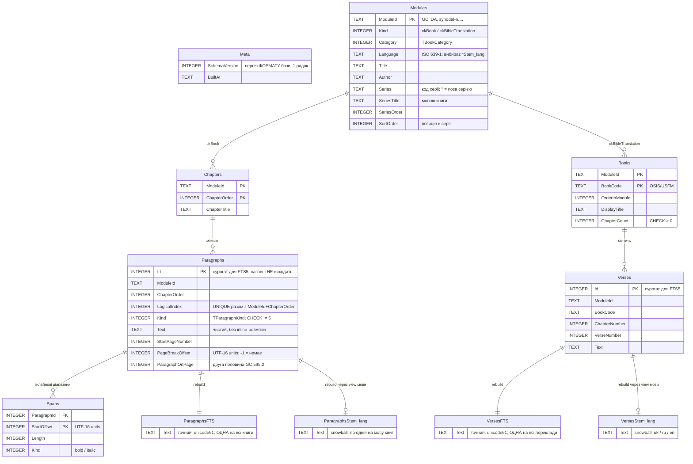

# Slovo — 02: Сховище — одна бібліотечна база SQLite + FTS5

> **Ревізія R2 — 2026-09-11.** Додано `SchemaVersion`; `SpansToNextOriginalPage` замінено на `PageBreakOffset`; додано `ParagraphOnPage` і таблицю `Spans`; тригери наповнення FTS5 замінено на `rebuild`; розділ про підготовку файлу та параметри конекції; у запиті — `LIMIT`, явний `ORDER BY` і службові маркери замість HTML; `BuildMatchQuery` захищено від порожнього запиту.
>
> **Ревізія R3 — 2026-09-13** (за `Slovo_Audit_R3_2026-09-13.md`). R3-02: `Books.ChapterCount`. R3-03: пошук вибирає `StartPageNumber` і `ParagraphOnPage`. R3-07: офсети — UTF-16 code units, від нуля. R3-08: серії. R3-24: рантайм-`sqlite3.dll`. **R3-06: уся бібліотека — ОДНА база `library.db`**; `IModuleLocator` видалено; глобальний пошук — у MVP.
>
> **Ревізія R4 — 2026-09-13 (View 4).** B-27: фільтр модулів — `ModuleId IN (…)` за `TSearchQuery.ModuleIds`. E-09: лічильник глав/книг у базі не зберігається.
>
> **Ревізія R5 — 2026-09-20.** `ILibrary` і каталог у пам'яті (B-29): `LoadCatalog` — три запити на старті. Конекція одна на все (C-21). Помилки відкриття бази — `MessageBox` у фазі 0 (C-22). `ModuleId` глобально унікальний і незмінний (B-30).
>
> **Ревізія R6 — 2026-10-30 (рішення Vitalii, закриття аудиту R4).** **B-31 — форми слова через Snowball усередині SQLite:** власна `sqlite3.dll` з токенізатором `fts5-snowball`; поруч із точними `ParagraphsFTS`/`VersesFTS` — **стемовані таблиці на кожну мову** (`ParagraphsStem_<lang>`, `VersesStem_<lang>`, зокрема `VersesStem_uk` з українським стемером Snowball). `WordForms` вибирає таблицю (B-28 переглянуто, префікс `mmPrefix` знову лише резерв для `CountPrefix`). Новий метод `FindInChapter` — збіги в главі з того самого індексу (E-08). Перевірки виду модуля в SQL немає (R4-23). Нерозривні пробіли й таби запиту — пробіл до `Trim` (R4-52). Дублювання з `Slovo_01` прибрано (R4-54): обґрунтування рішень реєстру — там, тут лише схема й механіка.

Продовження [01 — Домен і контракти](Slovo_01_Domain_and_Contracts.md). Тут — SQLite-схема бібліотечної бази, параметри конекції та пошукові запити.

---

## Ключові рішення сховища (обґрунтування — реєстр `Slovo_01`)

| Рішення | Що це означає для схеми |
|---|---|
| **B-06** — SQLite FTS5 замість власного індексу | Зворотний індекс і `snippet()`/`highlight()` — з коробки; `InMemoryDictionary`/`SQLitePostings` видалено; нічого не вантажиться в RAM при відкритті |
| **B-09** — уся бібліотека — одна база `library.db` | Таблиця `Modules` з N рядків; контентні таблиці мають `ModuleId`; нова книга = перевипуск бази; пошкоджена база = бібліотека недоступна (`MessageBox` у фазі 0, B-26) |
| **B-29** — каталог у пам'яті | `Modules`, `Chapters`, `Books` читаються повністю трьома запитами (`LoadCatalog`) і більше не запитуються |
| **B-31** (R6) — Snowball у власній `sqlite3.dll`, стемовані таблиці на мову | Два індекси на кожен текст: точний (`unicode61`) і стемований (`snowball <мова>`); мову модуля дає `Modules.Language` |

**Sprint-розподіл.** Sprint 1 (MVP): `SearchBook`/`SearchBible` у довільній множині модулів або по всій бібліотеці (B-27), точний і стемований режими (B-28/B-31), `FindInChapter`/`FindInBibleChapter` (E-08). Sprint 3: `CountPrefix` (живий лічильник під час набору) — на точних таблицях, режим `mmPrefix` із зірочкою на останньому терміні.

---

## Схема `library.db`

```sql
-- Один рядок. SchemaVersion — версія ФОРМАТУ бази, не версія контенту (B-16).
-- Невідома версія → reUnsupportedSchema у фазі 0. Поточна: 1
CREATE TABLE Meta (
  SchemaVersion  INTEGER NOT NULL,
  BuiltAt        TEXT    NOT NULL      -- ISO-8601, коли зібрано; для діагностики й логу
);

-- Усі модулі бібліотеки: і книги (ckBook), і переклади Біблії (ckBibleTranslation).
-- Читається повністю одним запитом при старті (LoadCatalog, B-29).
CREATE TABLE Modules (
  ModuleId       TEXT    PRIMARY KEY,  -- 'GC', 'DA', 'synodal-ru', 'ohienko-uk'... (B-30)
  Kind           INTEGER NOT NULL,     -- TContentKind
  Category       INTEGER NOT NULL,     -- TBookCategory; незначущий для ckBibleTranslation
  Language       TEXT    NOT NULL,     -- ISO 639-1; R6 (B-31): також вибирає стемовану таблицю
  Title          TEXT    NOT NULL,
  Author         TEXT    NOT NULL,     -- '' для перекладів Біблії

  -- Серії (R3-08, B-25): іменовані серії з канонічним порядком, решта книг — за Title.
  Series         TEXT    NOT NULL DEFAULT '',  -- код серії; '' = поза серією
  SeriesTitle    TEXT    NOT NULL DEFAULT '',  -- мовою книги; '' коли Series = ''
  SeriesOrder    INTEGER NOT NULL DEFAULT 0,   -- порядок серій між собою в межах категорії
  SortOrder      INTEGER NOT NULL DEFAULT 0,   -- позиція в межах серії; 0 поза серією
  Abbreviation   TEXT    NOT NULL DEFAULT ''   -- R6 (IMP-5): 'PP', 'ВБ'; '' — невідома. У MVP
                                               --   застосунок не читає; для цитат «PP 71.2» post-MVP (E-13)
  -- Лічильника глав/книг тут НЕМАЄ навмисно (E-09): TModule.ChildCount рахує каталог.
);

-- ПРАВИЛО ДЛЯ ВСІХ INTEGER-ПОЛІВ, ЩО ЗБЕРІГАЮТЬ ENUM (Kind, Category, Paragraphs.Kind,
-- Spans.Kind): нові значення — ТІЛЬКИ В КІНЕЦЬ відповідного enum'а в Delphi (B-16).

-- ===================== Книги (ckBook) =====================

CREATE TABLE Chapters (
  ModuleId      TEXT    NOT NULL REFERENCES Modules(ModuleId),
  ChapterOrder  INTEGER NOT NULL,      -- = TChapterRef.ChapterOrder, 1..N у межах модуля
  ChapterTitle  TEXT    NOT NULL,
  PRIMARY KEY (ModuleId, ChapterOrder)
) WITHOUT ROWID;

CREATE TABLE Paragraphs (
  Id               INTEGER PRIMARY KEY,   -- сурогатний rowid для FTS5 external content.
                                           -- ВНУТРІШНІЙ ключ: за межі Infrastructure не виходить
                                           -- ніколи (B-21) — змінюється при кожному перевипуску
  ModuleId         TEXT    NOT NULL,
  ChapterOrder     INTEGER NOT NULL,
  LogicalIndex     INTEGER NOT NULL,      -- = TParagraphRef.LogicalIndex
  Kind             INTEGER NOT NULL,      -- TParagraphKind; 5 = pkPageMarker тут не буває ніколи
  Text             TEXT    NOT NULL,      -- чистий текст, без inline-розмітки
  StartPageNumber  INTEGER NOT NULL DEFAULT 0,
  PageBreakOffset  INTEGER NOT NULL DEFAULT -1,  -- UTF-16 code units, від нуля (B-24);
                                                  -- ДЕ стояв маркер сторінки; -1 = не перетинає.
                                                  -- R6: у MVP не рендериться (View 4, Частина F)
  ParagraphOnPage  INTEGER NOT NULL DEFAULT 0,    -- друга половина посилання виду GC 595.2
  FOREIGN KEY (ModuleId, ChapterOrder) REFERENCES Chapters(ModuleId, ChapterOrder),
  UNIQUE (ModuleId, ChapterOrder, LogicalIndex),   -- і адреса, і індекс для GetChapterContent
  CHECK (Kind <> 5)                                 -- 5 = Ord(pkPageMarker) (R3-20)
);

-- Інлайнові діапазони форматування (B-18). У MVP не рендеряться, але пишуться з першої збірки.
CREATE TABLE Spans (
  ParagraphId  INTEGER NOT NULL REFERENCES Paragraphs(Id),
  StartOffset  INTEGER NOT NULL,          -- UTF-16 code units, від нуля (B-24)
  Length       INTEGER NOT NULL,
  Kind         INTEGER NOT NULL,          -- TInlineSpanKind
  PRIMARY KEY (ParagraphId, StartOffset)
) WITHOUT ROWID;

-- ТОЧНИЙ індекс — один на всі книги бібліотеки (B-15). unicode61: lowercase + зняття
-- пунктуації, без стемінгу. remove_diacritics 0 — єдине правильне для кирилиці:
-- 1 згорнуло б не лише ё→е, а й й→и.
CREATE VIRTUAL TABLE ParagraphsFTS USING fts5(
  Text,
  content='Paragraphs',
  content_rowid='Id',
  tokenize='unicode61 remove_diacritics 0'
);

-- ===================== Біблія (ckBibleTranslation) =====================

-- Books — «зміст» перекладу, аналог Chapters: усе для дерева й навігації одним запитом.
CREATE TABLE Books (
  ModuleId       TEXT    NOT NULL REFERENCES Modules(ModuleId),
  BookCode       TEXT    NOT NULL,      -- OSIS/USFM: 'GEN', 'MAT'...; спільний для всіх перекладів
  OrderInModule  INTEGER NOT NULL,
  DisplayTitle   TEXT    NOT NULL,      -- мовою перекладу
  Abbreviation   TEXT    NOT NULL DEFAULT '',  -- R6 (IMP-5): 'Бут', 'Быт', 'Gen'; у MVP не читається
  ChapterCount   INTEGER NOT NULL       -- B-22: глав у книзі В ЦЬОМУ перекладі, 1..N без пропусків
    CHECK (ChapterCount > 0),
  PRIMARY KEY (ModuleId, BookCode)
) WITHOUT ROWID;

CREATE TABLE Verses (
  Id             INTEGER PRIMARY KEY,   -- сурогатний rowid для FTS5
  ModuleId       TEXT    NOT NULL,
  BookCode       TEXT    NOT NULL,
  ChapterNumber  INTEGER NOT NULL,
  VerseNumber    INTEGER NOT NULL,
  Text           TEXT    NOT NULL,
  FOREIGN KEY (ModuleId, BookCode) REFERENCES Books(ModuleId, BookCode),
  UNIQUE (ModuleId, BookCode, ChapterNumber, VerseNumber)
);

CREATE VIRTUAL TABLE VersesFTS USING fts5(
  Text,
  content='Verses',
  content_rowid='Id',
  tokenize='unicode61 remove_diacritics 0'
);

-- ===================== Стемовані індекси (R6, B-31) =====================
-- Одна пара «view + FTS-таблиця» на кожну мову, що є серед модулів відповідного виду
-- і для якої Snowball має стемер. MVP: книги — лише ru (весь корпус CHM російською, IMP-3);
-- Біблія — uk, ru, en. Схема від цього не залежить: таблиці — за Modules.Language.
-- View обмежує external content рядками однієї мови — rebuild індексує лише їх,
-- а snippet()/highlight() читають текст з того самого view за rowid.

CREATE VIEW Paragraphs_ru AS
  SELECT p.Id, p.Text FROM Paragraphs p JOIN Modules m ON m.ModuleId = p.ModuleId
  WHERE m.Language = 'ru';

CREATE VIRTUAL TABLE ParagraphsStem_ru USING fts5(
  Text,
  content='Paragraphs_ru',
  content_rowid='Id',
  tokenize='snowball russian unicode61 remove_diacritics 0'
);

CREATE VIEW Verses_uk AS
  SELECT v.Id, v.Text FROM Verses v JOIN Modules m ON m.ModuleId = v.ModuleId
  WHERE m.Language = 'uk';

CREATE VIRTUAL TABLE VersesStem_uk USING fts5(
  Text,
  content='Verses_uk',
  content_rowid='Id',
  tokenize='snowball ukrainian unicode61 remove_diacritics 0'
);

-- VersesStem_ru ('snowball russian …'), VersesStem_en ('snowball english …') — так само.
-- Правило імен: <Paragraphs|Verses>Stem_<Modules.Language>; мапа ISO 639-1 → назва
-- алгоритму Snowball ('uk' → ukrainian, 'ru' → russian, 'en' → english) — у виробника.

-- ТРИГЕРІВ НЕМАЄ (B-08). Усі FTS-таблиці збираються наприкінці збірки бази:
--   INSERT INTO <t>(<t>) VALUES('rebuild');
--   INSERT INTO <t>(<t>) VALUES('optimize');
-- для ParagraphsFTS, VersesFTS і кожної *Stem_<lang>.
```

**Мова без стемера.** Якщо колись з'явиться модуль мовою, для якої Snowball стемера не має, стемованої таблиці для неї немає: `WordForms = True` для таких модулів шукає в точній таблиці (тихий відкат, рядок у лог один раз за сеанс).

### ER-діаграма



**Розмір.** ≈42 книги + 3 переклади ≈ 45 модулів (оцінка, IMP-3) з двома наборами FTS5-індексів — орієнтовно 250–500 МБ в одному файлі (стемований індекс трохи менший за точний: основ менше, ніж словоформ). Для read-only бази з `mmap_size` це не має значення: сторінки читаються на вимогу.

---

## Власна `sqlite3.dll` зі Snowball (R6, B-31)

Застосунок і виробник бази використовують **одну й ту саму** `sqlite3.dll`, зібрану з амальгамації SQLite і розширення `fts5-snowball` (C, обгортка над `libstemmer_c` проєкту Snowball). Розширення вкомпільоване в DLL і реєструється автоматично (`SQLITE_EXTRA_INIT` → `sqlite3_auto_extension`), тож застосунку не потрібні `sqlite3_load_extension` і окремий файл.

Вимоги до збірки:

- `SQLITE_ENABLE_FTS5`;
- **Snowball ≥ 3.2.0** (реліз 2026-10-17) — перший, що **містить український стемер** (`ukrainian`). `fts5-snowball` (github `abiliojr/fts5-snowball`) не оновлювався з 2021 року, його git-submodule `snowball` старий — замість нього підставляється свіжий клон Snowball, і `fts5stemmer.c` лінкується з його `libstemmer.a`;
- Win64, та сама збірка для імпортера.

Синтаксис `tokenize` — `'snowball <мова> unicode61 remove_diacritics 0'`: перші аргументи — мови (кілька пробуються по черзі), далі — вкладений токенізатор і його параметри. Snowball стемує токени, які видає `unicode61`, тож lowercase і пунктуація поводяться так само, як у точних таблицях. Токени коротші за 4 байти UTF-8 (одна кирилична літера, дві латинські) і довші за 64 байти не стемуються — це константи `fts5stemmer.c`.

**Перевірено 2026-11-01** (Linux-збірка: Snowball 3.2.0 + `fts5-snowball` як завантажуване розширення до SQLite 3.53). На тестових віршах:

| Таблиця | Запит | Знайдено |
|---|---|---|
| `VersesStem_uk` | `"жертва"` | «жертву» (×2), «Жертви» |
| `VersesStem_uk` | `"жертва Богові"` (фраза) | «Жертви Богові» |
| `VersesStem_ru` | `"жертва"` | «Жертва», «жертвы» |
| `VersesStem_en` | `"sacrifice"` / `"saving"` | «sacrifices» / «saved» |
| `VersesFTS` (точна) | `"жертва"` | лише «Жертва» |

Схема з view мови як external content працює; `highlight()` і `snippet()` повертають текст з view. **Відомі промахи стемера** (прийнято як є, рішення Vitalii): ru «благодать» → `благода`, але «благодатью» → `благодат`; uk «благодаттю» → `благодатт`; en «sacrificed» → `sacrif` — такі форми пошук за формами не з'єднує (Межі токенізації нижче).

**Windows-DLL зібрано й перевірено 2026-11-04** (Sprint 1, крок 1). Усе для збірки — у репозиторії, `tools\sqlite\`: амальгамація SQLite 3.54.1, C-дистрибутив Snowball `libstemmer_c` 3.2.0 (лише UTF-8-стемери), `fts5stemmer.c` без змін — вкомпільований через клей `slovo_snowball.c` (`SQLITE_CORE`, `SQLITE_EXTRA_INIT=slovo_extra_init`). MinGW-w64 з `-static-libgcc`: DLL імпортує лише `KERNEL32.dll` і `msvcrt.dll` і експортує тільки API SQLite. `build.sh` працює на Linux (крос-компіляція) і в MSYS2 UCRT64; версії й SHA-256 — `out\build-info.txt`, ліцензії для поставки — `out\LICENSES\`. Delphi-тест `delphi\SnowballCheck.dpr` (Win64, `LoadLibraryEx` за повним шляхом, `bind_text` для `MATCH`, вирізання маркерів `highlight()` із перевіркою офсетів UTF-16 проти `Verses.Text`, пробні запити фази 0) — `ALL PASS` на тій самій таблиці; «saving» знаходить і «saved», і «save». Звичайна SQLite на тій самій схемі дає `no such tokenizer: snowball`, тож перевірка фази 0 чужу DLL ловить.

**Перевірка у фазі 0 старту (C-22, D-08).** Після завантаження DLL: `sqlite3_compileoption_used('ENABLE_FTS5')`; після відкриття бази — по одному пробному запиту `SELECT rowid FROM <t> WHERE <t> MATCH 'a' LIMIT 1` на кожну `*Stem_*`-таблицю. Помилка `no such tokenizer` означає не ту DLL (підкладену чи системну) → `MessageBox` `startup.wrongSqlite` і вихід — а не загадкова помилка при першому пошуку з галочкою.

---

## Одиниця текстових офсетів (B-24)

Усі позиції в тексті, які зберігає формат (`Spans.StartOffset`/`Length`, `Paragraphs.PageBreakOffset`) або повертає рантайм (`TSearchHighlight`), вимірюються в **UTF-16 code units з індексацією від нуля** — так, як їх бачить Delphi-`string`: `Copy(Text, StartOffset + 1, Length)`. Слово «символ» у SQLite означає кодову точку (`length()`, `substr()`), у байтових функціях — байт UTF-8; для символу поза BMP відповіді різні.

Сторонній валідатор чи генератор (Python, SQL-скрипт) зобов'язаний рахувати позиції по `utf-16`-кодуванню рядка. Офсети обчислюються **після** будь-якої нормалізації тексту виробником. Перевірка меж — обов'язок виробника (`Slovo_Import_Deferred.md`).

**Офсети з `snippet()`/`highlight()`.** Позиції збігів застосунок отримує, вирізаючи службові маркери `char(2)`/`char(3)` з рядка, який повернув SQLite, — уже в Delphi, тож одиниця автоматично UTF-16. `highlight()` повертає **весь** текст абзацу з маркерами, тому офсети після вирізання маркерів збігаються з офсетами в `Paragraphs.Text`.

---

## Вимоги до файлу бази та параметри конекції

### Що виробник зобов'язаний зробити перед тим, як віддати `library.db`

Виробник бази — окремий проєкт (`Slovo_Import_Deferred.md`). Застосунок на це покладається й у рантаймі не перевіряє.

```sql
PRAGMA foreign_keys = ON;      -- на час запису: у SQLite FK вимкнені за замовчуванням
-- ... наповнення таблиць ...
-- rebuild + optimize для ParagraphsFTS, VersesFTS і всіх *Stem_<lang> (схема вище)
PRAGMA journal_mode = DELETE;  -- КРИТИЧНО, див. нижче
VACUUM;                         -- дефрагментація + мінімальний розмір файлу
```

**Чому `journal_mode = DELETE` — критично (D-07).** У режимі **WAL** навіть суто читальне відкриття вимагає створити поруч `-shm`-файл. Програма портативна: у `Program Files` чи на read-only диску застосунок отримав би `SQLITE_CANTOPEN` замість бібліотеки.

`page_size` за потреби задається **до** наповнення.

**`ModuleId` — глобально унікальний і незмінний (B-30).** Без `=`, `,`, `:`; не починається з `;`/`[` — він стає ключем у `settings.ini` (View 4, C.2). Перейменування модуля між випусками бази заборонене так само, як зміна `ChapterOrder` чи `LogicalIndex` наявного абзацу.

**`Paragraphs.Text` / `Verses.Text`** можуть містити будь-які символи; CR/LF/TAB застосунок при показі замінює пробілом без зміни довжини (View 4, C.4).

### Інваріанти даних, які застосунок не перевіряє

`Books.ChapterCount` (B-22), поля серій (B-25), межі офсетів (B-24), повнота стемованих таблиць (кожен рядок `Paragraphs`/`Verses` мовою зі стемером — у відповідній `*Stem_<lang>`) — дані, яким застосунок **довіряє**. Перевірки — у `Slovo_Import_Deferred.md`.

### Як застосунок відкриває базу

| Параметр | Значення | Навіщо |
|---|---|---|
| Прапорці `sqlite3_open_v2` | `SQLITE_OPEN_READONLY` | read-only конекція навіть не намагається створювати журнал |
| `SQLITE_OPEN_NOMUTEX` | для єдиної конекції (R5) | Уся робота з базою — в UI-потоці (C-21); `SQLITE_THREADSAFE=1` не вимагається |
| `PRAGMA mmap_size` | 512 МБ — з запасом на розмір бази | сторінки читаються через відображення в пам'ять, без копіювання через кеш SQLite |
| `PRAGMA cache_size` | помірний, у кілобайтах зі знаком «−» | конекція одна |
| `PRAGMA foreign_keys` | **не вмикати** | у read-only конекції перевіряти нема чого |

**Конекція — одна (C-02, C-21).** `TLibraryDatabase` відкриває `library.db` у фазі 0 (шлях — UTF-8) і тримає конекцію до виходу; на ній працюють `TLibrary` і `Fts5SearchIndex`, послідовно в UI-потоці.

**Порядок.** `GetChapterContent` пише `ORDER BY LogicalIndex`, `GetBibleChapter` — `ORDER BY VerseNumber`, `LoadCatalog` — `ORDER BY` для глав і книг. `UNIQUE`-індекс і так поверне потрібний порядок, але це побічний ефект плану запиту, а не гарантія.

---

## Запити каталогу й вмісту

```sql
-- LoadCatalog (B-29) — один раз у фазі 0 старту, три запити на всю бібліотеку.
SELECT ModuleId, Kind, Category, Language, Title, Author,
       Series, SeriesTitle, SeriesOrder, SortOrder
FROM Modules;

SELECT ModuleId, ChapterOrder, ChapterTitle
FROM Chapters ORDER BY ModuleId, ChapterOrder;              -- усі глави всіх книг

SELECT ModuleId, BookCode, OrderInModule, DisplayTitle, ChapterCount
FROM Books ORDER BY ModuleId, OrderInModule;

-- GetChapterContent(ModuleId, ChapterOrder)  → Paragraphs + Spans двома запитами
SELECT Id, LogicalIndex, Kind, Text, StartPageNumber, PageBreakOffset, ParagraphOnPage
FROM Paragraphs WHERE ModuleId = :m AND ChapterOrder = :c ORDER BY LogicalIndex;

-- GetBibleChapter(ModuleId, BookCode, ChapterNumber)
SELECT VerseNumber, Text FROM Verses
WHERE ModuleId = :m AND BookCode = :b AND ChapterNumber = :c ORDER BY VerseNumber;
```

`ORDER BY OrderInModule` для `Books` — явний: `BookCode` текстовий, фізичний порядок з канонічним не збігається. Обсяг каталогу — кілька тисяч коротких рядків, кілька сотень КБ у пам'яті.

---

## Пошукові запити

### Вибір таблиці (R6, B-28/B-31)

`Fts5SearchIndex` отримує каталог у конструкторі (мова кожного модуля — `TModule.Language`) і для кожного виклику будує **список таблиць**:

| `WordForms` | Книги (`SearchBook`) | Біблія (`SearchBible`) |
|---|---|---|
| `False` | `ParagraphsFTS` — один запит | `VersesFTS` — один запит |
| `True` | `ParagraphsStem_<lang>` — **по запиту на кожну мову** серед модулів скоупу | `VersesStem_<lang>` — по запиту на мову |

Модулі скоупу (`ModuleIds`, або всі модулі виду, якщо масив порожній) групуються за `Language`; кожна група — свій запит зі своїм `IN (…)` і своїм `LIMIT`. Результати склеюються **групами** в `TSearchPage.Items` — у порядку мов `uk`, `ru`, `en`, далі решта за алфавітом коду — кожна група в порядку `bm25` своєї таблиці; ранги між таблицями не порівнюються (View 4 показує групи окремо). `Truncated = True`, якщо обрізано хоч одну групу. У MVP переклад = мова, тож для Біблії групи мов збігаються з групами перекладів.

### Запит — приклад (книги)

```sql
SELECT
  p.ModuleId,                   -- → TChapterRef.ModuleId
  p.ChapterOrder,
  p.LogicalIndex,
  p.StartPageNumber,            -- B-23: → TBookSearchResult.PageNumber
  p.ParagraphOnPage,            -- B-23: → TBookSearchResult.ParagraphOnPage
  snippet(T, 0, char(2), char(3), '…', 8) AS Snippet
FROM T                          -- ParagraphsFTS або ParagraphsStem_<lang> (таблиця вище)
JOIN Paragraphs p ON p.Id = T.rowid
WHERE T MATCH :match
  AND p.ModuleId IN (:m1, :m2, :m3)   -- B-27: рівно Length(група) плейсхолдерів;
                                      -- при «уся бібліотека» в точній таблиці умова НЕ додається
ORDER BY rank
LIMIT :maxResultsPlusOne;         -- B-19: MaxResults + 1 — зайвий рядок = ознака Truncated
```

**Множина модулів (B-27).** Значення `ModuleId` прив'язуються кожне окремо — жодної конкатенації у SQL. Список короткий (≈45 модулів, оцінка IMP-3), ліміт параметрів SQLite недосяжний. Перевірки виду модуля немає (R6, R4-23): ViewModel розкладає скоуп за каталогом, а модуль не того виду в `IN (…)` просто дав би нуль рядків — він не має рядків у цій таблиці. Фільтр `IN (…)` застосовується **після** FTS5-збігу; якщо профілювання колись покаже вартість — `ModuleId UNINDEXED` у FTS-таблицях (post-MVP).

**Решта правил запиту:**

1. **`LIMIT :maxResults`** доходить до SQL (B-19); `MaxResults ≤ 0` нормалізується до `DefaultMaxResults = 200` **до** прив'язки (у SQLite `LIMIT 0` — нуль рядків); прив'язується `MaxResults + 1` → `Truncated`.
2. **`char(2)`/`char(3)` замість `'<b>'`/`'</b>'`.** `Fts5SearchIndex` вирізає ці службові символи й віддає `Snippet` чистим текстом плюс `Highlights` з межами підсвітки.
3. **Назва глави в запиті не вибирається** — мапінг `ChapterOrder → Title` дає каталог (B-20, B-29).
4. **`ORDER BY rank` (bm25)** вирішує **склад** видачі; порядок показу — справа View 4 (секції й групи, перемикача порядку в MVP немає). Перший `sqlite3_step` сортує весь набір збігів — `LIMIT` єдине, що обмежує вартість запиту.

Аналогічний запит для `VersesFTS` / `VersesStem_<lang>` + `Verses` → `TBibleSearchResult` (`v.ModuleId, v.BookCode, v.ChapterNumber, v.VerseNumber` у `SELECT`).

### Збіги в главі — `FindInChapter` / `FindInBibleChapter` (R6, E-08)

Той самий `MATCH`, та сама таблиця (вибір вище, для мови модуля глави), але обмежений однією главою і з `highlight()` замість `snippet()`:

```sql
SELECT p.LogicalIndex,
       highlight(T, 0, char(2), char(3)) AS Marked   -- увесь текст абзацу з маркерами збігів
FROM T
JOIN Paragraphs p ON p.Id = T.rowid
WHERE T MATCH :match
  AND p.ModuleId = :m AND p.ChapterOrder = :c
ORDER BY p.LogicalIndex;
```

`Fts5SearchIndex` вирізає маркери й повертає `TArray<TParagraphHit>` — `LogicalIndex` + `Highlights` (офсети в `Paragraphs.Text`, UTF-16). Для Біблії — `v.VerseNumber` і `TVerseHit`. Порядку за релевантністю тут немає — лише порядок у главі. Запит на одну главу дешевий: FTS знаходить збіги в індексі, `JOIN` відсікає чужі глави, `highlight()` рахується лише для кількох абзаців.

Так підсвітка в главі збігається з видачею точно, в обох режимах, і в Delphi немає жодної емуляції токенізатора чи стемера.

### Побудова `MATCH` і обов'язкове екранування

FTS5 має власний синтаксис усередині `MATCH` — лапки `"`, дужки `( )`, `*`, `:` (column-filter), `AND`/`OR`/`NOT`. `TSearchQuery.Text` від користувача не можна підставляти напряму (B-12): кожен термін обгортається в подвійні лапки, внутрішні `"` подвоюються.

```pascal
type
  TMatchMode = (
    mmAllWords,     // усі слова десь у тексті, порядок і відстань не враховуються
    mmExactPhrase,  // точний порядок слів (у стемованій таблиці — фраза з основ)
    mmPrefix        // РЕЗЕРВ для CountPrefix (Sprint 3): зірочка на останньому терміні.
                    // R4–R5 тут був префікс для WordForms; з R6 форми дає стемована таблиця (B-31)
  );

const
  // Роздільники слів: при копіюванні з Word чи з вебу приїжджає нерозривний пробіл
  // (#$00A0), з багаторядкового поля — табуляція й переноси.
  WordSeparators: array[0..4] of Char = (' ', #9, #10, #13, #$00A0);

function SanitizeFtsTerm(const Term: string): string;
begin
  Result := '"' + StringReplace(Term, '"', '""', [rfReplaceAll]) + '"';
end;

// False — запитувати нема чого; викликач НЕ йде в базу й повертає roSuccess
// з порожньою сторінкою. Без цього порожній або лише-пробільний запит дав би
// MATCH '""' — синтаксичну помилку FTS5, а користувач побачив би банер помилки.
function TryBuildMatchQuery(const RawText: string; Mode: TMatchMode;
  out MatchExpr: string): Boolean;
var
  Normalized: string;
  Words: TArray<string>;
  SanitizedWords: TArray<string>;
begin
  MatchExpr := '';
  // R6 (R4-52): Trim не зрізає #$00A0 — спершу всі роздільники стають пробілом.
  // Довжина не змінюється; для mmExactPhrase фраза отримує звичайні пробіли.
  Normalized := RawText;
  for var C in WordSeparators do
    Normalized := Normalized.Replace(C, ' ');
  Normalized := Normalized.Trim;
  if Normalized.IsEmpty then
    Exit(False);

  if Mode = mmExactPhrase then
  begin
    MatchExpr := SanitizeFtsTerm(Normalized);
    Exit(True);
  end;

  Words := Normalized.Split([' '], TStringSplitOptions.ExcludeEmpty);
  SetLength(SanitizedWords, Length(Words));
  for var I := 0 to High(Words) do
    SanitizedWords[I] := SanitizeFtsTerm(Words[I]);

  MatchExpr := string.Join(' ', SanitizedWords);
  Result := True;
end;
```

Вибір режиму: `ExactPhrase` → `mmExactPhrase`, інакше `mmAllWords`. `WordForms` на `MATCH` не впливає — лише на таблицю. Приклади:

- `ExactPhrase = True` → `MATCH '"через Його благодать"'`
- `ExactPhrase = False` → `благодать  (спасіння` → `MATCH '"благодать" "(спасіння"'` — неявний `AND`, `(` вже не спецсимвол
- `WordForms = True` → той самий `MATCH`, але в `*Stem_<lang>`: Snowball стемує і терміни запиту, тож «жертва» знайде «жертви», «жертвою», «жертвами»
- Ручна нормалізація тексту в Delphi **не потрібна**: FTS5 проганяє контент і запит через той самий токенізатор таблиці

`StrictWordOrder` прибрано з MVP (B-11): `NEAR()` перевіряє лише близькість, не порядок.

### Межі токенізації — що користувач помітить

| Ситуація | Що станеться | Статус |
|---|---|---|
| `ё` / `е` | Точний пошук «все» не знайде «всё». Російський стемер Snowball сам `ё` не згортає | Відоме обмеження MVP |
| Апостроф | `unicode61` розіб'є «пам'ять» на `пам` + `ять` — і в точній, і в стемованій таблиці | Відоме обмеження MVP |
| Дефіс | «будь-який» = два токени | Відоме обмеження MVP |
| Форми слова — чергування | Стемер обрізає закінчення за правилами, але не знає чергувань: «друг» / «друзі», «рука» / «руці» можуть дати різні основи | Свідоме наближення (B-31); точніше — словник форм, post-MVP |
| Форми слова — збіг основ | Різні слова з однією основою знаходяться разом | Свідоме наближення (B-31) |
| Форми слова — різні основи однієї лексеми | Snowball іноді обрізає форми по-різному: «благодать» / «благодатью», «благодать» / «благодаттю», «sacrifice» / «sacrificed» — пошук із галочкою їх не з'єднує. Префікс на стемі («стем + *») з'єднав би, але додає шум («благодать» → «Благодарите») — відхилено | Прийнято як є (R6, перевірено 2026-11-01); точніше — словник форм, post-MVP |

**Шлях покращення — власний токенізатор** через `fts5_api`/`xCreateTokenizer` (згортання `ё→е`, апострофи), загорнутий навколо того самого Snowball. Зміна токенізатора **не вимагає розбору вихідних текстів**: індекси external-content, достатньо `rebuild` по наявній базі й підняти `SchemaVersion`.

---

## Індекси — підсумок

Понад `PRIMARY KEY`/`UNIQUE`, вказані вище, **жодних додаткових `CREATE INDEX` не потрібно** (B-13):
- `Modules`, `Chapters`, `Books` читаються повністю (`LoadCatalog`); `ORDER BY` збігається з PK
- `Paragraphs`: `UNIQUE (ModuleId, ChapterOrder, LogicalIndex)` покриває `GetChapterContent`; `Verses`: `UNIQUE (ModuleId, BookCode, ChapterNumber, VerseNumber)` — главу Біблії
- Фільтри `IN (…)` і `ModuleId = … AND ChapterOrder = …` у пошуку йдуть по вже знайдених FTS5-рядках
- View мов (`Paragraphs_<lang>`, `Verses_<lang>`) потрібні лише як content для FTS: за rowid вони звертаються до PK

---

## Infrastructure — перелік

| Клас | Реалізує | Джерело даних |
|---|---|---|
| `Infra.SQLite.LibraryDatabase` | *(внутрішній)* | Одна read-only конекція до `library.db` на весь сеанс: відкриття у фазі 0 з pragma вище й UTF-8 шляхом, перевірка `Meta.SchemaVersion` і стемованих таблиць (токенізатор), володіння хендлом |
| `Infra.SQLite.LibraryReader` (не `…Library`: `library` — зарезервоване слово Delphi, навіть у крапковому імені модуля) | `ILibrary` | `LoadCatalog` → `TLibraryCatalog`; `GetChapterContent` — `Paragraphs` + `Spans`; `GetBibleChapter` — `Verses` |
| `Infra.Search.Fts5SearchIndex` | `ISearchIndex` | Точні й стемовані FTS-таблиці; вибір таблиць за `WordForms` і мовами з каталогу; `IN (…)` за `ModuleIds`; `FindInChapter`/`FindInBibleChapter` через `highlight()` |
| `Infra.Settings.IniSettings` | `ISettings` | `data\settings.ini` (View 4, C.2) — не SQLite |

**Доступ до SQLite** (C-01, D-08): прямий import C API з власної `sqlite3.dll` поруч з EXE, завантаженої в рантаймі за повним шляхом (`Infrastructure.SQLite3.Api`), без FireDAC. **Логування:** `LibraryDatabase`, `Library` і `Fts5SearchIndex` приймають `ILogger` через конструктор (View 3, A.7).

---

## Наступні кроки

- [x] View 2 — SQLite-схема, FTS5 як пошуковий рушій
- [x] Ревізія R2 — `SchemaVersion`, `PageBreakOffset`, `ParagraphOnPage`, `Spans`, `rebuild`, параметри конекції
- [x] Ревізія R3 — одна база `library.db`, глобальний пошук, серії, `ChapterCount`, офсети, DLL
- [x] Ревізія R4 — `IN (…)` за `ModuleIds` (B-27), лічильники дерева без зміни формату (E-09)
- [x] Ревізія R5 — `LoadCatalog` (B-29), одна конекція (C-21), `ModuleId` глобально унікальний (B-30)
- [x] Ревізія R6 — Snowball у власній DLL, стемовані таблиці на мову (B-31), `FindInChapter` (E-08)
- [x] Перевірка Snowball (2026-11-01, Linux): синтаксис `tokenize`, український стемер у Snowball 3.2.0, view як external content, `highlight()`/`snippet()`
- [x] Sprint 1, крок 1 (2026-11-04): власна `sqlite3.dll` під Win64 (SQLite 3.54.1 + `fts5stemmer.c` + Snowball 3.2.0, `SQLITE_EXTRA_INIT`) — `tools\sqlite\`; та сама перевірка з Delphi — `ALL PASS`
- [ ] Sprint 3: `CountPrefix` — живий лічильник входжень; режим `mmPrefix` із зірочкою на останньому терміні; повертається в контракт `ISearchIndex`
- [ ] Post-MVP: власний токенізатор (`ё→е`, апострофи) поверх Snowball — лише `rebuild`
- [ ] Post-MVP: словник форм замість стемера, якщо чергування заважатимуть
- [ ] Post-MVP: `ModuleId UNINDEXED` у FTS-таблицях, якщо профілювання покаже вартість фільтра
