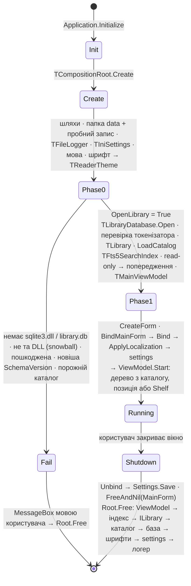
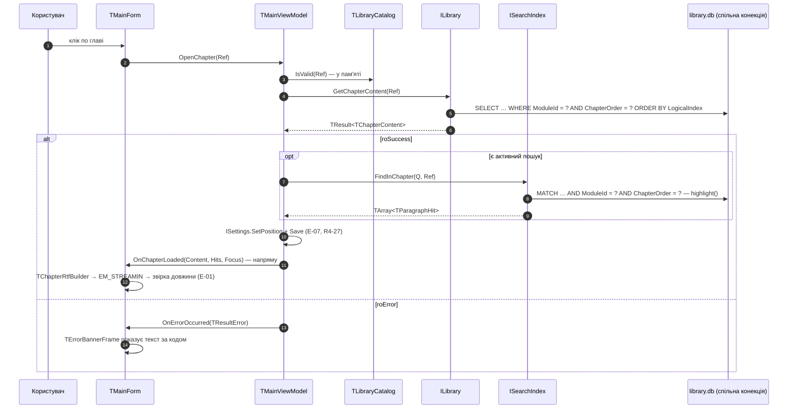
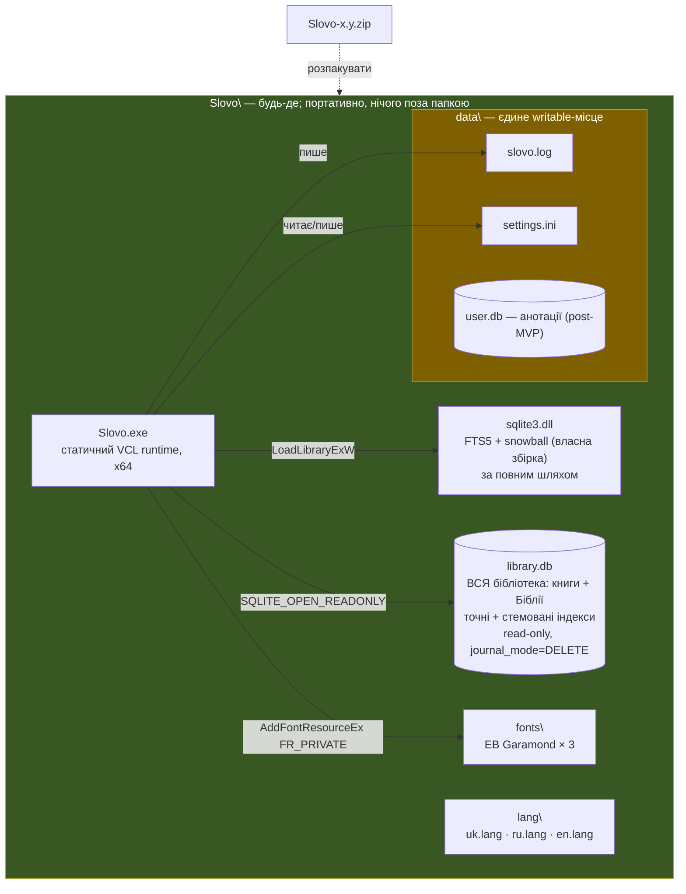

# Slovo — Архітектурний Огляд — View 3: Process View / Deployment View

> **Ревізія R2 — 2026-09-11.** Скасування пошуку ініціює UI-потік; порядковий номер запиту; лічильник задач «у польоті» у ViewModel; власність `Fts5SearchIndex`, шляхи (`ParamStr(0)`), порядок знищення форми й кореня, створення директорії логу та захист логера від власних винятків.
>
> **Ревізія R3 — 2026-09-13** (за `Slovo_Audit_R3_2026-09-13.md`). R3-24: SQLite — рантайм-`sqlite3.dll` за повним шляхом. Скасування пошуку прибрано (пошук лише по кнопці/Enter). **R3-06: одна база `library.db` + портативна поставка** — усе поруч з EXE, `data\` — єдине writable-місце.
>
> **Ревізія R4 — 2026-09-13 (View 4).** `ISettings` у композиційному корені (E-06); один пошук користувача = `SearchBook` + `SearchBible` (B-27); `fonts\` і `data\settings.ini` у поставці; тексти банера — ключі `error.*`. Додано **Частину C — стратегію тестування**.
>
> **Ревізія R5 — 2026-09-20 (спрощення для MVP).** Пошук синхронний в UI-потоці (C-21): без `TTask`, `TThread.Queue`, токена життя, лічильника задач, bounded wait і другої конекції. Старт у дві фази (C-22). `ILibrary` і каталог у пам'яті (B-29). Кілька екземплярів (C-23); лок логера знято. Бюджети продуктивності прибрано (E-17).
>
> **Ревізія R6 — 2026-10-30 (закриття аудиту R4).** **Власна `sqlite3.dll` з `fts5-snowball`** — форми слова (B-31): D-08 переглянуто, фаза 0 перевіряє ще й токенізатор (`startup.wrongSqlite`). `Fts5SearchIndex` отримує каталог (мови модулів). Порожній запит і порожній скоуп перевіряє форма — рядок стану, не банер (R4-24); A.5 оновлено. Глава з активним пошуком — `FindInChapter` (E-08), A.4 оновлено. Шрифти — лише EB Garamond, 3 файли, без `RemoveFontResourceEx` (E-04). `Save` налаштувань — при виході й при зміні глави (R4-27). Тести (Частина C) — під стемовані таблиці. Обґрунтування рішень реєстру тут лише там, де це View — їхнє джерело (R4-54).

Продовження [01 — Домен і контракти](Slovo_01_Domain_and_Contracts.md) та [02 — Сховище: SQLite + FTS5](Slovo_02_Storage_SQLite_FTS5.md). Тут — композиційний корінь, потоки виконання і як усе це розгортається на диску користувача.

---

## Частина A. Process View

### A.1. Рішення цього View

Перший стовпчик — ID з реєстру `Slovo_01`. Закреслені рядки лишаються для історії: рішення знято, пояснення — чому.

| # | Рішення | Обґрунтування |
|---|---|---|
| C-21 | **Пошук синхронний, в UI-потоці (R5, MVP)** | Пошук запускається лише кнопкою/Enter і не скасовується (C-04), тож фоновий потік давав тільки «живе» вікно на час запиту. Платили за це половиною аудиту R4: `TTask`, `TThread.Queue`, токен життя, лічильник задач у польоті, bounded wait з визнаним use-after-free при виході, друга конекція й вимога `SQLITE_THREADSAFE`. Без фону вся ця механіка зникає. UX на час запиту — рядок стану «Шукаю…», примусово перемальований через `Update` (не `Application.ProcessMessages` — без реентрантності), і курсор `crHourGlass`. Ввід під час пошуку стає в чергу повідомлень; повторний Enter виконає той самий пошук ще раз — нешкідливо. **Шлях назад** — C-08: `ISearchIndex` синхронний у Core, тож фон повертається зміною лише ViewModel і `Fts5SearchIndex` разом із `CountPrefix` у Sprint 3 |
| C-22 | **Старт у дві фази (R5).** Фаза 0 — передумови до створення форми; кожна невдача → `MessageBox` мовою користувача → вихід. Фаза 1 — наповнення форми, на даних вона вже не падає | Без бібліотеки програмі нема що показати. Фаза 0 перевіряє все, від чого залежить робота: `data\` і можливість запису, `sqlite3.dll` (FTS5), `library.db` (відкриття з UTF-8 шляхом, `SchemaVersion`, **R6: токенізатор `snowball` у стемованих таблицях**), непорожній каталог. Settings і мова створюються раніше за все, що може впасти, — повідомлення вже мовою користувача. Відсутня база найчастіше означає запуск EXE прямо з ZIP — текст повідомлення про це й каже. Read-only папка — не вихід, а одне попередження. Фаза 1 будує дерево з каталогу й відновлює позицію; невалідна позиція → Shelf мовчки + рядок у лог |
| C-23 | **Кілька екземплярів програми дозволено (R5)** | Mutex і активація першого вікна — код без споживача. `library.db` — кілька read-only читачів; `slovo.log` — відкрити-дописати-закрити на кожен рядок, `LogError` при зіткненні не кидає (C-18); `settings.ini` — виграє той екземпляр, що зберіг останнім (`Slovo_04` C.2) |
| C-13 | Композиційний корінь — один клас `TCompositionRoot`, ручний constructor injection; **з R5 — дві фази** (C-22) | Усі об'єкти створюються в одному видимому місці, порядок залежностей читається зверху вниз. Без DI-контейнера (Spring4D) для MVP |
| C-15 | `ISearchIndex` — singleton-сервіс (не per-module) | `TSearchQuery.ModuleIds` несе, які модулі шукати (`[]` = уся бібліотека). Індекс працює на спільній конекції `TLibraryDatabase`; **R6:** отримує ще каталог — мова модуля вибирає стемовану таблицю (B-31) |
| C-09 | Помилки пошуку — не exception, а `roError` у `TResult` | Апаратна помилка (пошкоджена база, синтаксис FTS5) ловиться в `Fts5SearchIndex`, логується з технічним деталем і приходить кодом `TResultError`; ViewModel веде її в той самий банер, що й помилку читання глави |
| C-04 | **Пошук — по кнопці/Enter, без скасування (R3).** Один пошук за раз | Модель live-пошуку (слот хендла, `sqlite3_interrupt`, `FQueryId`, `roCancelled`) має сенс лише при пошуку «на льоту», якого в MVP немає. З синхронним пошуком (C-21) «один за раз» гарантує сам UI-потік. Коли `CountPrefix` повернеться, `interrupt` повернеться разом з ним — локально, в один клас |
| C-18 | **`LogError` не має права кинути виняток за жодних обставин** | Його викликають з блоку `except`; виняток із логера підмінив би собою оригінальний. Джерела — відсутня `data\`, файл, зайнятий іншим екземпляром (C-23), read-only папка. Тому в A.7: створення директорії + тотальний `try/except` |
| D-08 | **Власна `sqlite3.dll` поруч з EXE, завантажена в рантаймі за повним шляхом** (R3-24; **R6 — зібрана з `fts5-snowball`**, B-31) | `Infrastructure.SQLite3.Api` вантажить DLL через `LoadLibraryExW` за повним шляхом; системна `winsqlite3.dll` не використовується (FTS5 не гарантований, Snowball — точно ні), повний шлях закриває hijacking. **R6:** DLL збирається з амальгамації SQLite + `fts5-snowball` + `libstemmer_c` з українським стемером; розширення реєструється автоматично (`SQLITE_EXTRA_INIT`). Та сама DLL — у виробника бази. Фаза 0: `sqlite3_compileoption_used('ENABLE_FTS5')`, а після відкриття бази — пробний `MATCH` на кожній `*Stem_*`-таблиці: `no such tokenizer` → `startup.wrongSqlite` (View 2). `SQLITE_THREADSAFE=1` не вимагається (C-21). Оновлення SQLite — перезбірка й заміна файлу |
| ~~C-03~~ | ~~Пошук — окрема конекція, нова на кожен виклик~~ — **знято R5** | Пошук іде на спільній конекції в UI-потоці (C-21). Повернеться разом із фоном |
| ~~C-07~~ | ~~Bounded wait при закритті~~ — **знято R5** | Задач у польоті немає — чекати нічого |
| ~~C-11 (лок)~~ | ~~`TFileLogger` під власною критичною секцією~~ — **знято R5** | Логер викликається лише з UI-потоку; між процесами (C-23) діє «відкрити-дописати-закрити» |
| ~~C-16~~ · ~~C-20~~ | ~~Стан реєстру між потоками~~ (знято R3) · ~~ViewModel звертається до `IModuleRegistry` лише для навігації~~ (знято R5) | Реєстру модулів немає: дерево й навігація — каталог у пам'яті, контент — `ILibrary` (B-29) |

---

### A.2. Композиційний корінь (MVP)

Дві фази (C-22), ручний constructor injection, порядок побудови — знизу вгору за залежностями. `Create` не робить нічого, що може впасти; усе, від чого залежить робота, перевіряє `OpenLibrary`.

```pascal
unit App.CompositionRoot;

interface

uses
  System.SysUtils, System.IOUtils, Winapi.Windows,
  Core.Domain, Core.Contracts,
  Infrastructure.SQLite3.Api, Infra.Logging.FileLogger, Infra.Settings.IniSettings,
  Infra.SQLite.LibraryDatabase, Infra.SQLite.LibraryReader, Infra.Search.Fts5SearchIndex,
  Presentation.Localization, Presentation.Fonts, Presentation.Theme,
  Presentation.MainViewModel, Presentation.Views;

type
  TCompositionRoot = class
  private
    FExeDir, FDataDir: string;
    FDataWritable: Boolean;

    FLogger: ILogger;
    FSettings: ISettings;
    FFonts: TPrivateFonts;              // E-04: AddFontResourceEx(FR_PRIVATE), лише EB Garamond
    FTheme: TReaderTheme;               // реальне ім'я шрифту тексту або fallback

    FDatabase: TLibraryDatabase;        // ОДНА конекція на сеанс — для всього (C-02, C-21); володіє корінь
    FLibrary: ILibrary;                 // B-29: каталог і вміст глав
    FCatalog: TLibraryCatalog;          // незмінний після фази 0; володіє корінь, інші лише читають
    FSearchIndex: ISearchIndex;         // на тій самій конекції; мови модулів — з каталогу (B-31)

    FMainViewModel: TMainViewModel;

    function Fail(const MessageKey: string): Boolean;              // MessageBox(L(Key)) → False
    procedure ShowStartupMessage(const MessageKey: string; Flags: UINT);
  public
    constructor Create;                                            // нічого фатального
    destructor Destroy; override;

    function OpenLibrary: Boolean;                                 // фаза 0; False — повідомлення показано, виходимо
    procedure BindMainForm(const View: IMainView);                 // фаза 1 (C-14)
    procedure UnbindMainForm(const View: IMainView);
    procedure ReportFatal(E: Exception);                           // виняток поза Application.Run
  end;

implementation

constructor TCompositionRoot.Create;
begin
  inherited;

  // ШЛЯХИ. Усе поруч з EXE (портативна поставка). Від ParamStr(0), НЕ від CWD:
  // ярлик із заповненим "Start in" інакше ламав би запуск.
  FExeDir  := TPath.GetDirectoryName(ParamStr(0));
  FDataDir := TPath.Combine(FExeDir, 'data');

  // 1. data\ — один раз тут: ForceDirectories + пробний запис і видалення
  //    тимчасового файлу. Результат вирішує лише одне — чи попередити користувача.
  FDataWritable := EnsureWritableDir(FDataDir);

  // 2. Логер — першим із сервісів: решта логує апаратні помилки в місці ловлі.
  FLogger := TFileLogger.Create(TPath.Combine(FDataDir, 'slovo.log'));

  // 3. Налаштування — до мови, бо мова зберігається в них (E-06).
  FSettings := TIniSettings.Create(TPath.Combine(FDataDir, 'settings.ini'), FLogger);

  // 4. Мова інтерфейсу (R3-25) — до першого тексту, включно з MessageBox фази 0.
  LoadLanguage(TPath.Combine(FExeDir, 'lang'), FSettings.GetLanguage, FLogger);

  // 5. Шрифт тексту (E-04) — до створення форми. Відсутній файл → Georgia, рядок у лог.
  //    UI — системний Segoe UI, нічого не вантажиться.
  FFonts := TPrivateFonts.Create(TPath.Combine(FExeDir, 'fonts'), FLogger);
  FTheme := FFonts.ResolveTheme;
end;

function TCompositionRoot.OpenLibrary: Boolean;
var
  OpenError: TResultError;
begin
  // 6. sqlite3.dll — лише звідси, за повним шляхом, з перевіркою FTS5 (D-08).
  if not TSQLite3Api.TryLoad(TPath.Combine(FExeDir, 'sqlite3.dll'), FLogger) then
    Exit(Fail('startup.noSqlite'));

  // 7. library.db: SQLITE_OPEN_READONLY, шлях — UTF-8, перевірка Meta.SchemaVersion (B-16).
  FDatabase := TLibraryDatabase.Create(FLogger);
  if not FDatabase.Open(TPath.Combine(FExeDir, 'library.db'), OpenError) then
    case OpenError of
      reUnsupportedSchema: Exit(Fail('startup.unsupportedSchema'));
      reModuleCorrupted:   Exit(Fail('startup.libraryCorrupted'));
    else
      Exit(Fail('startup.noLibrary'));   // немає або недоступна — найчастіше запуск прямо з ZIP
    end;

  // 7a. R6 (B-31): стемовані таблиці відкриваються лише з DLL, у якій є snowball.
  //     Пробний MATCH на кожній *Stem_*; «no such tokenizer» = не та DLL.
  if not FDatabase.CheckStemTokenizer then
    Exit(Fail('startup.wrongSqlite'));

  // 8. Каталог — один раз на сеанс (B-29): модулі, глави, книги Біблії.
  FLibrary := TLibrary.Create(FDatabase, FLogger);
  try
    FCatalog := FLibrary.LoadCatalog;
  except
    on E: Exception do
    begin
      FLogger.LogError('Startup', E.ClassName + ': ' + E.Message);
      Exit(Fail('startup.libraryCorrupted'));
    end;
  end;
  if Length(FCatalog.Modules) = 0 then
    Exit(Fail('startup.noLibrary'));

  // 9. Пошук — на тій самій конекції (C-21); каталог дає мови модулів (B-31).
  FSearchIndex := TFts5SearchIndex.Create(FDatabase, FCatalog, FLogger);

  // 10. Read-only папка — не вихід, одне попередження (D-04).
  if not FDataWritable then
    ShowStartupMessage('startup.readOnlyFolder', MB_ICONWARNING);

  // 11. ViewModel отримує лише порти й каталог.
  FMainViewModel := TMainViewModel.Create(FLibrary, FCatalog, FSearchIndex, FSettings, FLogger);
  Result := True;
end;

destructor TCompositionRoot.Destroy;
begin
  // Зворотний порядок. Задач у польоті немає (C-21) — нічого не чекаємо.
  FMainViewModel.Free;        // першим: тримає підписки й посилання на каталог
  FSearchIndex := nil;        // тримає посилання на каталог — до його звільнення
  FLibrary := nil;
  FCatalog.Free;
  FDatabase.Free;             // після всіх, хто працює на її конекції
  FFonts.Free;                // RemoveFontResourceEx НЕ викликає — Windows знімає FR_PRIVATE сама (E-04)
  FSettings := nil;           // Save уже викликано з Unbind
  FLogger := nil;             // останнім — інші логують аж до власного знищення
  inherited;
end;

procedure TCompositionRoot.BindMainForm(const View: IMainView);
begin
  // Єдине місце, де DI-граф торкається форми (C-14) — через IMainView.
  // Форму створює СТАНДАРТНИЙ Application.CreateForm у dpr.
  // Bind: підписка на події → Application.OnException → ApplyLocalization →
  // геометрія й панелі з ISettings → ViewModel.Start (фаза 1; View 4, C.1).
  View.Bind(FMainViewModel, FSettings, FTheme);
end;

procedure TCompositionRoot.UnbindMainForm(const View: IMainView);
begin
  View.Unbind;                // відписка + геометрія й панелі → ISettings.Save
end;

procedure TCompositionRoot.ReportFatal(E: Exception);
begin
  // До Application.Run VCL-обробника ще немає: без цього виняток із фази 1
  // закрив би програму без жодного слова.
  FLogger.LogError('Startup', E.ClassName + ': ' + E.Message);
  ShowStartupMessage('startup.unexpected', MB_ICONERROR);
end;

end.
```

```pascal
// Program.dpr
begin
  Application.Initialize;
  Application.MainFormOnTaskbar := True;

  var Root := TCompositionRoot.Create;     // нічого фатального (C-22)
  try
    try
      if not Root.OpenLibrary then          // фаза 0; False — MessageBox уже показано
        Exit;
      Application.CreateForm(TMainForm, MainForm);
      Root.BindMainForm(MainForm);          // фаза 1: вікно з'явиться на Run уже наповненим
      Application.Run;
    except
      on E: Exception do
        Root.ReportFatal(E);                // лог + MessageBox 'startup.unexpected'
    end;
  finally
    // ПОРЯДОК ІСТОТНИЙ. Application.CreateForm робить власником форми Application,
    // і без явного Free форма помирала б під час фіналізації VCL — ПІСЛЯ ViewModel,
    // на який вона підписана. Тому: відв'язати, звільнити форму явно, потім корінь.
    // CreateForm міг не дійти — звідси Assigned.
    if Assigned(MainForm) then
      Root.UnbindMainForm(MainForm);
    FreeAndNil(MainForm);
    Root.Free;
  end;
end.
```

**Повідомлення фази 0** — ключі `startup.*` у `lang\` (View 4, C.3): `noSqlite`, `wrongSqlite` (R6), `noLibrary` (з підказкою «розпакуйте архів повністю в окрему папку»), `libraryCorrupted`, `unsupportedSchema`, `readOnlyFolder` (попередження, не вихід), `unexpected`. Технічний деталь щоразу — у `data\slovo.log`, якщо папка доступна для запису.

---

### A.2a. Життєвий цикл застосунку



---

### A.3. Потоки виконання — один UI-потік (R5)

> **C-21 — фонового потоку в MVP немає.** Читання глави, каталог, пошук, збіги в главі, логування, збереження settings — усе в UI-потоці, на одній конекції `TLibraryDatabase`. Події ViewModel фаяться напряму, без `TThread.Queue`.

```pascal
// Infra.Search.Fts5SearchIndex (не Core).
type
  TFts5SearchIndex = class(TInterfacedObject, ISearchIndex)
  private
    FDatabase: TLibraryDatabase;   // спільна конекція (C-21); не володіє
    FCatalog: TLibraryCatalog;     // R6: мова модуля → стемована таблиця (B-31); не володіє
    FLogger: ILogger;
  public
    constructor Create(ADatabase: TLibraryDatabase; ACatalog: TLibraryCatalog; const ALogger: ILogger);

    // ISearchIndex — синхронний контракт Core (C-08). Кожен виклик: таблиці за
    // WordForms і мовами → TryBuildMatchQuery → MATCH … [AND ModuleId IN (…)]
    // ORDER BY rank LIMIT N+1 на кожну таблицю → склейка групами. Без стану між викликами.
    function SearchBook(const Query: TSearchQuery): TResult<TSearchPage<TBookSearchResult>>;
    function SearchBible(const Query: TSearchQuery): TResult<TSearchPage<TBibleSearchResult>>;
    // E-08: той самий MATCH у межах однієї глави, highlight() замість snippet()
    function FindInChapter(const Query: TSearchQuery; const Ref: TChapterRef): TResult<TArray<TParagraphHit>>;
    function FindInBibleChapter(const Query: TSearchQuery; const Ref: TBibleChapterRef): TResult<TArray<TVerseHit>>;
  end;
```

```
┌──────────────────────────────────────────────────────────────┐
│  UI-потік — єдиний                                            │
│                                                                │
│  TMainForm ──виклики──► TMainViewModel ──► TLibraryCatalog     │
│      ▲                        │            (у пам'яті, B-29)   │
│      │                        ├──► ILibrary ─────┐             │
│      └──── події напряму ─────┤                   ▼             │
│                               └──► ISearchIndex ─► TLibraryDatabase
│                                                  одна конекція, │
│                                                  READONLY      │
└──────────────────────────────────────────────────────────────┘
```

**Чому саме так:**
- Читання глави — один запит по PK (плюс один `FindInChapter` при активному пошуку) на спільній конекції; синхронний виклик не створює відчутної затримки.
- Пошук — потенційно повільніша FTS5-операція, з галочкою форм — по запиту на мову. На час запиту вікно не реагує, форма заздалегідь показує «Шукаю…» і пісочний годинник (C-21).
- Одна конекція в одному потоці — ні `NOMUTEX`-міркувань, ні `THREADSAFE`, ні питання «хто закриває хендл, поки інший потік у ньому».

**Коли фон повернеться** (разом із `CountPrefix`, Sprint 3), повертаються й уроки аудиту R4: задача захоплює лише локальні копії (`Idx`, токен, запит), а не `Self` (R4-03); `try…except` усередині задачі, `TThread.Queue` після нього безумовно (R4-02); власна конекція на виклик (колишнє C-03); очікування задачі при виході. Змінюються лише ViewModel і `Fts5SearchIndex` — Core-контракт той самий (C-08).

---

### A.4. Сценарій: «Відкрити главу книги»

1. Користувач клікає главу в дереві (View → `ViewModel.OpenChapter(Ref)`).
2. ViewModel перевіряє адресу за каталогом у пам'яті (`FCatalog.IsValid(Ref)`), без SQL.
3. `ILibrary.GetChapterContent(Ref)` — синхронний виклик на спільній конекції, `TResult<TChapterContent>`.
4. При `roSuccess`: якщо є активний пошук — `ISearchIndex.FindInChapter(ActiveQuery, Ref)` дає збіги цієї глави (E-08; помилка тут лише логується, глава показується без підсвітки). ViewModel записує позицію в `ISettings` і викликає `Save` (R4-27), фаїть `OnChapterLoaded(Content, Hits, Focus)`. Форма будує RTF (`TChapterRtfBuilder`, View 4 C.4), вантажить його `EM_STREAMIN` і звіряє довжину: розбіжність — рядок у лог, без банера (E-01).
5. При `roError` (`reNotFound`/`reModuleCorrupted`/`reIOFailure`) → `FOnErrorOccurred.Fire(Error)` — єдина подія помилки (A.6).



### A.5. Сценарій: «Пошук у книгах або бібліотеці»

1. Користувач набирає текст і тисне Enter або кнопку (live-пошуку в MVP немає).
2. **Форма** (R6, R4-24): текст після заміни nbsp/табів і `Trim` порожній → рядок стану «введіть слово»; «Відмічені книги» без жодної відмітки → «відмітьте хоча б одну книгу». До ViewModel і бази нічого не йде, банера немає. Інакше — «Шукаю…» + `Update` цього контролу, `crHourGlass`, `ViewModel.Search` (курсор повертається в `finally`).
3. ViewModel формує `TSearchQuery` (`ExactPhrase`, `WordForms`, `MaxResults`) і розкладає скоуп за видом через каталог: «Уся бібліотека» → `ModuleIds = []`; відмічені → окремо книги й переклади. **Порожній список виду → виклику немає, секція порожня** (R4-01).
4. `Fts5SearchIndex.SearchBook`: таблиці за `WordForms` і мовами модулів (View 2, B-31) → `TryBuildMatchQuery` → `MATCH` на кожній таблиці → `ORDER BY rank LIMIT MaxResults + 1` → склейка групами в `TSearchPage` з `Truncated`. Потім так само `SearchBible`. Якщо перший повернув `roError`, другий не виконується.
5. Успіх → `FActiveQuery := Query`, `FOnSearchCompleted.Fire(TSearchReply)` напряму.
6. `roError` будь-якого з викликів → `FOnErrorOccurred.Fire(Error)` — той самий банер (A.6). Мапінг кодів SQLite (R3-10): `SQLITE_CORRUPT`/`SQLITE_NOTADB` → `reModuleCorrupted`, `SQLITE_IOERR`/`SQLITE_CANTOPEN` → `reIOFailure`, помилка синтаксису FTS5 (`SQLITE_ERROR` з текстом `fts5:`) → `reInvalidQuery`, решта → `reModuleCorrupted` з повним текстом у лозі.

```mermaid
sequenceDiagram
    autonumber
    participant F as TMainForm
    participant VM as TMainViewModel
    participant SI as TFts5SearchIndex
    participant DB as library.db (спільна конекція)

    alt порожній текст або порожній скоуп
        F->>F: рядок стану «введіть слово» / «відмітьте книгу» — без виклику
    else є що шукати
        F->>F: «Шукаю…» + Update · crHourGlass
        F->>VM: Search(Text, WholeLibrary, Exact, Forms)
        VM->>VM: ModuleIds за видом через каталог; порожній вид — без виклику (R4-01)
        VM->>SI: SearchBook(Q)
        SI->>SI: таблиці: ParagraphsFTS або ParagraphsStem_lang (B-31)
        loop кожна таблиця
            SI->>DB: MATCH ? [AND ModuleId IN (…)] ORDER BY rank LIMIT N+1
        end
        SI-->>VM: TResult<TSearchPage<TBookSearchResult>> — групами
        VM->>SI: SearchBible(Q) — той самий шлях
        SI-->>VM: TResult<TSearchPage<TBibleSearchResult>>
        alt roError у будь-якому
            VM-->>F: OnErrorOccurred(код) — банер
        else roSuccess
            VM-->>F: OnSearchCompleted(TSearchReply)
        end
        F->>F: курсор назад (finally)
    end
```

---

### A.6. Обробка помилок — UI (єдиний error banner)

**Рішення (C-10):** один перевикористовуваний UI-компонент — `TErrorBannerFrame`, вузька смуга під хедером, авто-приховується — для **всіх** помилок під час роботи: читання глави й пошуку. Розміри й кольори — View 4, E-15. Помилок старту банер не показує: вони йдуть `MessageBox` у фазі 0 (C-22). Порожній запит і скоуп — не помилки, а рядок стану (A.5).

```pascal
// Presentation.MainViewModel
type
  TMainViewModel = class
  private
    FOnErrorOccurred: TEvent<TResultError>;   // ЄДИНА подія помилки на весь ViewModel
  public
    property OnErrorOccurred: TEvent<TResultError> read FOnErrorOccurred;
  end;
```

- `GetChapterContent`/`GetBibleChapter` (A.4) і `SearchBook`/`SearchBible` (A.5) при `roError` фаять той самий `FOnErrorOccurred.Fire(Result.Error)`. `FindInChapter` — ні: його помилка лише логується, глава показується без підсвітки.
- `MainForm.Bind` підписує `TErrorBannerFrame` на цю подію один раз — банер знає лише код `TResultError`.
- `Application.OnException` ставить `MainForm.Bind`: виняток в обробнику VCL-події → `ViewModel.ReportUnexpected` → рядок у лог + `FOnErrorOccurred(reUnexpected)`.
- Текст банера — мапінг `TResultError → error.<code>` у Presentation (View 4, C.3). `reInvalidQuery` з R6 означає лише синтаксис FTS5, що прорвався крізь санітизацію; `reUnsupportedSchema` — лише у фазі 0.

---

### A.7. Логування

**Рішення (C-11):** просте логування помилок у текстовий файл — без рівнів, без ротації, без структурованого формату. Мета — діагностика (пошкоджена `library.db`, неповний рендер глави), не observability.

```pascal
ILogger = interface
  procedure LogError(const Source, Msg: string);
end;
```

```pascal
// Infra.Logging.FileLogger
TFileLogger = class(TInterfacedObject, ILogger)
private
  FLogFilePath: string;
  // Критичної секції немає: логер викликається лише з UI-потоку (C-21);
  // від інших екземплярів програми (C-23) внутрішньопроцесний лок однаково
  // не захищає — там працює «відкрити-дописати-закрити» на кожен рядок.
public
  constructor Create(const LogFilePath: string);
  procedure LogError(const Source, Msg: string);
end;

procedure TFileLogger.LogError(const Source, Msg: string);
var
  Dir: string;
begin
  // ЦЕЙ МЕТОД НЕ МАЄ ПРАВА КИНУТИ ВИНЯТОК (C-18).
  try
    Dir := TPath.GetDirectoryName(FLogFilePath);
    if not TDirectory.Exists(Dir) then
      TDirectory.CreateDirectory(Dir);

    // Відкрити-дописати-закрити на кожен виклик: помилки рідкісні, файл не
    // тримається відкритим — його можна читати під час роботи, і в нього можуть
    // писати кілька екземплярів (C-23).
    TFile.AppendAllText(FLogFilePath,
      Format('[%s] [%s] %s', [DateTimeToStr(Now), Source, Msg]) + sLineBreak);
  except
    // Свідомо проковтнуто. Втратити рядок логу — прикро; підмінити собою
    // оригінальну помилку застосунку — неприпустимо.
  end;
end;
```

**Де використовується:** `Infra.SQLite.LibraryDatabase`, `Infra.SQLite.LibraryReader`, `Infra.Search.Fts5SearchIndex`, `Infra.Settings.IniSettings`, `Presentation.Fonts` — приймають `ILogger` через конструктор (A.2). Логується оригінальний технічний деталь (текст SQLite-помилки, шлях файлу). Крім того, ViewModel пише в лог неповний рендер глави (`ReportRenderProblem`, E-01), неочікувані винятки (`ReportUnexpected`), помилку `FindInChapter` і невалідну позицію на старті.

**Розташування:** `<exe>\data\slovo.log`. Якщо папка read-only, `LogError` мовчки нічого не пише, а фаза 0 один раз показує `startup.readOnlyFolder`. Читання й пошук при цьому працюють повністю.

**Поза MVP навмисно:** ротація, рівні, надсилання логів розробнику.

---

## Частина B. Deployment View

### B.1. Структура на диску користувача

**Портативна поставка (D-02):** ZIP-архів, розпаковується в будь-яку папку, інсталятора немає, **нічого поза директорією програми** — ні в `%APPDATA%`, ні в `%LOCALAPPDATA%`, ні в реєстрі, ні в системних шрифтах. Видалити програму = видалити папку; перенести на інший комп'ютер = скопіювати папку разом з усіма даними користувача.

```
Slovo\                          -- будь-де: Документи, робочий стіл, флешка
├── Slovo.exe                  -- статично лінкований VCL runtime (без BPL), x64
├── sqlite3.dll                -- ВЛАСНА збірка: SQLite + FTS5 + fts5-snowball (R6, B-31);
│                               --   вантажиться ЛИШЕ звідси, за повним шляхом, у фазі 0 (C-22)
├── library.db                 -- ВСЯ бібліотека в одній базі: книги + переклади Біблії,
│                               --   контент + точні й стемовані FTS5-індекси. Тільки читання.
│                               --   Оновлення бібліотеки = заміна цього файлу
├── lang\                      -- мови інтерфейсу: uk.lang, ru.lang, en.lang (R3-25)
├── fonts\                     -- E-04 (R6): EB Garamond Regular / Italic / Bold + OFL.txt.
│   ├── EBGaramond-*.ttf       --   AddFontResourceEx(FR_PRIVATE) — видимі лише процесу Slovo.
│   └── OFL.txt                --   UI — системний Segoe UI
├── LICENSES\                  -- тексти ліцензій: SQLite (public domain), Snowball (BSD),
│                               --   fts5-snowball, VirtualTreeView (MPL 1.1)
└── data\                      -- ЄДИНЕ writable-місце; створює корінь у фазі 0 (C-22)
    ├── slovo.log              -- логування помилок (A.7)
    ├── settings.ini           -- E-06: мова, масштаб, панелі, геометрія вікна,
    │                           --   позиції читання, скоуп пошуку (View 4, C.2)
    └── user.db                -- (post-MVP) анотації користувача — нотатки, хайлайти.
                                --   Саме заради цього файлу програма портативна:
                                --   «метадані не зникають разом із програмою»
```

**Якщо папка read-only** (`Program Files`, CD, захищена мережева шара): читання й пошук працюють повністю — `library.db` відкривається `SQLITE_OPEN_READONLY` і в режимі `journal_mode = DELETE` не потребує запису поруч; лог і налаштування не зберігаються, про що фаза 0 один раз попереджає.

**Запуск прямо з ZIP.** Провідник при подвійному кліку розпаковує в temp лише `Slovo.exe` — без `library.db`, `sqlite3.dll`, `lang\` і `fonts\`. Фаза 0 не знайде DLL або базу й покаже повідомлення, яке прямо каже розпакувати архів повністю (C-22).

**Шлях із кирилицею** (`D:\Мої програми\Slovo`) — звичайний випадок. `sqlite3_open_v2` приймає шлях у UTF-8 (`UTF8Encode`); DLL і шрифт вантажаться W-функціями (`LoadLibraryExW`, `AddFontResourceExW`).



### B.2. Рішення щодо розгортання

Зміст рядків — як у реєстрі `Slovo_01`; тут — наслідки для розгортання.

| # | Рішення | Наслідки для розгортання |
|---|---|---|
| D-02 | **Портативна поставка — ZIP, без інсталятора** | Немає ярликів у «Пуск», деінсталятора, асоціацій файлів, UAC. Усі шляхи — від `ParamStr(0)`, папку можна переносити |
| D-01 | Статичне лінкування VCL runtime (без BPL) | Єдина DLL у поставці — `sqlite3.dll`. VirtualTreeView (E-02) компілюється в EXE статично |
| D-08 | **Власна `sqlite3.dll` зі Snowball, завантаження за повним шляхом** (R6) | Збирається один раз на випуск SQLite: амальгамація + `fts5-snowball` + `libstemmer_c` (з `ukrainian`), Win64; post-build подія копіює її поруч з EXE. Підкладена чужа DLL (без snowball) → `startup.wrongSqlite` у фазі 0 |
| D-03 | **`library.db` — одна база на всю бібліотеку**, поруч з EXE, тільки читання | Оновлення бібліотеки — заміна одного файлу. Нова книга = перевипуск бази виробником (`Slovo_Import_Deferred.md`). Стемовані індекси збільшують файл приблизно вдвічі (View 2) |
| D-07 | База відкривається `SQLITE_OPEN_READONLY`; файл — у `journal_mode = DELETE` після `VACUUM` | WAL-база в read-only папці не відкриється (`-shm`) — класичне «у мене працює» |
| D-04 | `data\` — єдине writable-місце | Лог і `settings.ini`; анотації — post-MVP. Read-only папка — одне попередження у фазі 0 |
| D-09 | **`fonts\` у поставці — EB Garamond, 3 файли** (R6, E-04) | SIL OFL 1.1, `OFL.txt` з copyright-рядком шрифту. `FR_PRIVATE` — жодного запису в систему. Відсутній файл → Georgia без банера |
| D-05 | Ціль — Windows 10+, x64 | Окремої x86-збірки не заплановано |
| D-06 | Без auto-update у MVP | Оновлення — розпакувати новий ZIP поверх; `data\` не чіпається |

### B.3. Ліцензійне нагадування

Delphi 13 Community Edition має ліцензійні обмеження (ліміт річного доходу, умови поширення) — це впливає на те, ЯК і КОМУ можна розповсюджувати `Slovo.exe`, а не на архітектуру. Звірити актуальні умови Embarcadero перед публічним релізом. Шрифт (OFL), VirtualTreeView (MPL 1.1 — обрати її з подвійної ліцензії, бо лінковка статична), SQLite (public domain), Snowball/`libstemmer_c` (BSD) і `fts5-snowball` — сумісні з безкоштовним поширенням; тексти ліцензій — у `LICENSES\` у ZIP.

---

## Частина C. Стратегія тестування (MVP-мінімум, R4)

Рішення Vitalii (2026-09-13): короткий розділ тут, не окремий документ. Мета — три речі, які без тестів ламаються тихо: гексагональна межа, санітизація й вибір таблиць пошуку, каталог з навігацією.

**Фреймворк:** DUnitX, окремий проєкт `Tests\Slovo.Tests.dproj`, консольний ранер; запускається вручну й у pre-commit. UI-тестів форми немає — `TMainForm` тонкий за побудовою.

| Шар | Що тестуємо | Як | Що НЕ тестуємо |
|---|---|---|---|
| **Core** | `TResult<T>`; `TLibraryCatalog` (B-29): групування за `ModuleId`, лічильники `ChildCount` (E-09), `IsValid`, `ChapterTitle`/`BookTitle`, `Neighbour` через межу книги Біблії (B-22) і `False` на межі модуля; побудова дерева за B-25 | Табличні тести на масивах-фікстурах, без бази | Записи домену самі по собі |
| **Infrastructure — пошук, чисті функції** | `TryBuildMatchQuery`: обидва режими, порожній/пробільний ввід, лапки й спецсимволи, `#$00A0` і таби (R4-52); вибір таблиць за `WordForms` і мовами модулів, групування `ModuleIds` за мовою (B-31); вирізання маркерів `char(2)`/`char(3)` у `Highlights` (офсети UTF-16, B-24); генерація `IN (?, …)`; мапінг кодів SQLite → `TResultError` | Без бази | Ранжування `bm25` |
| **Infrastructure — бібліотека** | `TLibrary.LoadCatalog`; `GetChapterContent`/`GetBibleChapter` з `ORDER BY`; `SearchBook`/`SearchBible` end-to-end: `LIMIT N+1` → `Truncated`, `IN` по модулях, **стемований пошук: «жертва» знаходить «жертвою» в uk/ru, «sacrifice» — «sacrificed» в en**, групи мов у видачі; `FindInChapter`: збіги лише цієї глави, офсети збігаються з `Text`; `TLibraryDatabase.Open`: read-only папка, шлях із кирилицею, невідомий `SchemaVersion`, пошкоджений і відсутній файл; `CheckStemTokenizer` з DLL без snowball → `False` | **Тестова `library.db`** (~3 книги × 3 глави + 3 переклади × 2 книги, по одній мові на переклад; тести збирають її самі на старті з `Tests\fixtures\schema.sql` + `data.sql` тією самою власною DLL і тим самим `rebuild`/`VACUUM`, що й у виробника; у репозиторії лише `.sql`, бінарника немає — рішення 2026-11-04; `schema.sql` — еталонна схема і для виробника) | Реальну бібліотеку; якість стемера як такого |
| **Presentation — `TChapterRtfBuilder`** | RTF за кожним `Kind`, заголовок першим блоком; маркер `[71]` на початку абзацу, що починає сторінку, і **відсутність** маркера посеред абзацу з `PageBreakOffset ≥ 0` (R6); номер вірша; запечена підсвітка з `Hits`/`Focus`; `ExpectedChars` дорівнює довжині видимого тексту; `TParagraphRange` (діапазони не перетинаються, `StartChar` — після маркера, `Len = Length(Text)`); заміна CR/LF/TAB без зміни довжини; `\uN?` і `\uc1` | Golden-файли `Tests\golden\*.rtf` + властивості діапазонів | Як RichEdit це малює |
| **Presentation — `TMainViewModel`** | Стан колонки (Shelf/Toc/Read) і події; `Start`: дерево з каталогу, невалідна позиція → Shelf без банера, `Checked` без зниклих модулів; `Search` з порожнім текстом / порожнім `FChecked` → без виклику індексу й без події; фільтрація `ModuleIds` за `Kind`, порожній вид → виклику немає (R4-01); `roError` → `OnErrorOccurred`; `OpenChapter` з активним пошуком → `FindInChapter` і `Hits` у події, його помилка → глава без підсвітки; запис позиції + `Save` при `OpenChapter` | Ручні моки `ILibrary`/`ISearchIndex`/`ISettings`/`ILogger` (усі з GUID, A-08); каталог — з масивів; усе синхронно (C-21) | Реальну базу |
| **`TIniSettings`** | Round-trip усіх ключів; відсутній файл = дефолти (`WholeLibrary=1`, `ZoomStep=0`); значення з пробілами обрізаються; `[Positions]`: двокрапка = Біблія (R4-28), невідомий `ModuleId` ігнорується; `SetLastPosition` пише і `Last`, і рядок `[Positions]`; `Save` у read-only папку не кидає | Тимчасова папка | — |
| **`TFileLogger`** | Відсутня папка створюється; `LogError` не кидає при заблокованому файлі і в read-only папці | Тимчасова папка | — |

**Правило межі:** тестовий проєкт Core і Presentation компілюється без `Vcl.*` і без `Infrastructure.SQLite3.Api` у `uses` — якщо не збирається, гексагональну межу порушено. `ChapterRtf` — у цій самій групі.

**Golden-тести парсера CHM** — у проєкті виробника (`Slovo_Import_Deferred.md`). **Бюджетів продуктивності в MVP немає** (E-17).

---

## Наступні кроки

- [x] View 3 — композиційний корінь, threading model, deployment layout
- [x] Ревізія R2 — скасування з UI-потоку, `FQueryId`, лічильник задач, шляхи, власність індексу
- [x] Ревізія R3 — скасування прибрано, одна база, портативна поставка, DLL
- [x] Ревізія R4 — `ISettings`, два пошукові виклики, `fonts\` і `settings.ini`, Частина C
- [x] Ревізія R5 — синхронний пошук (C-21), старт у дві фази (C-22), кілька екземплярів (C-23), `ILibrary` + каталог (B-29)
- [x] Ревізія R6 — власна DLL зі Snowball (D-08, B-31), `FindInChapter` у сценарії глави, порожній запит без банера, EB Garamond × 3
- [ ] Sprint 1, крок 1: збірка `sqlite3.dll` зі Snowball (View 2) — і для застосунку, і для тестової бази
- [ ] Sprint 3: `CountPrefix` — механізм живого лічильника; фон і скасування повертаються разом із ним
- [ ] Post-MVP: оновлення бібліотеки онлайн — окремий View, коли дійде черга
- [ ] Post-MVP: `IAnnotationStore` — `data\user.db`, окрема БД від read-only `library.db`
