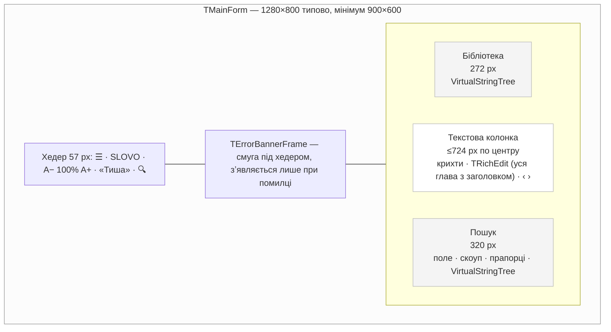
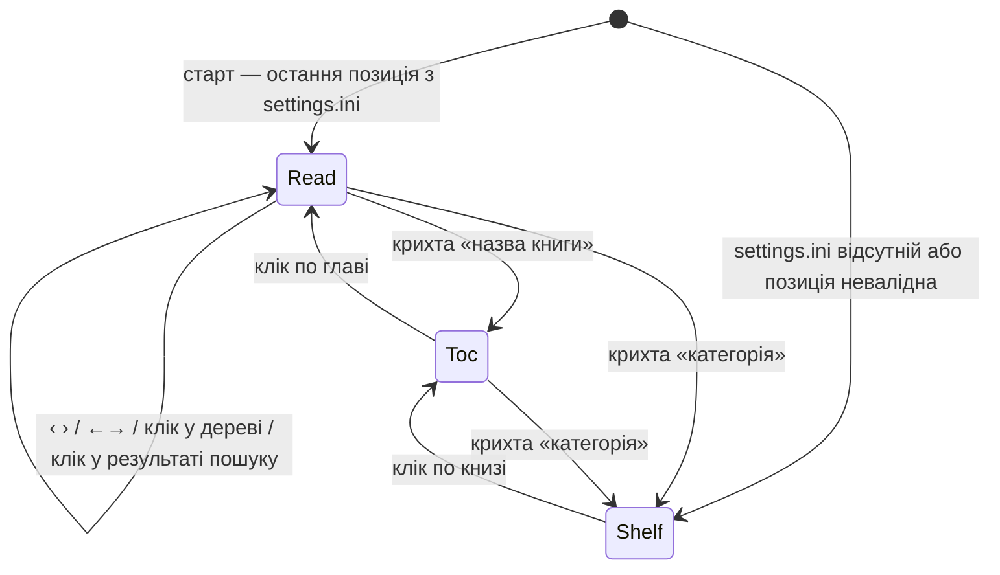
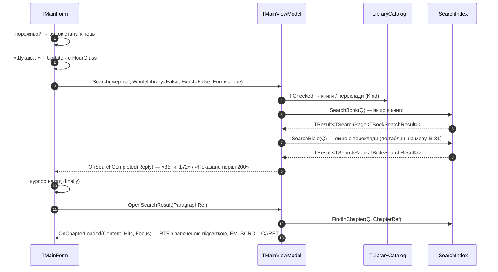

# Slovo — Архітектурний Огляд — View 4: Presentation / UI

> **Ревізія R4 — 2026-09-13.** Перша версія документа. Джерело істини для вигляду й поведінки — макет Vitalii у Claude Design: **«Slovo — Читання v2 (збережена точка)»** (`.dc.html`, 3 сторінки; standalone-копія з вбудованими шрифтами додана до проєкту). Цей документ не переказує макет — він фіксує, **чим** макет реалізується у VCL, **де** макет розходиться з View 1–3 і що з цього випливає для контрактів.
> Закриті входи з аудиту R3: R3-01 (контракт `TMainViewModel`/`IMainView`), R3-05 (`ISettings`, `settings.ini`), R3-25 (механіка локалізації форми), R3-21/R3-22 (цитати — частково: «копіювати з посиланням» у MVP, «перейти за посиланням» відкладено).
> **Нові рішення:** група **E** у реєстрі `Slovo_01` (E-01…E-17) і два рішення групи B, які макет змусив переглянути: **B-27** (`ModuleIds` — пошук у відмічених книгах) і **B-28** (`WordForms`).
>
> **Ревізія R5 — 2026-09-20 (спрощення архітектури для MVP, рішення Vitalii).** E-01: глава — один RTF-документ разом із заголовком, підсвітка запікається при генерації, неповний рендер → лог. E-16: старт — фаза 1 з двох (C-22). E-17: бюджети продуктивності прибрано. C.1 — під синхронний пошук (C-21) і каталог у пам'яті (B-29).
>
> **Ревізія R6 — 2026-10-30 (закриття аудиту R4, рішення Vitalii «спершу найпростіше, потім покращимо»).** RTF: маркер сторінки — на початку рядка, маркера посеред абзацу в MVP немає, штатний інтервал, фіксована таблиця кольорів, `\uc1` (R4-07…R4-09, R4-11, R4-16). Шрифти — лише EB Garamond (3 файли), UI — Segoe UI (R4-17). **Форми слова — Snowball усередині власної `sqlite3.dll`, два індекси** (B-28 переглянуто, B-31, View 2); тому **збіги в главі тепер дає FTS** (E-08 переглянуто), «Точна фраза» і «форми» незалежні, секція Біблії групується за перекладом. Полиця — список, як зміст; «Тиша» повертає хедер у потоці; Ctrl+C — як є; масштаб — індекс кроку; `Save` — при виході й зміні глави. Що відкладено — Частина F; статуси — `Slovo_Audit_R4_2026-09-14.md`.

Продовження [01 — Домен і контракти](Slovo_01_Domain_and_Contracts.md), [02 — Сховище](Slovo_02_Storage_SQLite_FTS5.md), [03 — Процеси й поставка](Slovo_03_Runtime_Threading_Deployment.md).

---

## Частина A. Що фіксує макет

Одне вікно, три зони, без діалогів. Усі розміри — у CSS-пікселях макета при 96 DPI; у VCL — через `ScaleValue` (E-14). **Макет лежить у репозиторії:** `design/slovo-reading-v2.standalone.html` — подивитися, `design/slovo-reading-v2.dc.html` — точні значення CSS (`design/README.md`).



### A.1. Токени дизайну

| Токен | Значення з макета | У VCL |
|---|---|---|
| Шрифт тексту | EB Garamond 400/600, italic 400 | `fonts\EBGaramond-Regular/Italic/Bold.ttf` — стандартна сім'я, `\b`/`\i` штатні (R6, R4-17); приватне завантаження (E-04); fallback `Georgia` |
| Шрифт UI | IBM Plex Sans 400/500/600 | **IBM Plex Sans у поставці** (перегляд R4-17, Vitalii, 2026-11-06): `fonts\IBMPlexSans-{Regular,Medium,SemiBold}.ttf`; GDI бачить ваги окремими сім'ями — `IBM Plex Sans`, `IBM Plex Sans Medm` (500), `IBM Plex Sans SmBld` (600), імена — змінні `UiFont*Name` у `Presentation.Theme`; немає файлів → Segoe UI / Segoe UI Semibold. **Розрідка капітелей** (`letter-spacing` .08–.14em) — `SetTextCharacterExtra` (`TTrackedLabel`, `SetTracking` у `Shell.FlatControls`) |
| Розмір тексту глави | база 20.5 px, крок 1.5, межі 15…30; міжряддя 1.72; відступ між абзацами 24 px | `EM_SETZOOM` над базовим RTF (E-11); міжряддя **1.72 як у макеті** — точна висота `\sl-529\slmult0`, епіграф 1.6 `\sl-456` (R4-08, Vitalii 2026-11-06; у R6 було штатне). Підсвітка `\highlight` тепер на всю висоту рядка; якщо заважатиме — власне малювання (Частина F) |
| Кольори | фон `#fcfcfc`, текст `#2f2f2f`, заголовок `#242424`, приглушений `#767676`/`#8a8a8a`, акцент `#3c6ea8`, hover-акцент `#2f5f95`, лінії `rgba(0,0,0,.09)` | константи в `Presentation.Theme` — єдине місце; таблиця кольорів RTF — C.4 |
| Підсвітка збігу | поточний `rgba(60,110,168,.26)`, інші `rgba(120,160,210,.18)` | непрозорі еквіваленти на `#fcfcfc`: `#CAD7E6` і `#E4EBF4` (R6, R4-09) |
| Маркер сторінки | `[71]` у лівому полі, IBM Plex Sans 10.5 px `#8a8a8a` | **у лівому полі** за рецептом R4-07 (Vitalii, 2026-11-06; у R6 був на початку рядка): `\f1\fs16\cf2`, правий край на 44 px, текст на 64 px (C.4); номер вірша — так само, `\fs19\cf3` |
| Паперова текстура | SVG-шум, opacity .28, вимикається | **не переносимо** — на RichEdit фон-шум неможливий без власного painter'а; `paperTexture` вважається `false` |

### A.2. Стани текстової колонки

Колонка має три стани, між якими ведуть крихти й дерево. Це стан **ViewModel**, не форми:



| Стан | Що показує | Джерело даних |
|---|---|---|
| **Shelf** — полиця | Заголовок категорії, «Книг у бібліотеці: N», **список книг** (R6, R4-38): рядок з двох ліній — назва; «73 розд. · читаю · розділ 3» для книг з позицією | каталог у пам'яті (B-29) + `[Positions]` із settings |
| **Toc** — зміст | Назва книги, «Зміст», список глав з номером у полі й міткою «читаю» | каталог: глави книги / для Біблії — `TBookInfo.ChapterCount` → номери глав |
| **Read** — читання | Крихти, документ глави (заголовок, «Розділ 3», епіграф, текст — один RTF, E-01), навігатор збігів, ‹ попередня / наступна › | `ILibrary.GetChapterContent` + збіги з `ISearchIndex.FindInChapter` (E-08) |

Shelf і Toc — **одна й та сама** `TVirtualStringTree` у режимі плаского списку (рядок 56 px, номер глави — у лівому полі; для полиці поле порожнє), спільний код малювання (R6, R4-38). Крихти: `КАТЕГОРІЯ / КНИГА / РОЗДІЛ 3 · НАЗВА`; для Біблії — `БІБЛІЯ · ОГІЄНКО / БУТТЯ / БУТТЯ 3`. Назва категорії — ключ локалізації (`category.spiritOfProphecy` → «Праці Е. Ґ. Вайт»); назва серії, книги, глави — з бази, мовою контенту (B-25).

### A.3. Ліва панель — дерево бібліотеки

Порядок вузлів — B-25: категорія → серії за `SeriesOrder` (книги за `SortOrder`) → решта книг за `Title`; Біблія — переклади за `Title` → книги за `OrderInModule`. Серія — третій рівень з тим самим стилем заголовка групи, але без лінії.

Рядок книги: карета ▸/▾ · чекбокс «Шукати в цій книзі» (B-27) · назва · крапка «зараз читаю» (лише коли вузол згорнутий) · лічильник «73 розд.» / «66 кн.» (E-09). Дочірні вузли — глави (`номер · назва`, активна — крапка); для книги Біблії — номери глав `1…ChapterCount`. **Усе дерево будується один раз з каталогу при старті** (R5, B-29). Клік по назві книги → стан **Toc** і розгортання вузла; клік по главі → **Read**.

**Чекбокси** (R6, R4-41) — лише на вузлах книг (`lnModule`) і перекладів (`lnBibleTranslation`); категорії й серії мають `CheckType = ctNone`, без каскаду й tri-state. Малюються **як у макеті** (рамка 14 px, квадрат 8 px кольору акценту в `OnAfterCellPaint`, клік — за зоною чекбокса, розміри через `ScaleValue`). Число в «Відмічені книги · N» **рахує форма** (R6, R4-42): при `OnLibraryChanged` — підрахунком відмічених вузлів, далі ±1 в обробнику кліку разом із `ViewModel.SetChecked`. **Активний вузол** (крапка «читаю») форма визначає сама за `ViewModel.Position` в обробниках завантаження глави й перемальовує `InvalidateNode` (R4-43) — у вузлі прапорця немає.

**Реалізація (Sprint 2, 2026-11-05).** `Vcl\Shell.LibraryTree` малює кожен рядок сам: `OnGetText = ''`, усе в `OnAfterCellPaint`, тож VST не міряє рядок ширшим за панель — довгі назви закінчуються «…» (`DT_END_ELLIPSIS`), горизонтальної прокрутки немає. Чекбокси — **не VST** (`toCheckSupport` вимкнено): стан у масиві обгортки, клік у зоні 24 px навколо рамки або пробіл перемикає. **Геометрія — макета, не VST** (2026-11-06): `Indent = 0`, кнопки й корінь VST вимкнено, x рахує `RowLeft`. Хост дає поля aside (18 зліва, 10 справа), низ — `BottomSpace` 40 px. Рядок книги 30 px + 2: трикутник ▸/▾ `#8a8a8a` у кнопці 24 px на x 2 (свій hover `rgba(0,0,0,.06)`; лише він розгортає — подвійний клік вимкнено), чекбокс у кнопці 24 px на x 30, назва на x 62 (книга Біблії без чекбокса — на x 34), праворуч лічильник, крапка «читаю» (коли згорнуто), відступи 4. Розділи — вкладений список: лінія `rgba(0,0,0,.08)` на x 26 від рядка книги, рядки з x 37, розділ 29 px + 1, номер у колонці 12 px праворуч, назва через 9 px, **номер і назва на одній базовій лінії**, крапка в кінці рядка; поля списку 2 зверху й 8 знизу додаються до висоти першого й останнього рядка. Книги Біблії вкладені в переклад так само, їхні розділи — на рівень глибше. Група — капітель 10.5 px вагою 600 з розрідкою .12em і лінією праворуч, 26 px перед групою (крім першої) і 8 після; серія — без лінії. Рамку, квадрат, крапку й трикутник малює GDI+ зі згладжуванням (`Shell.FlatControls`).

Панель ховається кнопкою ☰, у режимі «Тиша» і автоматично за правилами ширини (A.5).

### A.4. Права панель — пошук

Зверху вниз: поле «слово або фраза» (EB Garamond 19 px) · «Де шукати»: сегмент **Уся бібліотека | Відмічені книги · N** · прапорці **Точна фраза**, **Враховувати форми слова** · рядок стану · список результатів.

**Рядок стану — один над обома секціями** (R6, R4-76): «Збіги: 172», або «Показано перші 200», коли хоч одна сторінка `Truncated`; «Шукаю…» під час пошуку; порожнє поле (стерте або Enter без слова) **очищає видачу й рядок стану** (Vitalii, 2026-11-06; раніше було «введіть слово»); «відмітьте хоча б одну книгу» — скоуп «Відмічені книги» без відміток. Порожній запит і порожній скоуп — **не банер** і не `reInvalidQuery` (R6, R4-24): форма перевіряє їх сама до виклику `Search`.

**Прапорці незалежні** (R6, B-28): «Враховувати форми слова» вибирає індекс (стемований замість точного, B-31), «Точна фраза» — вигляд запиту (фраза чи окремі слова). Обидва разом — фраза з основ: «жертва Христа» знайде «жертвою Христовою».

Рядок результату — **фіксованої висоти** (R6, R4-37): реф (`Патріархи і пророки · Розділ 3 · 71.2` або `Буття 22:8`) і сніпет у два рядки з `…`, збіги в сніпеті напівжирні `#2f5f95` (позиції — `TSearchHighlight`). Список має **дві секції** — «Книги» і «Біблія» (B-27); секція Біблії **групується за перекладом** (R6, B-31), кожна група — у своєму порядку релевантності: ранги різних мовних таблиць непорівнювані. Перемикача «за порядком у книзі» в MVP немає (R6, R4-44). Клік → **Read** з підсвіткою збігів і прокруткою до абзацу (E-08).

Панель відкривається кнопкою 🔍 або клавішею `/` (фокус у поле); видимість — `[Ui] RightPanel` (E-06).

**Реалізація (Sprint 2, 2026-11-05).** Рядки видачі (реф, сніпет шматками між `Highlights`, групи перекладів, число для рядка стану) будує `Presentation.SearchResults` — без VCL, з тестами; малює `Vcl\Shell.SearchResults` (C.5). Скоуп — пігулка-сегмент `TScopeSwitch`, прапорці — квадратні `TFlatCheckBox` (`Vcl\Shell.FlatControls`, власні `TCustomControl`, розміри через `ScaleValue`); фокус з клавіатури: Tab, пробіл, ←/→ на пігулці. **Рамка фокусу — лише після клавіатури**: фокус, узятий кліком мишею, рамки не показує, доки не натиснуто клавішу (UI state вікна не використовується — з увімкненим «підкресленням клавіш доступу» Windows рамку не ховає). `/` ловиться за символом (`OnKeyPress`), тож працює в будь-якій розкладці. Зміна скоупу чи прапорців пошук не перезапускає — лише `Enter`. Скоуп і прапорці записуються в `settings.ini` одразу при зміні, а не лише разом із пошуком (2026-11-06).

**Навігатор збігів у главі (E-08)** — окремий нерухомий рядок **під крихтами, праворуч**, «›» врівень із правим краєм тексту (у макеті він є лише в даних, без місця на екрані; місце обрав Vitalii, 2026-11-06 — унизу було неочевидно; відступ крихти — текст лишається 44 px: 8 + рядок 28 + 8): `‹ «дети» · 3 з 5 у розділі ›` (рахує слова, E-08); поки поточного збігу немає (глава відкрита з дерева при активному пошуку) — `«дети» · у розділі: 3`. Видно лише коли в главі є збіги. ‹ › — те саме, що `Shift+F3` / `F3`. Новий пошук відкриту главу не перезавантажує, тож навігатор показує текст того запиту, з якого її підсвітка.

**Хедер (E-15) — реалізація (Sprint 2, 2026-11-05).** Створюється в коді: панель 57 px з лінією 1 px знизу, кнопки `TFlatButton` (`Shell.FlatControls`, 32 × 32, гліфи з SVG макета на GDI+, hover — заокруглення 7 px `rgba(0,0,0,.05)`) і два підписи. Розкладка — у `OnResize` хедера: зліва ☰ · SLOVO (розрідка `.14em` — волосяні пробіли U+200A), справа A− 100% A+ · «Тиша» · 🔍 · **⋯**. ☰ ховає/показує бібліотеку (`settings.ini`, `LeftPanel`), 🔍 — пошук, A−/A+ — ті самі дії, що `Ctrl+-`/`Ctrl+=`, на межах масштабу неактивні. Кнопки хедера фокус при кліку не беруть (читач його зберігає), з клавіатури — Tab, пробіл/Enter. **Рядка меню немає** (рішення Vitalii, 2026-11-05): його пункти — спливаюче меню з **⋯**, вирівняне по правому краю кнопки: «Звичайний розмір (Ctrl+0)», «Мова ›», «Діагностика SQLite…», «Вихід»; збільшення/зменшення й пошук — лише в хедері. Тимчасовий рядок стану прибрано: масштаб — у хедері, «Відмічені книги · N» — у пігулці пошуку. Пігулка «Тиша» стоїть на місці, але неактивна до кроку A.5.

### A.5. Режим «Тиша» і адаптивність

«Тиша» (кнопка-пігулка / `Esc` для виходу): хедер і обидві панелі ховаються, лишається лише текстова колонка (по центру, ≤724 px). Наведення миші на верхні 28 px вікна повертає хедер **на своє місце** — `Visible := True`, текст зсувається вниз на 57 px; хедер ховається, коли курсор опускається нижче за нього (R6, R4-36). Відстеження — `TApplicationEvents.OnMessage`, фільтр `WM_MOUSEMOVE` з переведенням у координати форми (над дочірніми контролами `TForm.OnMouseMove` не викликається). Перехід у Shelf/Toc, клік у дереві чи результаті скидає «Тишу»; ‹ › — ні. Стан — лише на сеанс: програма завжди відкривається без «Тиші».

Адаптивність за шириною вікна (R6, R4-39) — правила `TMainForm.Resize` і обробників кнопок, не ViewModel:

- **< 1180 px** — права панель ховається сама; відкриття однієї бічної панелі (☰, 🔍, `/`) закриває другу — показується та, що відкрита останньою;
- **< 780 px** — ліва панель ховається;
- перемикач «Відмічені книги» **відкриває ліву панель** (там чекбокси).

**Як у макеті** (рішення Vitalii, 2026-11-05): автоматичне ховання **тимчасове** — вибір користувача (☰ / 🔍, `settings.ini`, `LeftPanel`/`RightPanel`) воно не змінює, і щойно вікно ширше за поріг, панель повертається. Панель, відкрита кнопкою у вузькому вікні, лишається («forced»), доки вікно не стане ширшим за свій поріг. Пороги — у CSS-пікселях через `ScaleValue`, ширина — `ClientWidth`.

**Реалізація (Sprint 2, 2026-11-05).** Один метод `TMainForm.ApplyLayout` (виклик з `OnResize` форми, кнопок, «Тиші» й «підглядання») рахує видимість хедера й панелей зі стану: бажане (`FLeftWanted`/`FRightWanted`), «forced», хто відкритий останнім, `FSilence`, `FPeek`; фокус із контрола, що ховається, переходить у текст (`FocusReaderOrList`). «Тиша» — пігулка в хедері («Тиша» / «Вийти з тиші») або `Esc`; ☰ / 🔍 / `/` теж виходять із неї. Смуга 28 px — `SilencePeekStrip` (`Presentation.Theme`), `TApplicationEvents` створюється в коді.

Текстова колонка: `Min(864, доступна ширина)` — **ширше за макет** (724; Vitalii, 2026-11-06: текст ≈ 800 px; у макеті `max-width` 724 на широкому екрані лишає по боках ≈ 300 px), по центру (R6, R4-19); `EM_SETRECT` не використовується. **Поля — з CSS макета «Читання v2»** (звірено 2026-11-05, виправлено 2026-11-06): центральна зона має бічні поля `clamp(16px, 4vw, 56px)`; усередині колонка **724 px разом із лівим полем** `clamp(48px, 6vw, 64px)` (CSS `box-sizing: border-box` — текст 724 − поле), по центру; 44 px над крихтами й 44 px між крихтами та заголовком. `vw` — ширина вікна. Константи — `Presentation.Theme` (`TextColumnSide*`, `TextColumnLeft*`).

**Заголовок глави** — `clamp(30px, 4.6vw, 46px)`, як `h1` макета: RTF будується з 46 px, а `UpdateTitleSize` ставить розмір символам `0..TitleLen` (`EM_SETCHARFORMAT`, без перебудови, прокрутка зберігається) при зміні ширини вікна; заголовок полиці/змісту — так само. **Рядок видачі** — поля панелі 22 px, радіус 8, hover `rgba(0,0,0,.04)` і смужка акценту 2 px, що йде за заокругленням; проміжок 2 px, знизу 60 px (`BottomSpace`, ставиться в `Show`).

**Смуги прокрутки — як у макеті** (`::-webkit-scrollbar` 9 px; Vitalii, 2026-11-06): `TThinScrollBar` (`Shell.FlatControls`) — без стрілок і доріжки, заокруглений повзунок `rgba(0,0,0,.16)`, під мишею й при перетягуванні `.28`, клік по доріжці — сторінка. Три смуги на всю висоту зон, від хедера донизу: бібліотека (праворуч, перед лінією), центр (біля правого краю центральної зони, біля панелі пошуку; ціль — RichEdit або список полиці/змісту, перемикається в `ShowView`), пошук (праворуч). Власні смуги контролів працюють, але виходять за край свого хоста й обрізаються (`FitHidingScrollBar`); щоб ширина тексту не стрибала, вони ніколи не ховаються — `ES_DISABLENOSCROLL` (інтерпозер `TRichEdit` у `Shell.MainForm`) і `ScrollBarOptions.AlwaysVisible` у VST. RichEdit читається через `GetScrollInfo` і рухається `WM_VSCROLL SB_THUMBPOSITION` — ті самі одиниці, і для довгої глави, яку RichEdit масштабує до 16 біт (`EM_GETSCROLLPOS` 16-бітний); VST — `RangeY`/`OffsetY`. Коліщатко над полями центральної зони, крихтами чи нижньою смугою передається цілі (`TApplicationEvents.OnMessage`). Лінія під заголовком — 58 px (`U+2E3B` при 17 pt ≈ 56 px).

### A.6. Клавіатура

Через `TActionList` + `KeyPreview` (R6, R4-35):

| Клавіша | Дія | Де |
|---|---|---|
| `/` | відкрити пошук, фокус у поле | `ActiveControl <> SearchEdit` |
| `Enter` у полі пошуку | запустити пошук | поле |
| `Esc` | вийти з «Тиші»; інакше — зняти фокус з поля | скрізь |
| `←` / `→` | попередня / наступна глава (через межу книги Біблії — B-22) | стан Read, `ActiveControl` — не `SearchEdit` і не дерево (RichEdit — так) |
| `Ctrl+C` | копіювати виділене **як є, разом із `[71]`** (стандарт RichEdit, R6, R4-51); `Ctrl+Shift+C` — копіювати з посиланням (E-13) | текст |
| `Ctrl+=` / `Ctrl+-` / `Ctrl+0` | більший / менший / 100 %; `Ctrl+колесо` — те саме (перехоплено `WM_MOUSEWHEEL` з `MK_CONTROL`) | скрізь |
| `F3` / `Shift+F3` | наступний / попередній збіг у главі (те саме, що ‹ › навігатора) | стан Read з активним пошуком |

`Ctrl+=` — `ShortCut(VK_OEM_PLUS, [ssCtrl])` + `SecondaryShortCuts` для `VK_ADD`.

---

## Частина B. Рішення View 4

Перший стовпчик — ID з реєстру `Slovo_01`. Тут — повне обґрунтування; реєстр тримає один рядок.

| # | Рішення | Обґрунтування |
|---|---|---|
| E-01 | **Рендер глави — `TRichEdit` (RichEdit 4.1, `msftedit.dll`) з RTF, який будує `TChapterRtfBuilder`; уся глава — один документ разом із заголовком, «Розділ N», лінією й епіграфом** (R5); **R6 — найпростіший RTF:** маркер сторінки на початку рядка, маркера посеред абзацу немає, штатний інтервал | Макет потребує: заголовок, курсивний епіграф з відступами, маркери сторінок, два кольори підсвітки, вірші з номерами — усе це штатні можливості RTF. Виділення, копіювання, скрол, колесо, `Ctrl+C`, IME, DPI, читання з екрана — з коробки. **R5:** заголовок у RTF, щоб прокручувалась уся сторінка (R4-14); підсвітка запікається при генерації (R4-15); ліміт тексту знімається явно, неповний рендер → лог (C.4). **R6:** висячий відступ із табуляціями (маркер у полі) і вставка `[72]` посеред речення (`PageBreakOffset`) відкладено — позиція в тексті = `StartChar + Offset`, мапа без поправок (R4-07, R4-11); `PageBreakOffset` лишається в базі. Альтернативи відхилено: **власний painter** — власні виділення/копіювання/скрол; **WebView2** — рантайм поза папкою (D-02), перехоплення клавіатури й асинхронність; **THtmlViewer** — обмежений CSS; **TRichView** — платна залежність. Шлях на майбутнє: `TChapterHtmlBuilder` з тим самим входом |
| E-02 | **VirtualTreeView (`TVirtualStringTree`) для дерева бібліотеки, полиці/змісту й списку результатів** — єдина стороння залежність проєкту | Рядок дерева в макеті — карета + чекбокс + назва + крапка + лічильник; рядок результату — дворядковий з напівжирним фрагментом. На `TTreeView`/`TListBox` — той самий обсяг custom-draw, але без моделі даних VST. VST — MPL 1.1, компілюється у статичний EXE (D-01). Залежність живе лише в Shell |
| E-03 | **Три панелі в одному вікні; «Тиша» — стан форми, не ViewModel** | Що показано/сховано — справа `TMainForm` (панелі, `Resize`); ViewModel про панелі не знає. Стан панелей і геометрія — у `settings.ini` (E-06); «Тиша» — ні (A.5) |
| E-04 | **Шрифти йдуть у поставці: `fonts\EBGaramond-{Regular,Italic,Bold}.ttf` і (з 2026-11-06) `fonts\IBMPlexSans-{Regular,Medium,SemiBold}.ttf`, `AddFontResourceEx(FR_PRIVATE)` при старті** (R6; UI-шрифт переглянуто — A.1) | EB Garamond — SIL OFL 1.1. Три файли однієї сім'ї — GDI бачить «EB Garamond», `\b`/`\i` і `fsBold` працюють штатно, без окремих сімей Medium/SemiBold і без faux-bold (R4-17). IBM Plex Sans (SIL OFL 1.1, `fonts\IBMPlexSans-OFL.txt`) спершу не постачався (R6); Vitalii повернув його 2026-11-06 заради точності макета — немає файлів → Segoe UI, рядок у лог. **EB Garamond постачається без інструкцій хінтингу** (2026-11-06: ті самі контури, що в Google Fonts 1.003, але GDI за `ttfautohint`-інструкціями деформував круглі літери при 20 px — «р» не як у макеті; прибрано `fpgm`/`prep`/`cvt`/програми гліфів, `gasp` = згладжування без підгонки). `FR_PRIVATE` — шрифт видимий лише процесу (D-02); `RemoveFontResourceEx` **не викликається** — Windows знімає приватні шрифти при завершенні процесу, і вимоги «знімати після знищення форми» немає (💡-13). Файл відсутній або не завантажився → `Georgia`, банера немає, рядок у лог |
| E-05 | **Локалізація форми: усі підписи призначаються в коді після `Create` (`ApplyLocalization`), у `.dfm` — жодного літерала інтерфейсу** (R3-25) | Явний список «компонент ← ключ» в одному методі читається й перевіряється очима, не залежить від імен компонентів і покриває `Caption`, `Hint`, `TextHint`, заголовки VST-колонок, тексти станів. Рядки з даними — **ключі-шаблони** `L(key, [args])` (R6, R4-40, C.3). Зміна мови → повторний `ApplyLocalization` + перемалювання, без перезапуску. Перевіряється грепом по `.dfm` (`Caption =`, `Hint =`, `TextHint =`, `Text =`). Мова контенту — з бази |
| E-06 | **`ISettings` — порт у Core/Contracts; реалізація `Infra.Settings.IniSettings` над `data\settings.ini`; створюється коренем у фазі 0, одразу після логера** (R3-05) | ViewModel має знати останню позицію, скоуп пошуку й відмічені книги — і бути тестованим без файлів. INI читається людиною, `TMemIniFile` у RTL. Секції — C.2. **Запис — при виході й при кожній зміні глави** (R6, R4-27). Read-only папка → `Save` мовчки не пише, лог один раз |
| E-07 | **Позиція читання зберігається на кожну книгу** (`[Positions]`), не лише «остання книга/глава» | Рядок полиці показує «читаю · розділ 3» для кожної книги з позицією (розширення макета, де «читаю» лише в поточної). Остання відкрита книга — `[Reading] Last=`. Значення: `ChapterOrder` (книга) або `BookCode:ChapterNumber` (Біблія) — **двокрапка означає Біблію** (R6, R4-28). Прокрутка всередині глави не зберігається (YAGNI) |
| E-08 | **Збіги в главі (підсвітка, «1 з 3 у розділі», ‹ ›, F3) дає той самий FTS-індекс, що й пошук** — `ISearchIndex.FindInChapter` / `FindInBibleChapter` з `highlight()` по абзацах відкритої глави (переглянуто R6) | До R6 Presentation шукав терміни в `Paragraphs[].Text` сам, наближаючи `unicode61`. Зі стемованим режимом (B-31) так не можна: Delphi не знає основ слів. Тепер одне джерело істини для обох режимів — точна відповідність видачі, жодної емуляції токенізатора в Delphi. ViewModel при відкритті глави з активним пошуком робить один запит (`MATCH` + абзаци цієї глави, View 2) і передає збіги в подію завантаження (C.1). **Одиниця навігації — слово** (переглянуто 2026-11-05, рішення Vitalii: при абзацах «2 з 3» не сходилося з п'ятьма підсвіченими словами): «3 з 5» рахує підсвічені слова глави в порядку документа; поточне слово — кольором «поточний», решта — «інші». ViewModel і далі називає поточний **абзац** (`Args.Focus` — клік по результату, `LogicalIndex` відомий); форма робить з нього перше слово цього абзацу (`TChapterRtf.HitFirstMatch`), прокрутка `EM_SCROLLCARET` до `MatchStarts[Focus]` |
| E-09 | **Лічильник у дереві — `TModule.ChildCount`, обчислений, у базі колонки немає** (R6: перейменовано з `ChapterCount`, R4-46) | Макет показує «73 розд.» біля кожної книги. Колонку в базі відхилено; з R5 число рахує `TLibraryCatalog` з уже прочитаних `Chapters`/`Books` — безкоштовно й ніколи не розійдеться з фактом. `ChildCount` = глав для книги, книг для перекладу («66 кн.») — назва чесна для обох видів, на відміну від `TBookInfo.ChapterCount` (справжні глави книги Біблії) |
| E-10 | **Епіграф у MVP рендериться одним блоком — `pkEpigraph.Text` як є**, окремого рядка-посилання під ним немає (підтверджено Vitalii) | Макет виносить посилання «БУТТЯ 3:4–5» під епіграф окремим рядком. У домені `pkEpigraph` — один текст. Розділити — обов'язок виробника (`Slovo_Import_Deferred.md`, IMP-6); Presentation готовий: якщо з'явиться `pkEpigraphReference`, він піде окремим стилем |
| E-11 | **Масштаб тексту — `EM_SETZOOM` над одним базовим RTF; зберігається індекс кроку** (R6, R4-20) | Крок 1.5 px від 20.5, межі 15…30 px → індекс −4…+6. `px := 20.5 + 1.5 × Step`; `EM_SETZOOM(Round(px × 10), 205)`; підпис `Round(px / 20.5 × 100)` %. Відсоток як число губив драбину кроків при округленні. `Ctrl+колесо` перехоплено, щоб власний зум msftedit не розійшовся зі збереженим |
| E-12 | **Кількість результатів: точне число, коли жодна сторінка не `Truncated`; «Показано перші 200» — інакше** — окремого `COUNT(*)` немає | Точна кількість понад ліміт вимагала б другого FTS-запиту без `LIMIT` — саме того, від чого захищає B-19. Один рядок над обома секціями (R4-76). Без множини (R3-25): «Збіги: 172» |
| E-13 | **«Копіювати з посиланням» — у MVP; «перейти за посиланням» — post-MVP** (R3-21/R3-22) | Контекстне меню тексту: *Копіювати* (= `Ctrl+C`, як є), *Копіювати з посиланням* (`Ctrl+Shift+C`). Текст — виділене **без маркерів** (вирізаються за мапою `Paragraphs`); посилання — **першого абзацу виділення** (R6, R4-51): `«…текст…» — Патріархи і пророки, 71.2` (книга з нумерацією сторінок), `— Патріархи і пророки, розділ 3` (без неї), `— Буття 3:4 (Огієнко)` (Біблія). Абзац, що перетинає межу сторінки, цитується за сторінкою, де починається. Абревіатури (`PP 71.2`) — post-MVP разом із `ResolveCitation` |
| E-14 | **DPI: `PerMonitorV2`, усі розміри макета — у 96-DPI пікселях через `ScaleValue`; RichEdit масштабує сам** | Константи розмірів — в одному місці `Presentation.Theme` |
| E-15 | **Помилка під час роботи — `TErrorBannerFrame` смугою під хедером** (C-10) | Смуга 36 px, фон `#fff4e5`, текст `#5c4b1e`, кнопка ✕, авто-приховування через 6 с. Тексти — `error.<code>` (C.3). Помилки старту — `MessageBox` у фазі 0 (C-22). Порожній запит і порожній скоуп — рядок стану, не банер (A.4) |
| E-16 | **Порядок старту UI (фаза 1, C-22): дерево будується з каталогу, позиція відновлюється з settings, вікно з'являється вже наповненим** | Каталог прочитано у фазі 0 (B-29), тож дерево — робота в пам'яті, з бази лишається один запит глави. Усе синхронно в UI-потоці (C-21). Невалідна позиція або `roError` при відновленні → стан **Shelf** (категорія `bcSpiritOfProphecy`) мовчки, рядок у лог, без банера (R4-29) |
| E-17 | **Бюджети продуктивності в MVP не ведуться** (R5): без замірів, спайків і `TStopwatch` | Перевірити числа можна лише на реальній `library.db`. Контроль, що лишився, — функціональний: розбіжність `ExpectedChars` → лог (E-01) |
| B-27 | **`TSearchQuery.ModuleIds: TArray<TModuleId>`**; порожній масив = уся бібліотека; ViewModel виконує `SearchBook` і `SearchBible` послідовно, синхронно (C-21); **видача — дві секції, не злиття за рангом** | Макет: «Відмічені книги · N» — чекбокси дають довільну множину модулів обох видів → `AND ModuleId IN (…)`. Якщо після фільтрації за `Kind` список порожній — виклику немає, секція порожня (R4-01). `bm25` між таблицями книг і віршів непорівнюваний — секції чесніші за злиття. Перевірки виду модуля в SQL немає: ViewModel розкладає скоуп через каталог, чужий модуль дав би 0 рядків (R6, R4-23) |
| B-28 | **`TSearchQuery.WordForms: Boolean` вибирає індекс: `False` — точні слова (`unicode61`), `True` — стемовані таблиці Snowball** (переглянуто R6; до R6 — префікс `"жертв"*`) | Макет має прапорець «Враховувати форми слова». Vitalii обрав справжні форми одразу в MVP: Snowball-токенізатор у власній `sqlite3.dll` (B-31, View 2) — SQLite сам зводить форми і в індексі, і в запиті, у Delphi мовного коду немає. Точний індекс лишається, щоб пошук без галочки знаходив саме ту форму, що введено. З `ExactPhrase` **незалежний**: галочка форм — таблиця, точна фраза — вигляд `MATCH` |

---

## Частина C. Контракти Presentation

### C.1. `TMainViewModel` та `IMainView` (закриває R3-01)

Правило потоків (R5, C-21): **усе в UI-потоці, події фаяться напряму**. ViewModel не знає про VCL, RTF, VST — лише про домен і порти; усе нижче компілюється без `Vcl.*` у `uses` і тестується без форми.

```pascal
unit Presentation.MainViewModel;

interface

uses
  System.SysUtils, System.Generics.Collections,
  Core.Domain, Core.Contracts, Core.Events;

type
  // Стан текстової колонки (A.2).
  TReaderView = (rvShelf, rvToc, rvRead);

  // Вузол дерева бібліотеки. Дерево будується ОДИН раз з каталогу (B-29) і
  // віддається плоским масивом у порядку показу — батько завжди раніше за дітей,
  // Parent — його індекс у цьому ж масиві (запис не може містити TArray самого
  // себе, E2086). Підписи, що залежать від мови, форма складає з CaptionKey/Count
  // (R4-12). Активний вузол форма визначає сама за Position (R4-43).
  TLibraryNodeKind = (lnCategory, lnSeries, lnBibleTranslation, lnModule, lnBibleBook, lnChapter);

  TLibraryNode = record
    Kind: TLibraryNodeKind;
    Parent: Integer;              // індекс батька в масиві; −1 — корінь
    CaptionKey: string;           // lnCategory: 'category.spiritOfProphecy', 'category.bible'…; інакше ''
    Caption: string;              // серія/переклад/книга/глава — з бази, мовою контенту (B-25)
    ModuleId: TModuleId;          // lnBibleTranslation/lnModule/lnBibleBook/lnChapter
    BookCode: TBookCode;          // lnBibleBook і глави Біблії
    ChapterOrder: Integer;        // lnChapter: ChapterOrder книги або ChapterNumber Біблії
    Count: Integer;               // E-09: TModule.ChildCount або TBookInfo.ChapterCount; 0 — без лічильника
    Checked: Boolean;             // лише lnModule/lnBibleTranslation (R4-41)
  end;

  // Один запуск пошуку повертає дві сторінки (B-27); порожня секція — порожній Items.
  // Bible.Items — групами перекладів (B-31): форма показує підвузол на кожен ModuleId.
  TSearchReply = record
    Books: TSearchPage<TBookSearchResult>;
    Bible: TSearchPage<TBibleSearchResult>;
    Query: TSearchQuery;
  end;

  // Глава відкрита (R6: R4-26, E-08). Hits — збіги активного пошуку в цій главі
  // (порожньо, якщо пошуку немає); Focus — індекс у Hits поточного абзацу, −1 — немає.
  TChapterLoadedArgs = record
    Content: TChapterContent;
    Hits: TArray<TParagraphHit>;
    Focus: Integer;
  end;

  TBibleChapterLoadedArgs = record
    Content: TBibleChapterContent;
    BookTitle: string;
    Hits: TArray<TVerseHit>;
    Focus: Integer;
  end;

  TMainViewModel = class
  private
    FLibrary: ILibrary;
    FCatalog: TLibraryCatalog;                        // B-29; володіє корінь, тут лише читання
    FSearchIndex: ISearchIndex;
    FSettings: ISettings;
    FLogger: ILogger;

    FView: TReaderView;
    FPosition: TReadingPosition;                      // Core.Domain (Slovo_01)
    FChecked: TList<TModuleId>;                       // відмічені для пошуку (B-27), лише наявні в каталозі
    FActiveQuery: TSearchQuery;                       // останній виконаний пошук (E-08)
    FHasActiveQuery: Boolean;

    FOnLibraryChanged: TEvent<TArray<TLibraryNode>>;
    FOnViewChanged: TEvent<TReaderView>;
    FOnChapterLoaded: TEvent<TChapterLoadedArgs>;
    FOnBibleChapterLoaded: TEvent<TBibleChapterLoadedArgs>;
    FOnSearchCompleted: TEvent<TSearchReply>;
    FOnErrorOccurred: TEvent<TResultError>;           // єдина подія помилки (C-10)
  public
    constructor Create(const ALibrary: ILibrary; ACatalog: TLibraryCatalog;
      const ASearchIndex: ISearchIndex; const ASettings: ISettings; const ALogger: ILogger);
    destructor Destroy; override;

    // ---- Фаза 1 старту (C-22) ----
    procedure Start;                                  // дерево з каталогу → Checked без зниклих → позиція або Shelf (E-16)

    // ---- Навігація (синхронно) ----
    procedure ShowShelf(Category: TBookCategory); overload;
    procedure ShowShelf(const TranslationId: TModuleId); overload;
    procedure ShowToc(const ModuleId: TModuleId); overload;
    procedure ShowToc(const Book: TBookRef); overload;
    procedure OpenChapter(const Ref: TChapterRef); overload;      // + FindInChapter, якщо є активний пошук; + Save (R4-27)
    procedure OpenChapter(const Ref: TBibleChapterRef); overload;
    procedure NextChapter;                            // TLibraryCatalog.Neighbour: через межу книги Біблії (B-22),
    procedure PreviousChapter;                        // але не через межу модуля — там ‹ › неактивні

    // ---- Пошук (B-27, B-28, B-31; синхронно — C-21) ----
    procedure SetChecked(const ModuleId: TModuleId; Value: Boolean);
    procedure Search(const Text: string; WholeLibrary, ExactPhrase, WordForms: Boolean);
    procedure OpenSearchResult(const Ref: TParagraphRef); overload;   // → OpenChapter, Focus = цей абзац
    procedure OpenSearchResult(const Ref: TVerseRef); overload;

    // ---- Довідка для форми — усе з каталогу, для будь-якого модуля ----
    function ModuleTitle(const ModuleId: TModuleId): string;
    function ChapterTitle(const Ref: TChapterRef): string;           // B-20
    function BookTitle(const Ref: TBookRef): string;
    function BuildCitation(const Ref: TParagraphRef; const PageNumber, ParagraphOnPage: Integer): string; overload;  // E-13
    function BuildCitation(const Ref: TVerseRef): string; overload;

    // ---- Діагностика (View 3, A.6/A.7) ----
    procedure ReportRenderProblem(const Msg: string);  // неповний рендер глави → лог, без банера (E-01)
    procedure ReportUnexpected(const Msg: string);     // Application.OnException → лог + OnErrorOccurred(reUnexpected)

    property View: TReaderView read FView;
    property Position: TReadingPosition read FPosition;
    property ActiveQuery: TSearchQuery read FActiveQuery;
    property HasActiveQuery: Boolean read FHasActiveQuery;
    property Catalog: TLibraryCatalog read FCatalog;   // Toc, крихти, доступність ‹ › — лише читання

    property OnLibraryChanged: TEvent<TArray<TLibraryNode>> read FOnLibraryChanged;
    property OnViewChanged: TEvent<TReaderView> read FOnViewChanged;
    property OnChapterLoaded: TEvent<TChapterLoadedArgs> read FOnChapterLoaded;
    property OnBibleChapterLoaded: TEvent<TBibleChapterLoadedArgs> read FOnBibleChapterLoaded;
    property OnSearchCompleted: TEvent<TSearchReply> read FOnSearchCompleted;
    property OnErrorOccurred: TEvent<TResultError> read FOnErrorOccurred;
  end;
```

```pascal
unit Presentation.Views;

interface

uses Core.Contracts, Presentation.MainViewModel, Presentation.Theme;

type
  // Єдиний інтерфейс, через який композиційний корінь торкається форми (C-14).
  IMainView = interface
    ['{5E2C8A1B-3F6D-4C0E-9A7B-1D2E3F4A5B6C}']
    // Settings і Theme — параметрами (R5): форма читає й пише геометрію, панелі,
    // масштаб; Theme — реальне ім'я шрифту тексту після фази 0.
    procedure Bind(ViewModel: TMainViewModel; const Settings: ISettings; const Theme: TReaderTheme);
    procedure Unbind;             // відписка від подій + геометрія й панелі → Settings.Save
  end;
```

**Що робить `Bind`.** Підписує обробники форми на шість подій ViewModel; ставить `Application.OnException` → `ViewModel.ReportUnexpected`; викликає `ApplyLocalization` (E-05); читає з `ISettings` геометрію вікна (обрізану до робочої області наявного монітора), стан панелей, крок масштабу; і аж тоді викликає `ViewModel.Start`. Вікно з'являється на `Application.Run` уже наповненим (E-16). `Unbind` знімає підписки й пише геометрію в `ISettings.Save`.

**Що робить `Start`** (фаза 1, C-22). Будує вузли з каталогу за B-25 і фаїть `OnLibraryChanged`; бере `Checked` із settings, відкидаючи модулі, яких у каталозі вже немає (R4-29); відновлює позицію: `[Reading] Last` → `FCatalog.IsValid` → `OpenChapter`. Невалідна позиція або `roError` від `GetChapterContent` на старті → стан **Shelf** мовчки і рядок у лог.

**`OpenChapter`.** `GetChapterContent` → якщо `FHasActiveQuery`: `FSearchIndex.FindInChapter(FActiveQuery, Ref)` (помилка тут не зриває показ глави — лише лог, глава без підсвітки) → `FPosition`, `SetPosition`/`SetLastPosition`, `FSettings.Save` (R4-27) → `FOnChapterLoaded.Fire(Args)`. Навігатор (F3, ‹ ›) — справа форми над `Args.Hits`; перехід до наступного збігу = перегенерація RTF з новим `Focus` (E-01).

**Що НЕ входить у ViewModel.** Панелі, «Тиша», масштаб, гарячі клавіші, RTF, контекстне меню, курсор очікування, лічильник відмічених (A.3), порожній запит/скоуп (A.4) — усе це форма.

**Пошук — послідовність (доповнює View 3, A.5).**

```pascal
procedure TMainForm.RunSearch;
begin
  if Trim(StringReplace(SearchEdit.Text, #$00A0, ' ', [rfReplaceAll])) = '' then
    Exit(ShowSearchStatus(L('search.enterWord')));          // R4-24: рядок стану, не банер
  if not FWholeLibrary and (FCheckedCount = 0) then
    Exit(ShowSearchStatus(L('search.checkSome')));
  ShowSearchStatus(L('search.busy'));
  SearchStatusLabel.Update;              // синхронний WM_PAINT; НЕ Application.ProcessMessages
  Screen.Cursor := crHourGlass;
  try
    FViewModel.Search(SearchEdit.Text, FWholeLibrary, FExactPhrase, FWordForms);
  finally
    Screen.Cursor := crDefault;
  end;
end;
```

`Search` синхронно збирає `TSearchQuery` і розкладає скоуп за видом через каталог: «Уся бібліотека» → `ModuleIds = []` для обох викликів; відмічені → окремо книги й переклади; **порожній список виду → виклику немає, секція порожня** (R4-01). Порожній текст чи скоуп ViewModel теж відкидає (`Exit` без події) — захист для тестів, у формі цей шлях не досягається. `SearchBook`, потім `SearchBible` — на спільній конекції (C-21). Якщо перший повернув `roError`, другий не виконується і фаїться `FOnErrorOccurred` (`reInvalidQuery` тепер означає лише FTS-синтаксис). Успіх → `FActiveQuery := Query`, `FOnSearchCompleted.Fire(Reply)`.



### C.2. `ISettings` і `data\settings.ini` (закриває R3-05)

`TReadingPosition` оголошено в `Slovo_01` (Domain, §Спільне) — на нього посилається порт.

```pascal
// Core/Contracts. Порт — щоб ViewModel тестувався без файлів. Значення типізовані:
// ViewModel не парсить рядки INI і не знає, що це INI.
ISettings = interface
  ['{9B4F2E7A-6C1D-4E8B-A3F5-7D0C1B2A3E4F}']
  // [Ui]
  function GetLanguage: string;                 // 'uk' | 'ru' | 'en'; дефолт 'uk' (R3-25, без автовизначення)
  procedure SetLanguage(const Value: string);
  function GetZoomStep: Integer;                // R6 (E-11): −4…+6, 0 = 20.5 px; поза межами → clamp
  procedure SetZoomStep(Value: Integer);
  function GetLeftPanelVisible: Boolean;  procedure SetLeftPanelVisible(Value: Boolean);
  function GetRightPanelVisible: Boolean; procedure SetRightPanelVisible(Value: Boolean);
  // [Window]
  function GetWindowBounds(out Bounds: TRect; out Maximized: Boolean): Boolean;   // False = ще не збережено
  procedure SetWindowBounds(const Bounds: TRect; Maximized: Boolean);
  // [Reading] + [Positions] (E-07)
  function GetLastPosition(out Position: TReadingPosition): Boolean;
  procedure SetLastPosition(const Position: TReadingPosition);   // R6: пише Last І рядок [Positions]
  function GetPosition(const ModuleId: TModuleId; out Position: TReadingPosition): Boolean;
  procedure SetPosition(const Position: TReadingPosition);
  // [Search] (B-27, B-28)
  function GetCheckedModules: TArray<TModuleId>;  procedure SetCheckedModules(const Value: TArray<TModuleId>);
  function GetSearchWholeLibrary: Boolean;        procedure SetSearchWholeLibrary(Value: Boolean);
  function GetExactPhrase: Boolean;               procedure SetExactPhrase(Value: Boolean);
  function GetWordForms: Boolean;                 procedure SetWordForms(Value: Boolean);

  procedure Save;                                // ніколи не кидає: read-only папка → лог один раз (D-04)
end;
```

```ini
; data\settings.ini — створюється при першому Save. Відсутній файл = усі дефолти.
; Коментарі — ЛИШЕ окремими рядками: TMemIniFile не обрізає інлайнові «;».
[Ui]
Language=uk
ZoomStep=0
LeftPanel=1
RightPanel=1

[Window]
Left=120
Top=80
Width=1280
Height=800
Maximized=0

; ModuleId останньої відкритої книги або перекладу
[Reading]
Last=PP

; E-07: позиція на кожен модуль. Двокрапка у значенні = Біблія (BookCode:ChapterNumber),
; інакше — ChapterOrder книги
[Positions]
PP=3
GC=12
ohienko-uk=GEN:3

[Search]
WholeLibrary=1
Checked=PP,GC,ohienko-uk
ExactPhrase=0
WordForms=1
```

Реалізація: `Infra.Settings.IniSettings` над `TMemIniFile` (`TEncoding.UTF8`), читання в конструкторі, значення обрізаються `Trim`. **Запис — лише `Save`, який викликають двоє** (R6, R4-27): `ViewModel.OpenChapter` (позиція — найцінніше, не втрачається при краху) і `IMainView.Unbind` (геометрія, панелі, зум, скоуп). Решта `Set*` лише змінює пам'ять і потрапляє у файл при найближчому `Save`; крах до нього втрачає ці дрібниці — прийнятно. `Save` загорнутий у `try/except` з одним рядком у лог (`EFCreateError` у read-only папці). Розбір `[Positions]` (R4-28): вид береться з двокрапки, `ModuleId` — з ключа; невідомий `ModuleId` ігнорується. Дефолт `WholeLibrary=1`. Інваріант для `ModuleId` (B-30, `Slovo_01`): без `=`, `,`, `:`, не починається з `;`/`[`.

**Кілька екземплярів програми (C-23).** Якщо два вікна читають різні книги, після закриття обох у файлі лишиться стан того, що закрилось пізніше: **виграє останній збережений**.

### C.3. Локалізація форми (закриває R3-25)

Механіка — рішення E-05. Рядки з даними — **шаблони `Format`** (R6, R4-40): `L(key)` для простих підписів, `L(key, [args])` для фраз із числами — порядок слів визначає перекладач, не код.

```ini
; lang\uk.lang — фрагмент. Правило: ключ = <зона>.<елемент>[.<стан>]
app.title = Slovo
header.library = Бібліотека
header.smaller = Менший текст
header.bigger = Більший текст
header.silence = Тиша
header.silence.exit = Вийти з тиші
header.silence.hint = Сховати все, крім тексту (Esc повертає)
header.search = Пошук ( / )
menu.view.zoomReset = Звичайний розмір
library.title = Бібліотека
library.checkHint = Шукати в цій книзі
library.chapters = %d розд.
library.bibleChapters = %d гл.
library.bibleBooks = %d кн.
category.spiritOfProphecy = Праці Е. Ґ. Вайт
category.history = Історія
category.spiritualLife = Духовне життя
category.prophecyStudy = Дослідження пророцтв
category.dailyReadings = Щоденні читання
category.bible = Біблія
shelf.booksCount = Книг у бібліотеці: %d
shelf.reading = читаю · розділ %d
toc.title = Зміст
toc.reading = читаю
read.chapter = Розділ %d
read.hitNav = «%s» · %d з %d у розділі
read.prevHit = Попередній збіг
read.nextHit = Наступний збіг
read.prevChapter = Попередній розділ
read.nextChapter = Наступний розділ
search.title = Пошук
search.placeholder = слово або фраза
search.where = Де шукати
search.scope.all = Уся бібліотека
search.scope.checked = Відмічені книги · %d
search.exactPhrase = Точна фраза
search.wordForms = Враховувати форми слова
search.wordForms.hint = Знаходить інші форми слова: «жертва» → «жертви», «жертвою»
search.enterWord = введіть слово
search.checkSome = відмітьте хоча б одну книгу
search.busy = Шукаю…
search.hits = Збіги: %d
search.truncated = Показано перші %d
search.section.books = Книги
search.section.bible = Біблія
copy.plain = Копіювати
copy.withReference = Копіювати з посиланням
error.notFound = Главу не знайдено
error.moduleCorrupted = Файл бібліотеки пошкоджено
error.ioFailure = Диск або файл недоступні
error.invalidQuery = Запит не вдалося розібрати — спробуйте без спецсимволів
error.unsupportedModule = Ця операція не підходить для вибраної книги
error.unsupportedSchema = Бібліотеку створено новішою версією програми
error.unexpected = Щось пішло не так — подробиці в data\slovo.log
; Повідомлення фази 0 старту (C-22) — MessageBox до появи вікна, не банер
startup.noSqlite = Не знайдено sqlite3.dll. Розпакуйте архів програми повністю в окрему папку й запустіть Slovo.exe звідти.
startup.wrongSqlite = Файл sqlite3.dll не підходить до цієї версії Slovo. Розпакуйте архів програми повністю заново.
startup.noLibrary = Не знайдено бібліотеку library.db. Розпакуйте архів програми повністю в окрему папку й запустіть Slovo.exe звідти.
startup.libraryCorrupted = Файл бібліотеки пошкоджено. Замініть library.db.
startup.unsupportedSchema = Бібліотеку створено новішою версією програми. Оновіть Slovo.
startup.readOnlyFolder = Папку програми захищено від запису — налаштування й лог не зберігатимуться
startup.unexpected = Не вдалося запустити програму. Подробиці — у data\slovo.log
```

`ApplyLocalization` у `TMainForm` — один метод присвоєнь `X.Caption := L('key')`; VST-колонки й тексти станів — там само. Мова — пункт меню **⋯** з трьома фіксованими значеннями (R3-25), зміна → `ISettings.SetLanguage` + `ApplyLocalization` + `Invalidate` дерева й видачі. **Перебудовувати дерево не потрібно** (R4-12): вузол несе `CaptionKey` і `Count`, підписи форма складає в `OnGetText`. Множини (`.one/.few/.many`) — поза MVP: формулювання їх уникають («Збіги: 5», «73 розд.»).

### C.4. `TChapterRtfBuilder` — рендер глави (E-01)

Presentation-клас без стану: вміст глави + тема + збіги → RTF-рядок, мапа абзаців, позиції збігів і `ExpectedChars`. **Уся глава — один документ** разом із заголовком, «Розділ N», лінією й епіграфом; поза ним лишаються крихти, навігатор збігів і смуга ‹ ›. **Підсвітка запікається при генерації**: зміна запиту чи поточного збігу → `Build` заново → `EM_STREAMIN` → прокрутка до збігу (`EM_EXSETSEL` + `EM_SCROLLCARET`). Масштаб — `EM_SETZOOM` над тим самим документом (E-11).

```pascal
type
  // Presentation.Theme. Кольори й розміри — константи (A.1). У записі — лише те,
  // що стає відомим на старті (E-04).
  TReaderTheme = record
    TextFont: string;            // 'EB Garamond' або fallback 'Georgia'
    UiFont: string;              // 'Segoe UI' (R6)
  end;

  TParagraphRange = record       // мапа для «Копіювати з посиланням» (E-13)
    LogicalIndex: Integer;       // для Біблії — VerseNumber
    StartChar, Len: Integer;     // текст абзацу в координатах RichEdit — ПІСЛЯ маркера; Len = Length(Text)
    MarkerLen: Integer;          // довжина префікса «⇥[71]⇥» / «⇥8⇥» перед StartChar; 0 — без маркера
    PageNumber, ParagraphOnPage: Integer;
  end;

  THighlightRequest = record     // що підсвітити (E-08) — готові збіги з FTS
    Hits: TArray<TParagraphHit>;
    Focus: Integer;              // номер поточного СЛОВА серед усіх збігів глави в порядку документа; −1 — немає
    class function None: THighlightRequest; static;
  end;

  TVerseHighlightRequest = record  // для Біблії — той самий принцип
    Hits: TArray<TVerseHit>;
    Focus: Integer;
    class function None: TVerseHighlightRequest; static;
  end;

  TChapterRtf = record
    Rtf: string;
    ExpectedChars: Integer;      // видимі символи: текст, маркери, по 1 на кожен \par
    Paragraphs: TArray<TParagraphRange>;
    HitStarts: TArray<Integer>;  // позиція першого збігу кожного Hits[i]; −1 — не в цій главі
    MatchStarts: TArray<Integer>;   // позиція кожного підсвіченого слова, порядок документа — навігатор і прокрутка
    HitFirstMatch: TArray<Integer>; // для Hits[i] — номер його першого слова в MatchStarts; −1 — немає
    Where: string;               // 'PP:3' / 'ohienko-uk:GEN:3' — для рядка логу
  end;

  TChapterRtfBuilder = class
  public
    // ChapterLabel — уже локалізоване «Розділ N»: форма передає L('read.chapter', [N]),
    // тож білдер не залежить від глобального локалізатора й лишається без стану.
    class function Build(const Chapter: TChapterContent; const ChapterLabel: string;
      const Theme: TReaderTheme; const Highlight: THighlightRequest): TChapterRtf; overload;
    class function Build(const Chapter: TBibleChapterContent; const BookTitle, ChapterLabel: string;
      const Theme: TReaderTheme; const Highlight: TVerseHighlightRequest): TChapterRtf; overload;
  end;
```

**Мапа символів (R6, R4-11).** Маркера посеред абзацу немає, тож позиція збігу в RichEdit = `StartChar + Offset` без поправок. `Text` перед записом у RTF проходить одну заміну, що **зберігає довжину**: CR, LF і TAB → пробіл; `\`, `{`, `}` екрануються (на кількість символів у контролі не впливає). Префікс маркера — до `StartChar`, тому він ніколи не потрапляє в підсвітку й легко вирізається для «Копіювати з посиланням».

**Абзаци розділяються `\par`, після останнього його немає**: RichEdit тримає власну кінцеву позначку абзацу й не рахує її, тож `ExpectedChars` = текст + маркери + кількість роздільників.

**Відступи між абзацами — порожні абзаци-розпірки, не `\sa`/`\sb`** (Sprint 2, 2026-11-05, рішення Vitalii). RichEdit додає відступ після абзацу до висоти його останнього рядка, а `\highlight` заливає весь рядок — збіг у кінці абзацу діставав плашку, що сягала в проміжок (видно на Windows 11). Тепер стилі не мають `\sa`/`\sb`; між двома абзацами `TRtfWriter` ставить порожній абзац `\pard\plain\sl-N\slmult0\fs2` точної висоти N = «після» попереднього + «перед» наступним (те саме, що давали `\sa` + `\sb`). Тексту в розпірці немає — підсвічувати нічого. Ціна: ще один `\par` (1 символ) на проміжок — `TRtfWriter` рахує його, як і решту, тож мапа й `ExpectedChars` не розходяться; `Ctrl+C` копіює абзаци через порожній рядок. Розпірка ніколи не остання — останній абзац глави завжди з текстом. Кожен абзац починається з `\pard\plain` — курсив епіграфа чи жирний підзаголовок не перетікають у наступний абзац. Заголовок береться з першого абзацу `pkChapterTitle` (він же входить у мапу й може мати збіги), а якщо такого немає — з `TChapterContent.Title` (тоді в мапі його немає). Підсвітки чистяться перед записом: поза текстом — обрізаються, порожні й ті, що перекриваються, — відкидаються. Перевірка — у двох місцях: `Presentation.ChapterRtf.Tests` читає RTF назад власним зчитувачем (швидко, без вікна), а `Shell.RichEdit.Tests` подає ті самі документи й **усі розділи тестової бази** у справжній прихований RichEdit тими самими викликами, що й форма, і звіряє `ExpectedChars` та текст за мапою через `EM_GETTEXTRANGE`. Друге ловить те, у чому зчитувач помиляється щодо RichEdit.

**Заголовок документа:** `{\rtf1\ansi\deff0\uc1` + `\fonttbl` + `\colortbl` нижче. Кирилиця й усе поза ASCII — `\uN?` (`\uc1` — один запасний символ; для N > 32767 — від'ємне N), кодова сторінка не використовується (R6, R4-16).

```rtf
{\fonttbl{\f0\fnil\fcharset204 EB Garamond;}{\f1\fnil\fcharset204 Segoe UI;}}
{\colortbl;\red47\green47\blue47;\red138\green138\blue138;\red118\green118\blue118;\red74\green74\blue74;\red202\green215\blue230;\red228\green235\blue244;\red36\green36\blue36;}
```

Таблиця кольорів фіксована (R6, R4-09): `\cf1` текст `#2f2f2f` · `\cf2` маркер і номер вірша `#8a8a8a` · `\cf3` приглушений `#767676` · `\cf4` епіграф `#4a4a4a` · `\cf7` заголовок `#242424` · `\highlight5` поточний збіг `#CAD7E6` · `\highlight6` інші `#E4EBF4` · `\highlight0` — скидання. Імена шрифтів підставляються з `TReaderTheme`; `\cf` ставиться явно в кожному абзаці.

Стилі за `Kind` (B-04) — усі в одній таблиці, іншого місця з розмірами шрифтів у коді немає. Міжряддя тексту — **1.72, точне** (`\sl-529\slmult0`; епіграф 1.6 — `\sl-456`; R4-08, 2026-11-06), розпірки мають свої `\sl`. **Документ закривається `\par`, який не рахується**: RichEdit поглинає його у власну кінцеву позначку, а без нього губив форматування абзацу останнього абзацу (`\li`, таби маркера — видно на Windows, 2026-11-06). «Перед / після» у таблиці — висоти розпірок у твіпах (константи `Space*` у `Presentation.ChapterRtf`), у самих стилях їх немає:

| `Kind` | RTF |
|---|---|
| `pkChapterTitle` | **перший блок документа:** заголовок `\pard\f0\fs69\cf7` (46 px); під ним «Розділ N» `\fs26\i\cf3` (17 px); після заголовка 120, після «Розділ N» 240; далі лінія — абзац `\f0\fs34\cf3` з одним гліфом U+2E3B (у Georgia — два `—`), після неї 600. **Не рамка абзацу:** RichEdit зберігає `\brdr…`, але не малює (перевірено на Windows, 2026-11-04). І **не порожній абзац**: порожній останній абзац RichEdit поглинає у власну кінцеву позначку, і `ExpectedChars` розходиться на 1 — так було з розділом, що має лише заголовок. Для Біблії — назва книги (`BookTitle`) і «Розділ N» |
| `pkSubChapterTitle` | `\pard\f0\fs42\cf1` (28 px), перед 480 / після 240 — менший за заголовок глави, у тексті |
| `pkEpigraph` | `\pard\li1560\ri600\f0\fs29\i\cf4` (19 px; поле 64 + відступ 40 px; E-10 — одним блоком), після 660 |
| `pkSectionHeading` | `\pard\f0\fs31\b\cf1`, перед 480 / після 240 — справжній Bold-файл (E-04) |
| `pkSourceCitation` | `\pard\qr\f0\fs22\i\cf3` (15 px), після 360 |
| `pkText` | `\pard\f0\fs31\cf1` (20.5 px, **без відступу першого рядка** — як у макеті), після 360 (24 px); **маркер у полі** (R4-07, 2026-11-06): якщо абзац починає сторінку (`StartPageNumber > 0` і `ParagraphOnPage = 1`) — стиль + `\fi-960\tqr\tx660\tx960`, вміст `\tab{\f1\fs16\cf2 [71]}\tab текст`; `PageBreakOffset` у MVP не рендериться (Частина F) |
| вірш (`TVerseContent`) | `\pard\f0\fs31\cf1\fi-960\tqr\tx660\tx960`, після 180; номер вірша в полі: `\tab{\fs19\cf3 8}\tab текст` (.62em `#767676`) |

**Ліве поле (2026-11-06).** Кожен абзац має `\li960` (64 px) — зону маркерів; `\tx` рахуються від краю формат-прямокутника. `pnlColumn` починається на 64 px лівіше тексту, тож крихти, нижня смуга, номери змісту й RTF стоять на одній лінії; `EM_SETZOOM` масштабує поле разом із текстом, тому `ReaderHostResize` зсуває RichEdit ліворуч на надлишок (`64 × zoom − 64`) — текст лишається під крихтами. `Ctrl+C` копіює маркер із табуляціями («⇥[71]⇥текст»).

Одиниці: 1 px при 96 DPI = 15 твіпів, `\fs` — у півпунктах (`px × 0.75 × 2`). Підсвітка: збіги з `Hits` вставляються групами `{\highlight5 …}` (слово `Focus`) або `{\highlight6 …}` (решта) під час генерації. `InlineSpans` у MVP не рендеряться (B-18); коли дійде черга — додаються в `Build` тим самим способом.

**Завантаження й контроль.** Дефолтний ліміт тексту RichEdit — 32 767 символів, і `EM_STREAMIN` понад нього **мовчки обрізає** главу. Тому ліміт знімається один раз після створення вікна, а після кожного завантаження кількість символів звіряється з тим, що видав білдер:

```pascal
// Один раз після створення вікна RichEdit:
SendMessage(Reader.Handle, EM_EXLIMITTEXT, 0, $7FFFFFFE);
SendMessage(Reader.Handle, EM_SETUNDOLIMIT, 0, 0);          // read-only: undo-буфер не потрібен
// R6 (R4-18): без автопідміни шрифту для кирилиці
Opts := SendMessage(Reader.Handle, EM_GETLANGOPTIONS, 0, 0);
SendMessage(Reader.Handle, EM_SETLANGOPTIONS, 0, Opts and not IMF_AUTOFONT);

procedure TMainForm.ShowChapter(const Doc: TChapterRtf);
var
  StreamError, Actual: Integer;
begin
  StreamInRtf(Reader, Doc.Rtf, StreamError);                // EM_STREAMIN, SF_RTF
  Actual := GetPreciseLength(Reader);                       // EM_GETTEXTLENGTHEX: GTL_PRECISE or GTL_NUMCHARS, 1200
  if (StreamError <> 0) or (Actual <> Doc.ExpectedChars) then
    FViewModel.ReportRenderProblem(Format(
      'Chapter %s rendered incompletely: expected %d chars, got %d, stream error %d',
      [Doc.Where, Doc.ExpectedChars, Actual, StreamError]));
end;
```

Користувач бачить те, що ввійшло; банера й діалогу немає. Позиції (`Paragraphs`, `HitStarts`) рахуються в тих самих одиницях, що й `EM_GETTEXTLENGTHEX` без `GTL_USECRLF`: кожен `\par` — 1 символ; індекси для виділення — лише через `EM_EXSETSEL`/`EM_GETTEXTRANGE`, не через `Lines.Text`.

**Що RichEdit має налаштованим:** `ReadOnly`, `HideSelection = False`, `BorderStyle = bsNone`, `ScrollBars = ssVertical`, `WantReturns = False`; ширина й положення — `TMainForm.Resize` (A.5). Клік по тексту не змінює нічого в ViewModel; `OnContextPopup` — меню копіювання (E-13). `Ctrl+C` — стандартний `WM_COPY`, не перехоплюється.

### C.5. Дерево, список і видача — VST (E-02)

Три `TVirtualStringTree`, шрифти й кольори — з `Presentation.Theme`:

- **Бібліотека.** `toShowTreeLines = False`, чекбокси намальовані як у макеті (A.3), `NodeDataSize = SizeOf(Integer)` — у вузлі лише індекс у масиві `TLibraryNode`, рядки в даних VST не тримаються (`OnFreeNode` не потрібен). Будується один раз при `OnLibraryChanged`: вузли додаються в порядку масиву, `Parent` — індекс уже доданого батька. Зміна мови — `Invalidate`; зміна чекбокса — `ViewModel.SetChecked` + лічильник форми, без перебудови.
- **Полиця / зміст** (R6, R4-38). Один контрол на обидва стани, плаский список, рядок 56 px: номер глави в лівому полі (для полиці поле порожнє), назва, другий рядок — мета («73 розд. · читаю · розділ 3» / «читаю»). Малювання — один `OnAfterCellPaint`.
- **Видача** (R6, R4-37). Фіксована висота рядка (реф + два рядки сніпета), `toVariableNodeHeight` вимкнено. Секції «Книги» / «Біблія» — кореневі вузли зі **стандартними** кнопками розгортання; у Біблії — підвузли перекладів (B-31). Текст рядка — `OnGetText = ''`, усе в `OnAfterCellPaint`: реф — `DrawText`; сніпет — шматками між `Highlights` (звичайний / напівжирний `#2f5f95`), з `DT_END_ELLIPSIS` на другому рядку.

---

## Частина D. Структура Shell і залежності

```
<корінь репозиторію>/               -- Shell: проєкт Slovo.dproj
  Slovo.dpr                         -- Application.CreateForm + Root.BindMainForm (C-14); фінал: Unbind → FreeAndNil(MainForm) → Root.Free
  App.CompositionRoot.pas           -- дві фази (C-22): Logger, Settings, мова, шрифт → TReaderTheme;
                                    --   далі sqlite3.dll + FTS5, LibraryDatabase, snowball, каталог, SearchIndex → ViewModel
  Core/                             -- Core.Domain, Core.Catalog, Core.Contracts, Core.Events (View 1)
  Infrastructure/                   -- SQLite3.Api/Database, Infra.SQLite.LibraryDatabase/LibraryReader,
                                    --   Infra.Search.Fts5SearchIndex, Infra.Logging.FileLogger, Infra.Settings.IniSettings (E-06)
  Presentation/
    Presentation.MainViewModel.pas  -- C.1; uses лише Core.*
    Presentation.Views.pas          -- IMainView
    Presentation.Localization.pas   -- ILocalizer, TFileLocalizer; InitLocalization, Localizer, L(key), L(key, args),
                                    --   LanguageName; UILanguageCodes (R3-25, R6). Лог — лише проблеми
    Presentation.Theme.pas          -- кольори, розміри — константи A.1 (E-14); TReaderTheme (C.4)
    Presentation.ChapterRtf.pas     -- TChapterRtfBuilder (C.4); uses System.*, Core.Domain — без Vcl
    Presentation.SearchResults.pas  -- рядки видачі з TSearchReply (A.4): секції, групи перекладів, реф, жирні шматки; без Vcl
    Presentation.Fonts.pas          -- TPrivateFonts: AddFontResourceEx FR_PRIVATE, запасний Georgia (E-04)
  Vcl/
    Shell.MainForm.pas/.dfm         -- TMainForm = class(TForm, IMainView); панелі, VST, RichEdit, хедер
                                    --   (зараз — тимчасова оболонка для перевірки старту; Bind/Unbind остаточні)
    Shell.FlatControls.pas          -- пігулка скоупу, квадратний прапорець, кнопка хедера; рамка/квадрат/крапка/гліфи на GDI+ (A.3, A.4, E-15)
    Shell.LibraryTree.pas           -- дерево бібліотеки на VST, намальоване за макетом (A.3)
    Shell.ChapterList.pas           -- полиця й зміст на VST (A.2, C.5)
    Shell.SearchResults.pas         -- видача пошуку на VST (A.4, C.5)
    Shell.RichEdit.pas              -- RTF у TRichEdit: завантаження, довжина, прокрутка (C.4)
    Shell.ErrorBannerFrame.pas/.dfm -- TErrorBannerFrame (C-10, E-15): мітка й таймер у .dfm, кнопка ✕ і розміри — у коді (Attach після Parent)
  lang/                             -- uk.lang, ru.lang, en.lang (C.3); post-build копіює до EXE
  Tests/                            -- Slovo.Tests.dproj (DUnitX)
```

Залежності: `Vcl\*` → `Presentation.*` → `Core.*`; `Presentation.*` не бачить `Vcl.*` (`ChapterRtf` — чистий текст; тестується без вікна). VST з'являється лише у `Vcl\Shell.MainForm`. Композиційний корінь створює чотири порти — `ILogger`, `ISettings`, `ILibrary`, `ISearchIndex` — плюс `TLibraryDatabase`, `TLibraryCatalog`, `TPrivateFonts`/`TReaderTheme` і локалізатор; порядок і дві фази — View 3, A.2.

Файли поставки (оновлює View 3, B.1): `fonts\` — **3 файли** EB Garamond (Regular, Italic, Bold) + `OFL.txt` з copyright-рядком шрифту (R6); `data\settings.ini` — з першого запуску.

---

## Частина E. Бюджети продуктивності — прибрано з MVP (E-17, R5)

Числа, прийняті як робочі 2026-09-13, **з MVP знято разом із замірами**: перевірити їх можна лише на реальній `library.db`. Що лишилось замість них:

- **Функціональний контроль рендера.** Розбіжність `ExpectedChars` після `EM_STREAMIN` → рядок у лог (C.4).
- **Відчуття швидкості закладено в рішення:** глава — один запит по PK (C-02) + один `FindInChapter` при активному пошуку (E-08), дерево — з каталогу в пам'яті (B-29), зум — `EM_SETZOOM` без перегенерації (E-11), видача обмежена `LIMIT 200` (B-19).
- **Відомий компроміс:** під час пошуку вікно не реагує (C-21) — «Шукаю…» і пісочний годинник.

---

## Частина F. Що макет має, а MVP свідомо не робить

| У макеті | Рішення | Куди |
|---|---|---|
| Паперова текстура (`paperTexture`) | Не реалізується на RichEdit | — |
| Градієнтна лінія під заголовком | Тонка суцільна лінія в RTF (C.4) | — |
| Маркер посеред абзацу (`[72]` у реченні, як у 4.0) | Не показується; `PageBreakOffset` є в базі (R6, R4-11) | Post-MVP: `MidMarkerAt/Len` у `TParagraphRange` і генерація відрізками (рецепт — аудит R4, R4-11) |
| Підсвітка збігу щільно по слову, заокруглена, з тінню | `\highlight` на всю висоту рядка (з міжряддям 1.72 — ≈ 35 px) | Якщо заважатиме: власне малювання плашок за `EM_POSFROMCHAR` |
| Ширина колонки 724 px | 864 px разом із полем (Vitalii, 2026-11-06) | — |
| Згладжування тексту як у браузері (DirectWrite: тонше, сіре, субпіксельне позиціонування) | GDI ClearType `msftedit.dll` — ті самі шрифт, розмір, колір і міжряддя, але текст «вагоміший» (Vitalii, 2026-11-06: лишаємо) | `RichEditD2D`/`RichEditD2DPT` є лише в Office-`riched20.dll` (не розповсюджується; можна вантажити з установленого Microsoft 365 з відкатом на `msftedit`, незадокументовано) або читач на WebView2 (перегляд E-01, D-02) |
| Кінцеві посилання ‹ › наприкінці глави (прокручуються з текстом) | Смуга внизу колонки, нерухома, але в стилі макета: лінія зверху, «← Розділ 2 · Назва» / «Розділ 4 · Назва →» EB Garamond 17 px `#6b6b6b`, hover — акцент; навігатор збігів між ними (Vitalii, 2026-11-06) | — |
| Прокручується вся центральна зона й панелі разом із заголовками | Заголовки панелей і крихти нерухомі, прокручується лише вміст; тонкі смуги — на всю висоту зони, від хедера (Vitalii, 2026-11-06: «навіть краще») | — |
| Сітка карток на полиці | Список, як зміст (R6, R4-38) | Post-MVP |
| Хедер без меню | Кнопка **⋯** зі спливаючим меню (мова, звичайний розмір, діагностика, вихід) — рядка меню Windows немає | — |
| Хедер «Тиші» поверх тексту | Хедер повертається в потоці (R6, R4-36) | Post-MVP: панель поверх RichEdit без `Align` |
| Hover-ефекти на абзацах, тінь навколо збігу | Наближення штатними засобами | — |
| Епіграф з окремим рядком посилання | Один блок (E-10) | `Slovo_Import_Deferred.md`, IMP-6 |
| «172 збіги» понад ліміт | «Показано перші 200» (E-12) | — |
| Абревіатури в посиланнях (`PP 71.2`) | Повна назва книги (E-13) | Post-MVP разом з «перейти за посиланням» |
| Множини («73 розділи» / «5 розділів») | Формулювання без узгодження (C.3) | Post-MVP |
| `startInSilence` | Не налаштування | — |
| Результати Біблії й книг упереміш | Дві секції, Біблія — групами перекладів (B-27, B-31) | — |
| Живий пошук під час набору (`onChange`) | Пошук по Enter (свідома зміна R3) | Sprint 3 разом із `CountPrefix` |

---

## Відкриті питання View 4

Закрито 2026-09-13: E-09, E-10, стратегія тестування (View 3, Частина C).
Закрито 2026-09-20 (R5): бюджети (E-17), рендер (E-01), старт (C-22).
Закрито 2026-10-30 (R6): усі 🔴/🟡 аудиту R4 — RTF (R4-07…R4-09, R4-11, R4-16…R4-19), форми слова (R4-21 → B-28, B-31), VST і клавіатура (R4-35…R4-44), налаштування (R4-20, R4-27, R4-28), копіювання (R4-51). Архітектурних питань View 4 не лишилось.

## Наступні кроки

- [x] View 4 — Presentation/UI: рішення E-01…E-17, B-27, B-28; контракти; локалізація; RTF-рендер
- [x] Ревізія R5 — E-01, E-16, E-17, C.1 під `ILibrary` + каталог і синхронний пошук
- [x] Ревізія R6 — закриття аудиту R4 (найпростіші варіанти; що відкладено — Частина F)
- [ ] Sprint 1 — Core + Infra за View 1–3 з урахуванням B-27, B-28, B-31 (`ModuleIds`, стемовані таблиці, `FindInChapter`)
- [ ] Sprint 2 — Shell за цим документом: форма, VST, RichEdit, банер, шрифт, settings, ZIP-поставка
